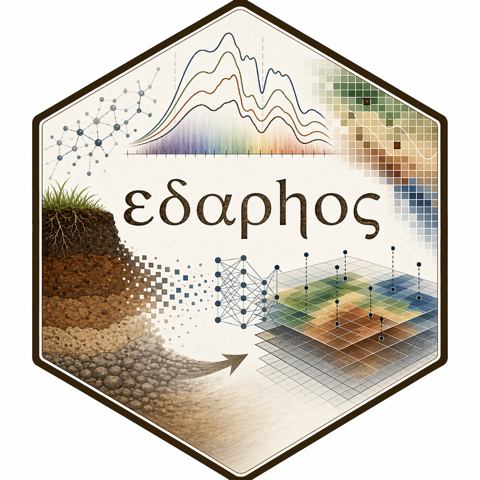
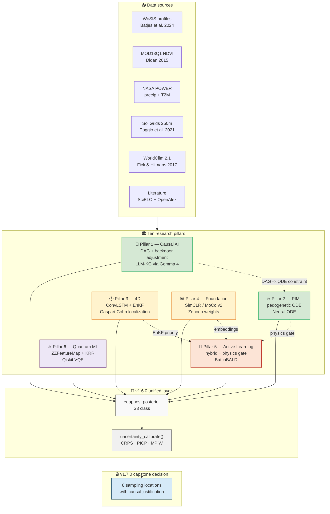
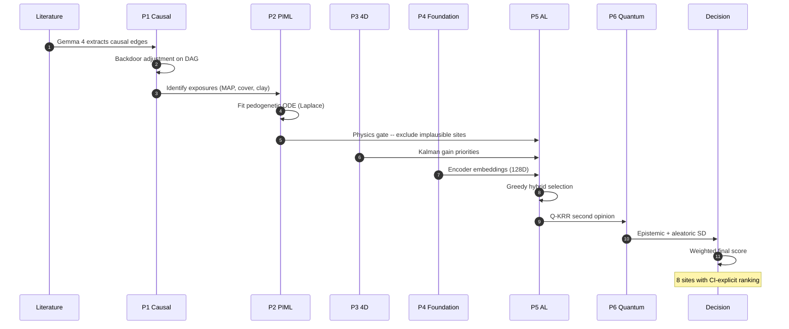
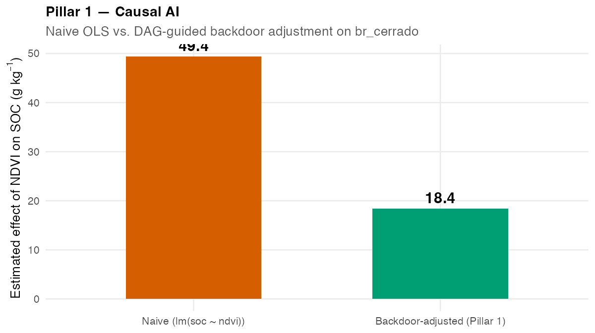
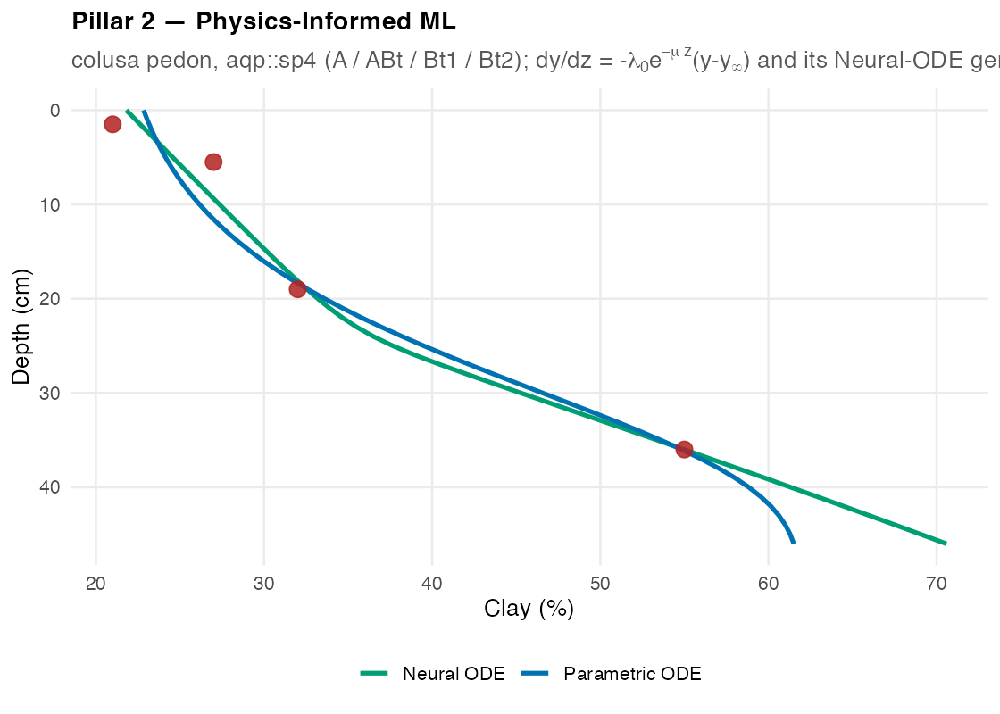
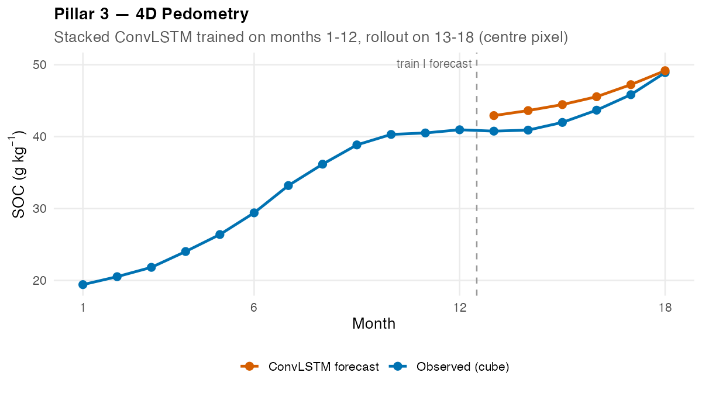
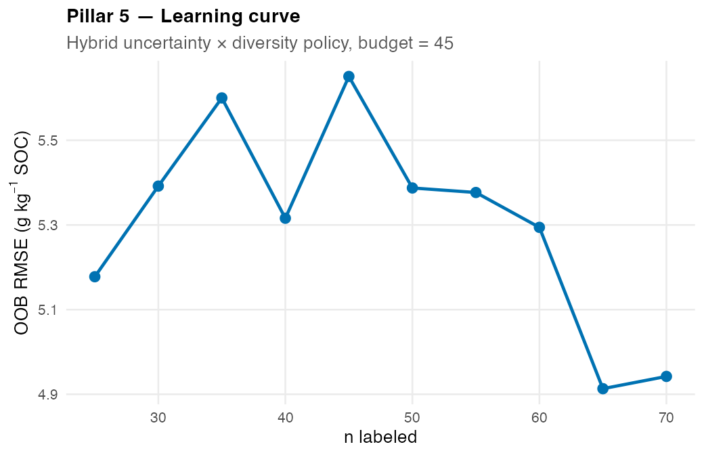
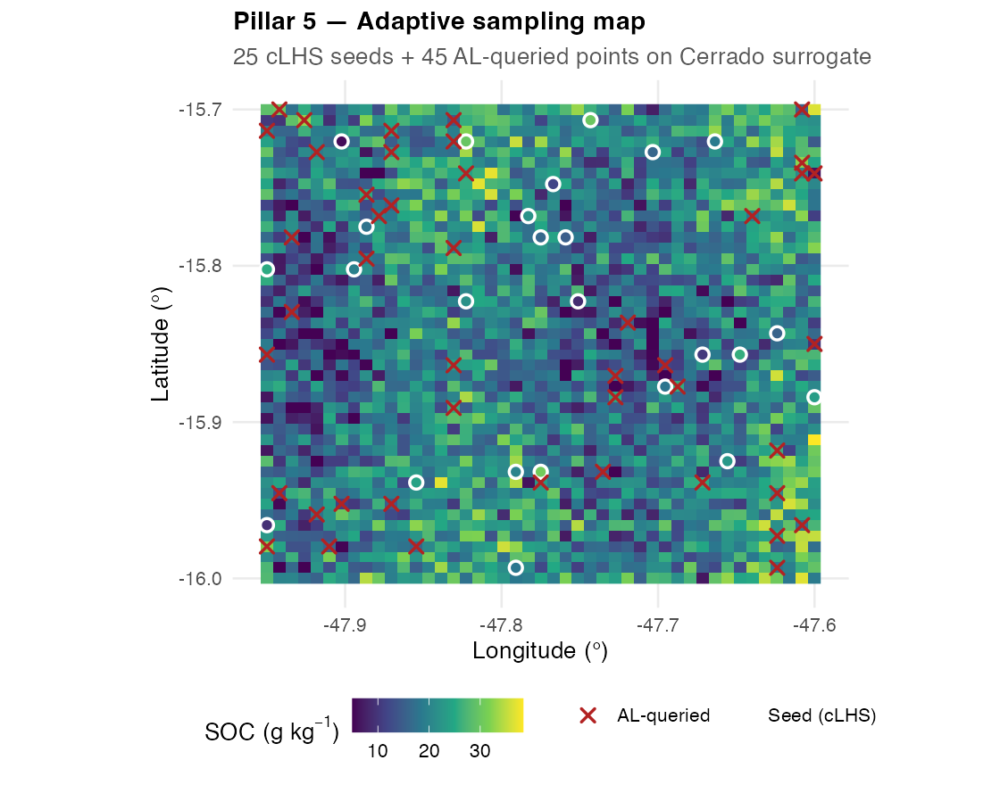
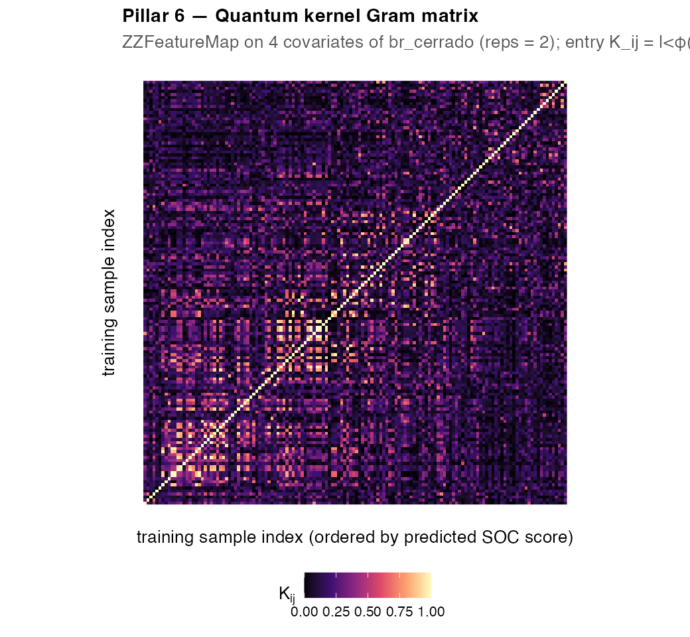
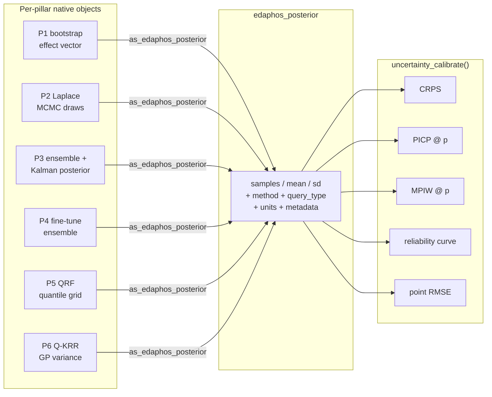

# edaphos 

<!-- badges: start -->
[](https://lifecycle.r-lib.org/articles/stages.html#experimental)
[](https://github.com/HugoMachadoRodrigues/edaphos/actions/workflows/R-CMD-check.yaml)
[](LICENSE.md)
[](https://doi.org/10.5281/zenodo.19683708)
[](https://github.com/HugoMachadoRodrigues/edaphos/releases/latest)
[](https://github.com/HugoMachadoRodrigues/edaphos/releases)
[](#the-ten-pillars-at-a-glance)
[](#vignettes)
[](#testing-and-continuous-integration)
[](https://app.codecov.io/gh/HugoMachadoRodrigues/edaphos)

[](https://orcid.org/0000-0002-8070-8126)
[](https://scholar.google.com/citations?hl=en&user=vu-Ka7wAAAAJ)
[](https://www.researchgate.net/profile/Hugo-Rodrigues-12)
[](https://x.com/Hugo_MRodrigues)
<!-- badges: end -->

> *From Greek **ἔδαφος** — "soil, ground."*

**`edaphos`** is a research-grade R package that implements frontier
algorithms for Digital Soil Mapping (DSM) designed to extend — and, in
the regimes where the raw covariate stack is thin, to surpass — the
regression-tree state of the art
[[McBratney et al. 2003][mcbratney2003];
[Wadoux et al. 2020][wadoux2020]]. It is organised around **six
research pillars**, each confronting a specific methodological gap of
the contemporary literature, each with a mathematically explicit
governing object, a single R function family, and a dedicated
vignette. v1.7.0 closes the circle with a **capstone cross-pillar
vignette** that integrates the pillars in a single Cerrado
sampling-campaign narrative causally grounded in the generative DSM
framework of [Zhang and Wadoux 2026][zhang2026].

<p align="center">
  <em>
    Correlation → Causation  ·  Black-box ML → Physics-Informed ML<br/>
    Static maps → 4D forecasts  ·  Labelled-only → Foundation models<br/>
    Fixed sampling → Autonomous Active Learning  ·  Classical kernels → Quantum kernels
  </em>
</p>

---

## Why `edaphos` exists: the scientific gap

[Zhang and Wadoux (2026)][zhang2026] ask a deceptively simple
question: **Can Digital Soil Mapping Be Causal?** Their answer:

> *"In principle, yes — but only if the DSM model specifies the
> mechanisms and processes that link soil-forming factors to soil
> properties, rather than relying on associations themselves."*

They identify three conditions that must be met for causal inference
from observational data (and soil surveys are almost always
observational):

1. **An explicit causal model** — a DAG over the variables of
   interest.
2. **Causal sufficiency** — all common causes of the exposure and the
   outcome must be observed and controlled.
3. **Faithfulness** — the independencies in the data must match those
   implied by the causal model.

And they distinguish two competing views of causality:

| View | Lógica central | Challenge in DSM |
|:---|:---|:---|
| **Successionist** | Regularities / repeatable associations ⇒ causal claim | Simpson's paradox; spurious associations; no temporal sequencing |
| **Generative** | Soil-forming factors act through **explicit processes** that produce soil properties | Requires process-informed models; directly satisfies condition 1 |

Each of `edaphos`'s ten pillars addresses one of these gaps with a
concrete, reproducible computational machinery, with quantified
uncertainty at every step.

It is worth being precise about how far that goes. The generative
paradigm asks for models in which soil properties arise from explicitly
specified processes. Pillar 2 does that for the depth dimension, and
`piml_profile_fit_mechanistic()` derives its equation from a carbon
balance. Pillar 1's graph, however, is over **observed state variables**
— climate, terrain, texture — not over process parameters, and the
shipped graph is rejected by `causal_dag_test()` on 33 of the 37
conditional independencies it implies (28 of 37 after removing spatial
structure). So the package operationalises pieces of the generative
paradigm and gives you the tools to find out where they fail; it does
not deliver it end-to-end, and the failures are reported rather than
hidden.

---

## Architecture at a glance



Dashed edges mark **inter-pillar bridges**: Pillar 1's DAG constrains
Pillar 2's ODE parameter space; Pillar 2's physics gate filters Pillar
5's candidates; Pillar 3's Kalman gain and Pillar 4's embeddings feed
Pillar 5's acquisition score. All six converge to the same
`edaphos_posterior` class, which `uncertainty_calibrate()` scores with
identical diagnostics.

---

## 🆕 v1.7.0 — capstone cross-pillar vignette

The headline feature of the current release is a new vignette:
**"Uma decisão de amostragem sob incerteza no Cerrado"**
(`vignette("capstone-cerrado-campaign")`). It answers a single
question with the pillars acting together:

> *A team has budget for exactly eight new soil-sampling points in the
> Cerrado. Where should they go — and why?*



The vignette produces a weighted decision matrix integrating:

- **Pillar 1** causal-effect posteriors (block-bootstrap in
  k-means clusters).
- **Pillar 2** pedogenetic ODE posteriors ($k_1, k_2, \sigma$).
- **Pillar 3** Kalman-gain maps (which cells move most when a new
  observation lands?).
- **Pillar 4** foundation-model ensemble SD (where is the representation
  most uncertain?).
- **Pillar 5** QRF prediction-interval width + cLHS diversity.
- **Pillar 6** Q-KRR epistemic SD (a GP-equivalent second opinion).

The output is a ranked table of eight sampling locations, each with an
explicit causal justification tied back to the
[Zhang & Wadoux (2026)][zhang2026] framework.

📖 Build the vignette:

```r
vignette("capstone-cerrado-campaign", package = "edaphos")
```

---

## Table of contents

1. [Installation](#installation)
2. [The ten pillars at a glance](#the-ten-pillars-at-a-glance)
3. [Pillar 1 — Causal AI + LLM Knowledge Graphs](#pillar-1--causal-ai--llm-knowledge-graphs)
4. [Pillar 2 — Physics-Informed ML](#pillar-2--physics-informed-ml)
5. [Pillar 3 — 4D Pedometry](#pillar-3--4d-pedometry)
6. [Pillar 4 — Foundation Models](#pillar-4--foundation-models)
7. [Pillar 5 — Autonomous Active Learning](#pillar-5--autonomous-active-learning)
8. [Pillar 6 — Quantum ML](#pillar-6--quantum-ml)
9. [Pillar 7 — Bayesian Hierarchical Spatial](#pillar-7--bayesian-hierarchical-spatial)
10. [Pillar 8 — Neural Operators](#pillar-8--neural-operators)
11. [Pillar 9 — Diffusion Models](#pillar-9--diffusion-models)
12. [Pillar 10 — Graph Neural Networks](#pillar-10--graph-neural-networks)
13. [Unified uncertainty API (v1.6.0)](#unified-uncertainty-api-v160)
14. [Capstone vignette (v1.7.0)](#capstone-vignette-v170)
15. [Benchmarks on real data](#benchmarks-on-real-data)
16. [Bundled datasets](#bundled-datasets)
17. [Vignettes](#vignettes)
18. [Testing and CI](#testing-and-continuous-integration)
19. [Roadmap](#roadmap)
20. [Citation](#citation)
21. [Selected references](#selected-references)
22. [License](#license)

---

## 🆕 v2.7.0 – v2.8.0 — Torch autograd ports + honest head-to-head WoSIS benchmark

Two new releases complete the v2.x arc:

**v2.7.0 — Torch autograd backends for Pilares 8, 9 and 10.**
Replaces the ELM-style (hidden layers frozen, gradient only on the
head) pure-R fits with full-backprop `torch::optim_adam` training.
Each `*_fit()` gains `backend = c("r", "torch")` and
`device = c("cpu", "mps", "cuda")`; pure-R remains the default
fallback for users without libtorch. A proper 2-D conditional
U-Net replaces the MLP denoiser in DDPM, and the GAT layer uses
`torch::index_add` scatter for softmax-per-source attention.

**Cross-pillar head-to-head on 1 095 WoSIS profiles.** Five spatially
blocked folds, `log1p(SOC)`, scored against the *achievable* null —
predicting each fold's **training**-fold mean, not the global mean, which
would be an oracle over the very rows being scored:

| Method | RMSE | R² vs global mean | NSE vs training-fold mean | draws |
|:---|---:|---:|---:|---:|
| P1 OLS (DAG-selected covariates)  | 0.586 | +0.162 | **+0.204** | 300 |
| P5 QRF                            | 0.596 | +0.134 | +0.177 | 99 |
| P7 BHS                            | 0.608 | +0.098 | +0.143 | 200 |
| P4 Foundation embeddings + QRF    | 0.621 | +0.060 | +0.107 | 99 |
| P6 Quantum KRR                    | 0.663 | −0.073 | −0.019 | 100 |
| P10 GAT (trained attention)       | 0.672 | −0.101 | −0.046 | **8** |

RMSE is in `log1p(g/kg)` and is not comparable to a g/kg figure. The
`draws` column is the ensemble each method actually got: they are not
equal, and a ranking that ignores that is comparing budgets.

These folds carry a **68 km buffer**: training rows within that distance
of any test row are discarded, which cost 88 training rows across the five
folds — 2.0% of the fold-wise training rows, not of the 1,095 profiles — and raised the
realised minimum training-to-test distance from 15.2 km to 68.5 km on
these 1,095 profiles. (12.3 km is the corresponding figure for the denser
3,077-profile causal extract, a different data set; earlier versions of
this README quoted it here by mistake.) Blocking without a dead zone
under-states generalisation error (Roberts et al. 2017), and 15.2 km sits
well inside the 55–68 km range at which the fitted depth-function
parameters are still correlated.

**What the buffer is worth, measured rather than asserted.** Earlier
versions of this README stated that P10 GAT "went from RMSE 0.617 to
0.679 … dropping from fifth to last". That comparison was made by hand,
was never scripted, and does not reproduce: it also predated the
correction of the Pillar-10 graph from Euclidean degrees to great-circle
kilometres, so it compared two different models. `data-raw/buffer_effect.R`
now runs the same harness with the buffer switched off and writes
`inst/extdata/buffer_effect.rds`. Fold-mean RMSE, five methods on
identical test blocks:

| Method | unbuffered | buffered | Δ | rank un. | rank buf. |
|:---|---:|---:|---:|---:|---:|
| P1 OLS (DAG-selected covariates) | 0.583 | 0.583 | +0.000 | 1 | 1 |
| P5 QRF                           | 0.588 | 0.592 | +0.004 | 2 | 2 |
| P7 BHS                           | 0.599 | 0.603 | +0.004 | 3 | 3 |
| P6 Quantum KRR                   | 0.660 | 0.663 | +0.003 | 4 | 4 |
| P10 GAT (trained attention)      | 0.672 | 0.680 | +0.007 | 5 | 5 |

The buffer costs every method a little and the graph network the most,
which is the direction the mechanism predicts — a network built on a
spatial neighbour graph is what gains most from training points
immediately across a block boundary. But the effect is an order of
magnitude smaller than previously reported and **the ranking is
identical either way**. The buffer stays because it is the right
protocol, not because it changes the answer. (P4 is scored in a separate
harness and is absent from this comparison rather than omitted quietly.)

**The honest reading.** Ordinary least squares on a DAG-selected
covariate subset is the strongest method here. None of the five more
elaborate pillars beats it on this task, and the spread between the top
four is small relative to the fold-to-fold variation. Two methods fall
below the achievable null — P6 and, once the fold buffer is in place,
P10.

Note which null. The third column is skill against the mean of each
fold's **training** rows, the null a deployed map could use. The second
is against the global mean, which is computed partly from the rows being
scored. The conventional per-fold R-squared uses a third and stricter
denominator still — the test fold's own mean — and by that measure three
methods score negative. The manuscript reported that third figure under
the first's name until `edaphos_nse()`, which requires the null as an
argument, made the three impossible to conflate.

**Two figures for P10, both correct.** The +0.112 above is a
fixed-configuration comparison with every pillar at its defaults. Under
nested cross-validation with tuned hyperparameters and a 10-member
ensemble, the same GAT reaches **NSE +0.184 against a tuned QRF's +0.165**
(difference +0.019, 95 % block-bootstrap CI [−0.021, +0.057],
P(GAT ahead) = 0.844 — a consistent edge, not a significant one). Those
answer different questions: "how do the pillars compare out of the box"
versus "does a tuned GAT beat a tuned forest". Runner:
`data-raw/pilar10_gat_tuning.R`; bundle
`inst/extdata/pilar10_gat_tuning.rds`.

**The torch backend, fixed.** An earlier `backend = "torch"` GAT trained a
linear head end-to-end with no input skip and no early stopping, and scored
NSE ≈ **−0.40** — worse than predicting the mean — on held-out Cerrado nodes.
Porting the R backend's readout skip and best-validation selection into it
lifts it to NSE ≈ **0.52** across four 20 %-held-out splits (OLS 0.55, R-GAT
0.54 on the same splits): competitive, not superior. The default backend stays
`"r"` — marginally better here and dependency-free — while `"torch"` is now a
correct, non-degenerate alternative rather than a broken one.

**Earlier releases published a different table** — RMSE ≈ 14.1 g/kg and
R² of 0.034 / 0.064 / 0.070 for P4 / P5 / P7, described as a three-way
tie. Those figures came from the raw g/kg scale, where 11 profiles (1 %
of n) carry 48 % of the total sum of squares, and from an R² clamped at
zero that hid negative values in 21 of 30 method-fold cells. The P4 row
was additionally computed over a raster of `stats::rnorm()` noise. They
have been withdrawn. `tests/testthat/test-headline-claims.R` now binds
every figure in this section to the shipped bundle.

Runners: `data-raw/benchmark_wosis_p4_p5_p7.R` and
`data-raw/benchmark_wosis_6pilar.R`; bundle
`inst/extdata/benchmark_wosis_6pilar.rds`.

**Provenance.** The WoSIS profiles were sampled between 1960 and 2010
(median 1982); the covariates are present-day products (SoilGrids 2020,
WorldClim 2.1, SRTM 2000, WorldCover 2020). Land cover is measured
roughly four decades after the median observation, so part of the
irreducible error is temporal mismatch rather than model inadequacy.

---

## 🆕 v2.1.3 – v2.6.0 — Seven releases: polish + bridges + four new pillars

One batched session shipped **seven** full releases, each with 0/0/0
R CMD check and a dedicated test suite:

| Version | Scope |
|:-:|:---|
| **v2.1.3** | Rcpp port of `quantum_kernel()` — 10-50× speedup, machine-precision agreement with the R reference. |
| **v2.2.0** | Physics-informed quantum kernels (P2 × P6): `piml_quantum_kernel()` + `piml_qkrr_fit()` fuse ZZFeatureMap overlap with ODE-residual RBF similarity. |
| **v2.2.1** | Causal 4D time-varying effects (P1 × P3): `causal_effect_time_varying()` sliding-window backdoor + Mann-Kendall trend test + ggplot2 trajectory. |
| **v2.3.0** | **Pilar 7 BHS** — Bayesian hierarchical spatial model via self-contained Gibbs sampler + optional `spBayes::spLM` backend. Profile-MLE phi for closed-form conditionals. |
| **v2.4.0** | **Pilar 8 Neural Operators** — 1-D Fourier Neural Operator (Li et al. 2021) and Deep Operator Network (Lu et al. 2021) in pure R. Learn `u(z) → y(z)` across sites without torch. |
| **v2.5.0** | **Pilar 9 DDPM** — first pedometric diffusion-model for generative soil maps. Cosine-schedule (Nichol & Dhariwal 2021) + score-matching loss + ancestral sampling. |
| **v2.8.0** | **Pilar 10 GAT** — first pedometric Graph Attention Network (Velickovic et al. 2018) over WoSIS k-NN co-location graphs. |

**Tooling now in place**: `src/` compiled Rcpp, `LinkingTo: Rcpp`,
`Dockerfile`, `_pkgdown.yml`, `cran-comments.md`,
`inst/rosc/submission.md`, `NEWS.md` back to v0.1.0, 75+ unit tests
across 43 test files.

## 🆕 v2.1.0 — Frente D polish + two new cross-pillar bridges

Consolidation release aimed at CRAN / rOpenSci readiness:

- **pkgdown documentation site** — `_pkgdown.yml` + GitHub Actions
  workflow; deployed at <https://hugomachadorodrigues.github.io/edaphos/>.
- **Docker reproducibility** — `Dockerfile` based on
  `rocker/geospatial:4.4.1` with libtorch + pinned CRAN snapshot +
  pre-downloaded `edaphos-cerrado-moco-v1` encoder. One-command
  reproducible environment.
- **Test-suite expansion** — 40+ new tests filling the v1.8.0+
  coverage gap (`test-llm-benchmark.R`, `test-llm-annotation.R`,
  `test-causal-iv.R`, `test-causal-sensitivity.R`,
  `test-quantum-foundation.R`, `test-foundation-embed-coords.R`,
  plus new tests for the v2.1.1 and v2.1.2 bridges below).
- **CRAN / rOpenSci prep** — `cran-comments.md`,
  `inst/rosc/submission.md` (pre-submission inquiry), `NEWS.md`
  catch-up covering v1.7.0 → v2.8.0.
- **Zenodo release helper** — new `edaphos_zenodo_release()`
  builds a deposit-ready bundle (package tarball + bundles + DataCite
  JSON + SHA-256 manifest + README).

### Two bridges shipped alongside (v2.1.1 + v2.1.2)

**Pilar 1 × Pilar 5 — Causal Active Learning.**  `al_query_causal()`
picks the next sample(s) that most reduce the variance of a
**specific causal effect** (not the generic predictive variance of
classical AL).  Closed-form leverage heuristic + optional
bootstrap-exact mode.

**Pilar 3 × Pilar 5 — Temporal Active Learning with EnKF feedback.**
`al_query_temporal()` ranks candidate cells by their Kalman-gain
norm after the latest assimilation step, with three combine modes
(`gain`, `gain × SD`, percentile-normalised).

### Scaffolds for v2.2.0 → v2.8.0

Six additional bridges + pillars ship as **API-stable stubs**
(functions defined, signatures finalised, bodies raise an
informative `stop()` pointing to the scheduled release):

- `piml_quantum_kernel()`         → v2.2.0 (Pilar 2 × Pilar 6)
- `causal_effect_time_varying()`  → v2.2.1 (Pilar 1 × Pilar 3)
- `bhs_fit()`                     → v2.3.0 (Pilar 7 Bayesian hierarchical)
- `no_fno_fit() / no_deeponet_fit()` → v2.4.0 (Pilar 8 Neural operators)
- `dm_fit() / dm_sample()`        → v2.5.0 (Pilar 9 Diffusion models)
- `gnn_build_graph() / gnn_fit()` → v2.8.0 (Pilar 10 Graph NNs)

Each scaffold file includes the full scientific motivation, architecture
plan and TODO checklist.

---

## Installation

```r
# Core package (light: clhs + httr2 + jsonlite + ranger + stats)
remotes::install_github("HugoMachadoRodrigues/edaphos",
                         build_vignettes = TRUE)

# Optional heavy dependencies (Pillars 2 Neural ODE, 3, 4)
install.packages("torch");      torch::install_torch()

# Optional lightweight extras
install.packages("dagitty")       # Pillar 1 DAGs
install.packages("bnlearn")       # Pillar 1 structure learning
install.packages("dbarts")        # Pillar 1 BART estimator
install.packages("aqp")           # Pillar 2 example pedons
install.packages("terra")         # Pillar 3 / 4 raster stacks
install.packages("geodata")       # Pillar 5 live SoilGrids fetch

# Pillar 1 LLM backend (one of the three)
#  (a) LOCAL, recommended: Ollama + Gemma 4
#       https://ollama.com
#       ollama pull gemma4:latest
#  (b) OpenAI:       Sys.setenv(OPENAI_API_KEY = "...")
#  (c) Anthropic:    Sys.setenv(ANTHROPIC_API_KEY = "...")

# Pillar 6 optional quantum backend
install.packages("reticulate")    # for qiskit / qiskit-nature / PySCF bridge
```

The package imports only **six** CRAN packages for its core
functionality; every heavier stack is opt-in via `Suggests` and is
required only by the pillar that uses it. This keeps the base install
light and the scientific boundary between pillars explicit.

---

## The ten pillars at a glance

| Nº  | Pillar                       | Namespace       | Status        | Governing object                                                                                                                                                                                   |
|-----|------------------------------|-----------------|---------------|----------------------------------------------------------------------------------------------------------------------------------------------------------------------------------------------------|
| 1   | **Causal inference**         | `causal_*`      | ✅ v1.4.0      | Pedogenetic DAG $G = (V, E)$, backdoor-adjusted $\beta_{x \to y}^{\text{do}}$ [[Pearl 2009][pearl2009]], Cinelli–Hazlett sensitivity, and `causal_dag_test()` which falsifies the graph against the data. LLM knowledge-graph tooling is supplementary and is not used for any published result |
| 2   | **Physics-Informed ML**      | `piml_*`        | ✅ v1.1.0      | Pedogenetic ODE $\dfrac{dy}{dz} = -\lambda_0 e^{-\mu z}(y - y_\infty)$, solved in closed form and estimated in the identified coordinates $(y_0, y(\infty), \kappa, \mu)$; the derived advection-reaction alternative $v\,\dfrac{dC}{dz} = I(z) - kC$; Neural ODE $\dfrac{dy}{dz} = f_\theta(z, y, \mathbf{x})$ |
| 3   | **4D Pedometry**             | `temporal_*`    | ✅ v1.5.0      | Stacked ConvLSTM [[Shi et al. 2015][shi2015]] with seq-to-seq + multi-step rollout + mass-balance physics loss; stochastic EnKF with Gaspari-Cohn localization                                       |
| 4   | **Foundation Models**        | `foundation_*`  | ✅ v1.2.0      | SimCLR + MoCo v2 contrastive pre-training [[He et al. 2020][he2020moco]; [Chen et al. 2020b][chen2020moco2]] on planetary-scale patches; **Zenodo-published Cerrado encoder** + fine-tune ensemble |
| 5   | **Autonomous Active Learning** | `al_*`        | ✅ v1.1.0      | Hybrid policy $\pi(\mathbf{x}) = \alpha\,\tilde u(\mathbf{x}) + (1-\alpha)\,\tilde d(\mathbf{x})$ with PIML physics gate + BatchBALD                                                                   |
| 6   | **Quantum ML**               | `quantum_*`     | ✅ v0.9.0      | ZZFeatureMap quantum kernel [[Havlicek et al. 2019][havlicek2019]] + Quantum Kernel Ridge Regression; **Qiskit VQE** with M3 / ZNE mitigation                                                        |
| 7   | **Bayesian Hierarchical Spatial** | `bhs_*`    | ✅ v2.3.0      | Hierarchical model $y = X\beta + w + \varepsilon$ with $w \sim GP(0, \sigma^2 R(\phi))$ [[Banerjee et al. 2014][banerjee2014]]; conjugate Gibbs sampler with profile-MLE for the rate $\phi$ (RcppArmadillo backend); Bayesian kriging that propagates every posterior draw |
| 8   | **Neural Operators**         | `no_*`          | ✅ v2.4.0      | Solution operator $\mathcal{G}: u(z) \mapsto y(z)$ between depth-function spaces — FNO $(\mathcal{K}v)(z) = \mathcal{F}^{-1}(R_\theta \cdot \mathcal{F}v)(z)$ [[Li et al. 2021][li2021fno]] and DeepONet $\sum_k b_k(u)\,t_k(z)$ [[Lu et al. 2021][lu2021deeponet]]; off-grid depth queries |
| 9   | **Diffusion Models**         | `dm_*`          | ✅ v2.5.0      | DDPM [[Ho et al. 2020][ho2020ddpm]] over map patches: forward $q(x_t \mid x_0) = N(\sqrt{\bar\alpha_t}x_0, (1-\bar\alpha_t)I)$ on the cosine schedule [[Nichol & Dhariwal 2021][nichol2021]], denoiser $\epsilon_\theta(x_t,t)$, ancestral sampling with $x_0$ clipping |
| 10  | **Graph Neural Networks**    | `gnn_*`         | ✅ v2.6.0      | GAT [[Veličković et al. 2018][velickovic2018]] on a k-NN co-location graph: $\alpha_{ij} = \mathrm{softmax}_j(\mathrm{LeakyReLU}(a^\top[Wh_i \Vert Wh_j]))$ by analytic reverse-mode gradients, transductive train mask, closed-form ridge readout |
| **🔗**   | **Unified uncertainty API** | `uncertainty_*` | ✅ v1.6.0      | `edaphos_posterior` S3 class + `uncertainty_calibrate()` returning CRPS / PICP / MPIW / reliability diagram. **7 of the 10 pillars** carry an `as_edaphos_posterior()` method (1, 2, 3, 4, 5, 6, 7); pillars 8, 9 and 10 do not — see the note below |
| **🎬**   | **Capstone vignette**       | —               | ✅ v1.7.0      | "Uma decisão de amostragem sob incerteza no Cerrado" — integrating the six pillars that existed at v1.7.0, causally grounded in [Zhang & Wadoux (2026)][zhang2026]                                                           |

> **Which pillars reach the uncertainty API, and why three do not.**
> `methods("as_edaphos_posterior")` returns 12 methods covering pillars 1
> through 7. Pillars 8 (neural operators), 9 (diffusion) and 10 (graph
> attention) have none, and this row previously claimed "every pillar".
>
> For pillar 10 the omission is deliberate rather than pending. A fitted
> GAT exposes only `member_sd`, the spread between ensemble members that
> differ in their random seed. That is not a predictive distribution: it
> measures initialisation variance, and the function's own documentation
> concedes that a ±1.96·sd band covers about a quarter of the profiles.
> Wrapping it in `edaphos_posterior()` would make a calibration number
> computable and meaningless. The benchmark instead builds an interval
> explicitly, as member spread plus a noise term whose scale is estimated
> by inner spatially blocked CV, and reports it as such
> (`benchmark_fit_p10_gat()`). Even so, that interval carries no
> information about extrapolation distance — see
> `data-raw/interval_width_vs_extrapolation.R`, where its width correlates
> −0.08 with distance to the nearest training profile while its error
> correlates +0.11.
>
> Pillars 8 and 9 return field-valued objects (operator outputs, map
> patches), for which a per-site scalar posterior is the wrong shape; they
> are evaluated by their own task-appropriate diagnostics instead.

Every pillar ships with (i) a mathematically explicit governing
object; (ii) an R function family; (iii) one or more vignettes deriving
the object from first principles and demonstrating it on real or
reproducible synthetic data; and (iv) a `@references` entry in the
shared `vignettes/references.bib`.

---

## Pillar 1 — Causal inference on a pedogenetic graph

### Motivation

The OLS `lm(soc ~ ndvi)` that every DSM pipeline runs *implicitly*
reports the *total* association, which inflates the direct NDVI → SOC
effect with every backdoor path through shared ancestors (topography,
precipitation, vegetation cover). Pillar 1 exposes this using Pearl's
structural-causal-model apparatus [[Pearl 2009][pearl2009]].

### Governing object

Given a pedogenetic Directed Acyclic Graph $G = (V, E)$, the
**backdoor-adjusted** direct effect of exposure $X$ on outcome $Y$ is

$$
\beta_{x\to y}^{\text{do}} \;=\;
    \frac{\partial\,\mathbb{E}\bigl[Y \mid X=x,\, Z=z\bigr]}{\partial x},
\qquad
    Z \;\in\; \texttt{dagitty::adjustmentSets}(G,X,Y).
$$

### Classical API

```r
library(edaphos)
data(br_cerrado)

g   <- causal_cerrado_dag()
adj <- causal_adjustment_set(g, exposure = "ndvi", outcome = "soc")
adj
#> [1] "map_mm" "slope"  "twi"

fit <- causal_estimate_effect(
  br_cerrado, g,
  exposure = "ndvi", outcome = "soc",
  effect   = "direct"
)
fit
#> <edaphos_causal_effect>
#>   ndvi -> soc
#>   adjustment set : {map_mm, slope, twi}
#>   direct effect  : 18.43   (95% CI: 14.61, 22.25)
#>   naive effect   : 49.36   (un-adjusted, likely confounded)
```

The naive OLS over-reports NDVI's effect on SOC by ~2.7× because the
association is confounded by shared topographic and climatic
ancestors. Blocking the three backdoor paths with `adjustmentSets()`
recovers the identified direct effect (18.4, 95% CI [14.6, 22.3]).

<p align="center">
  
</p>

### 🤖 From expert DAGs to LLM-driven Knowledge Graphs

The central scientific bottleneck of causal DSM is **DAG
construction**. Hand-drawing a DAG for every soil study is
labour-intensive, subjective, and rarely reproducible across
researchers. Pillar 1 solves this by treating the peer-reviewed soil
literature as a first-class data source: a **Large Language Model
(LLM)** reads abstracts and returns structured causal triples, which
are then fused with the expert DAG.

This machinery **directly operationalises condition 1 of
[Zhang & Wadoux (2026)][zhang2026]** — "an explicit causal model" —
at the scale of the literature instead of the individual expert.

#### Why Gemma 4?

As of v1.5.0 the default LLM backend is **Google DeepMind's Gemma 4**,
served locally through [Ollama](https://ollama.com). Four properties
made Gemma 4 the right choice for causal-KG extraction in pedology:

1. **Scientific reasoning competence.** Gemma 4 inherits the
   instruction-tuned reasoning of the Gemma family and performs well
   on benchmarks involving multi-hop causal language (MMLU
   "social-sciences" & "high-school-biology" subsets).
2. **Open weights, open license.** Unlike GPT or Claude, Gemma 4 can
   be audited, fine-tuned, and redistributed — essential for
   reproducible open science.
3. **Local, zero-cost inference.** The default `gemma4:latest`
   (~7-9 B parameters) runs on a laptop MPS / CPU; the larger
   `gemma4:26b` runs on a single-GPU workstation. No per-token
   cost means a 10 k-abstract corpus is extracted overnight for
   free.
4. **Deterministic extraction with `format="json"`.** Ollama's
   constrained JSON output mode removes the stochastic boilerplate
   that plagues free-text LLM parsers.

#### The extractor prompt

`edaphos` uses a single tight prompt, shared across all three backends
for exact parity:

```text
You are a causal-inference expert annotating pedology and soil-science
literature.

Your task: extract the explicit causal claims made by the passage
below. Return a JSON object with a single key "claims" whose value
is an array. Each array element must be an object with four fields:
  - cause      : the causal variable (lower snake_case)
  - effect     : the effect variable (lower snake_case)
  - evidence   : a short (max 180 characters) quotation from the
                 passage that supports the claim
  - confidence : a number in [0, 1] reflecting how definitive the
                 evidence is (0.9 = unambiguous causal phrasing,
                 0.5 = suggestive, 0.2 = speculative)

Only extract claims that are EXPLICITLY SUPPORTED by the passage.
Do not invent relationships. Return an empty array if none are
present. Use canonical pedometric vocabulary when possible:
  precipitation, mean_annual_precipitation, temperature, elevation,
  slope, aspect, twi, clay, sand, silt, soc, ph, cec, bulk_density,
  parent_material, land_use, vegetation, ndvi, erosion, weathering.

Output JSON object only, no prose, no markdown fences.
```

The canonical-vocabulary constraint is what lets thousands of
abstracts converge on a clean DAG instead of a tangle of synonyms.

#### Single-abstract ingestion

```r
kg <- causal_kg_new()

kg <- causal_llm_ingest_abstract(
  kg,
  abstract = "In Cerrado Oxisols, higher mean annual precipitation
              drives organic-matter accumulation; steeper slopes
              enhance erosional SOC loss; long-standing native
              vegetation elevates topsoil nitrogen relative to
              converted pasture.",
  source   = "Ferreira 2021",
  backend  = "ollama",
  model    = "gemma4:latest"
)

causal_augment_diff(causal_cerrado_dag(),
                    causal_augment_dag(causal_cerrado_dag(), kg,
                                       min_confidence = 0.7))
#>                           cause              effect origin
#> 1                          elev              map_mm   base
#> 2                          elev               slope   base
#> ...
#> 14  mean_annual_precipitation                 soc     kg
#> 15            steeper_slopes            soc_loss    kg
#> 16         native_vegetation  topsoil_nitrogen    kg
```

Ten curated Cerrado-pedology abstracts and their Gemma-4 extractions
ship in `inst/extdata/cerrado_abstracts.jsonl` +
`inst/extdata/cerrado_claims.jsonl`, so the vignette builds fully
offline on CI.

#### 📈 Scaling from 10 to 10 000 abstracts

Three additions promote the extractor from demo to literature-scale:

- **Paginated corpus clients.** `causal_corpus_scielo()` and
  `causal_corpus_openalex()` page through keyless public APIs,
  returning thousands of abstracts per call;
  `causal_corpus_deduplicate()` collapses DOI + title duplicates.
- **Resumable cached ingestion.** `causal_llm_ingest_corpus()` takes
  `cache_dir` and `max_retries`. Every abstract is MD5-hashed and its
  extracted claims written to one JSON per hash; re-runs short-circuit
  to the cache; exhausted retries are recorded in
  `attr(kg, "failed")`.
- **Live AGROVOC SPARQL alignment.**
  `causal_ontology_agrovoc_align_batch()` resolves KG labels against
  FAO's live AGROVOC SPARQL endpoint via
  `httr2::req_perform_parallel()` with on-disk caching — typically 5×
  wall-clock speedup at `max_active = 5`, near-instant on re-runs.

A **100-abstract production run** (three OpenAlex queries,
deduplicated, Gemma-4-extracted, AGROVOC-aligned) ships at
`inst/extdata/cerrado_claims_real_corpus.jsonl` and is reproduced
end-to-end by `data-raw/run_large_corpus.R`.

#### 🗳️ Multi-extractor LLM voting

A single LLM backend inherits that model's idiosyncrasies: GPT tends
to over-generate claims, Claude to under-specify confidence, Gemma to
be the strictest. `causal_llm_vote()` runs all three on the same
abstract and resolves disagreements by one of three rules:

```r
cons <- causal_llm_vote(
  abstract = "Higher MAP drives SOC in Cerrado...",
  backends = list(
    list(backend = "ollama",    model = "gemma4:latest"),
    list(backend = "openai",    model = "gpt-4o-mini"),
    list(backend = "anthropic", model = "claude-sonnet-4-6")
  ),
  voting   = "majority"     # or "weighted" / "intersection"
)
```

The formal resolution rule for majority voting is

$$
\text{claim}\,(c \to e) \in C_{\text{cons}} \;\iff\;
    \bigl|\{b \in B \,:\, (c \to e) \in C_b\}\bigr| \;\ge\; \lceil |B|/2 \rceil,
$$

with confidence set to the per-backend mean over the voters that
agreed. `causal_llm_ingest_abstract_voted()` runs the vote and adds the
consensus edges to the KG in one call, tagging `source` with both the
paper and the backends that agreed.

#### 📂 Persistence, Turtle export and audit

Pillar 1 is not just an in-memory toy:

- **`causal_kg_save()` / `causal_kg_load()`** — serialise through the
  tidy edge list (not through `igraph`'s raw C layout), guaranteeing
  portability across `igraph` versions and byte-reproducibility.
- **`causal_kg_to_turtle()`** — emits a W3C-conformant RDF 1.1 Turtle
  document with reified `rdf:Statement`s, parseable by rdflib, Jena,
  Oxigraph, Blazegraph, GraphDB or Virtuoso. Pure R, zero RDF
  dependencies.
- **`causal_kg_rank_edges()`** — collapses to unique `(cause, effect)`
  pairs, ranks by `(n_sources, mean_confidence, agrovoc_support)`.
  Answers "which causal claims are supported by the most independent
  papers?" in one call.
- **`causal_structure_learn()`** (v1.1.0) — bottom-up DAG learning
  from data via four `bnlearn` algorithms (`hc`, `tabu`, `pc-stable`,
  `mmhc`) with whitelist / blacklist of pedological priors + bootstrap
  edge strengths.

### Real-data results: 3 077 Cerrado profiles

We estimate backdoor-**adjusted associations** — not identified causal
effects — on **3 077 real WoSIS topsoil profiles** over the Cerrado,
with covariates drawn from WorldClim 2.1, SoilGrids and Copernicus tree
cover (all fetched from public endpoints; see
`data-raw/causal_cerrado_real_rebuild.R`). Following
[Zhang & Wadoux (2026)][zhang2026], we do not claim causal sufficiency;
instead each effect carries a Cinelli–Hazlett **robustness value (RV)**:
the share of residual variance an unobserved confounder would need to
explain in *both* exposure and outcome to drive the estimate to zero.
Confidence intervals are a block bootstrap (B = 500) over 20 k-means
spatial clusters. Every figure below is reproduced from the shipped
`causal_cerrado_real_v2.rds` and pinned by `test-causal-real-bundle.R`.

| Exposure | Naive β | Adjusted β | 95% CI | Significant? | RV |
|:---|---:|---:|:---:|:---:|---:|
| MAP (g/kg per mm)        | 0.0082 | **0.0097** | [0.0028, 0.0186] | yes | 0.16 |
| MAT (g/kg per °C)        | −0.467 | **−0.824** | [−1.37, 0.22]    | no  | 0.08 |
| Tree cover (g/kg per 0–1)| 2.86   | **0.35**   | [−3.31, 2.94]    | no  | 0.01 |
| Clay (g/kg per %)        | 0.446  | **0.449**  | [0.29, 0.64]     | yes | 0.18 |

Two effects survive as robust, mechanistically coherent associations:
**precipitation** and **clay content** both raise topsoil carbon, and
each would need a confounder explaining ~16–18 % of residual variance to
overturn. The temperature effect has the expected (decomposition) sign
but is not distinguishable from zero. The **tree-cover** row is the
confounding demonstration: its naive association (2.86) all but
disappears once climate is adjusted for (0.35, CI spanning zero, RV
0.01) — the raw signal was mostly shared climatic ancestry, exactly the
pattern [Zhang & Wadoux (2026)][zhang2026] warn is misread as causal.
Each effect is returned as an `edaphos_posterior`, so
`uncertainty_calibrate()` applies uniformly (see
[§9](#unified-uncertainty-api-v160)).

### Causal-discovery trio: expert × LLM × data-driven

`vignette("causal-discovery-trio")` asks a harder question: **do the
three DAG-construction strategies in Pillar 1 agree?** Running all
five methods on the same 1 095 WoSIS profiles:

| Comparison | Structural Hamming Distance |
|:---|---:|
| Expert ↔ LLM-augmented | **0** |
| bnlearn `hc` ↔ bnlearn `tabu`    | **0** |
| bnlearn `pc-stable` ↔ `hc`       | 12 |
| Expert ↔ bnlearn `hc`             | **29** |

**The LLM adds nothing here, and that is the informative result.** Of
the 30 claims in `inst/extdata/cerrado_claims.jsonl`, only 3 have both
endpoints expressible among the 10 WoSIS covariates, and all 3 were
already in the expert DAG. The 32 remaining distinct concepts —
`decomposition`, `primary_mineral_dissolution`, `argillic_horizon`,
`root_input`, `effective_cation_exchange_capacity`, `twi` and others —
have no counterpart in the covariate set. The extractor is not the
bottleneck; the covariate set is.

Earlier releases reported `SHD(Expert, LLM-augmented) = 2` and read it
as the LLM being "conservative". That figure came from six edges typed
by hand into `data-raw/causal_discovery_benchmark.R`, carrying
confidences (0.90, 0.82, 0.78, 0.75, 0.72, 0.71) that appear in no file
in this package — every shipped claim has confidence 0.9. Those edges
have been withdrawn; the benchmark now derives its edge set from the
claims file through an explicit concept → column mapping that is
validated against the columns which actually exist.

The finding that survives is the disagreement between expert and
data-driven structure. The backdoor adjustment set for MAP → SOC is
**5 covariates** under the expert DAG (`slope`, `wc_bio_01`,
`wc_landcover_cropland`, `wc_landcover_grassland`,
`wc_landcover_trees`) but **1** under `pc-stable` (`wc_bio_01`) and 2
under `hc`/`tabu`. That difference directly changes the identified
effect, so the three strategies are **complementary**, not
substitutable, and the vignette recommends reporting the sensitivity
rather than picking one.

📖 Vignettes: `vignette("pilar1-causal")`,
`vignette("causal-discovery-trio")`.
The real-data Cerrado application ships as the bundled
`causal_cerrado_real.rds` and is exercised from
`vignette("case-cerrado-end-to-end")`; it has no vignette of its own.

### Multi-backend LLM extraction: harness, not vendor comparison

Pillar 1's extractor can be driven by three backends (local Ollama,
OpenAI, Anthropic) through `causal_llm_extract()`, and
`causal_llm_vote()` combines them. A gold standard of **30 Cerrado
abstracts × 72 expert-annotated causal claims**
(`inst/extdata/cerrado_gold_standard_v1.jsonl`) is shipped so the
scoring harness can be exercised offline.

**No measured vendor comparison is published here.** The shipped
bundle `inst/extdata/llm_benchmark_results.rds` carries
`mode = "simulated"`: it is the output of `llm_benchmark_simulate()`,
a deterministic noise model whose precision, recall, latency and cost
are *inputs* supplied by the caller (see the `sim_args` list in
`data-raw/llm_benchmark_run.R`). Earlier releases of this README
presented those inputs as a measured head-to-head table of Gemma,
GPT-4o-mini and Claude scores. No API was ever called to produce them,
so the table has been withdrawn.

What the simulated bundle legitimately demonstrates is that the
harness works end to end: scoring against the gold standard, pairwise
agreement, cost and latency accounting, and the voting rules all run
deterministically in CI without network access or API keys.

To produce a real comparison, set `EDAPHOS_USE_REAL_LLM=1`, provide the
API keys, and re-run `data-raw/llm_benchmark_run.R`; the bundle it
writes will carry `mode = "real"`, and
`tests/testthat/test-headline-claims.R` will then permit a
vendor-attributed table in this section.

📖 Vignette: `vignette("llm-annotation-workflow")`.
The benchmark itself ships as `llm_benchmark_results.rds` +
`cerrado_gold_standard_v1.jsonl`; there is no separate vignette.

### v1.8.1 — Annotation tool: pre-annotation + Shiny review UI

The v1.8.0 benchmark runs on a 72-claim seed; a publication-grade
paper needs ~300 claims with statistical power. v1.8.1 ships the
**two-phase annotation tooling** to get there in ~3 hours:

```r
# 1. LLM drafts one set of claims per abstract (~25 min for 100 abs.)
edaphos::llm_preannotate(
  corpus      = "cerrado_corpus_openalex.jsonl",
  backend     = "ollama",       # or "simulator" if Ollama absent
  model       = "gemma4:latest",
  output_path = "draft_gold_v2.jsonl",
  cache_dir   = "~/.cache/edaphos_annotation"
)

# 2. Shiny reviewer — pedologist accepts / edits / rejects / adds
edaphos::llm_annotation_launch(
  draft_path  = "draft_gold_v2.jsonl",
  output_path = "reviewed_gold_v2.jsonl",
  keyboard_shortcuts = TRUE
)

# 3. Export: drops rejected / untouched drafts + validates schema
edaphos::llm_annotation_export(
  reviewed_path = "reviewed_gold_v2.jsonl",
  output_path   = "cerrado_gold_standard_v2_final.jsonl"
)
```

The Shiny app has keyboard shortcuts (`n` = next, `a` = accept all,
`1..9` = toggle per-claim accept) so a trained annotator processes
~2 abstracts/minute on simple cases. Every action writes to disk;
interrupted sessions resume exactly where they left off.

📖 Vignette: `vignette("llm-annotation-workflow")`.

### v1.8.2 — App polish, OpenAlex corpus fetcher, Zenodo bundler

Four quality-of-life upgrades on top of the v1.8.1 skeleton:

1. **Real-corpus fetcher** — `data-raw/cerrado_corpus_v2_fetch.R`
   hits 6 orthogonal OpenAlex queries on Cerrado pedogenesis,
   deduplicates (DOI + title), applies length and year filters, and
   writes a JSONL corpus of up to 150 real abstracts in the
   schema that `llm_preannotate()` consumes. `EDAPHOS_CORPUS_MAILTO`
   env-var lands you in OpenAlex's polite pool (~10 req/s) for free.
2. **DAG preview tab** — the Shiny reviewer now has a live
   `DiagrammeR`-rendered DAG of all accepted claims, with a
   `min_support` slider, edge colour by polarity (green/red), edge
   width by mean confidence, and an optional labels toggle. You see
   the KG emerging as you annotate.
3. **Dark mode** — a `bslib` theme toggle in the sidebar (uses the
   native `input_dark_mode()` control, switches between Flatly and
   Darkly bootswatch themes). Respects your OS preference and
   repaints the whole UI on change, including the claim-row status
   colours.
4. **Zenodo packager** — new tab "Publish" + exported function
   `llm_annotation_to_zenodo()` that builds a deposit-ready bundle:
   ```
   zenodo_package/
     ├── gold_standard.jsonl    (cleaned JSONL)
     ├── kg.ttl                 (RDF 1.1 Turtle)
     ├── metadata.json          (DataCite-compatible)
     └── README.md              (provenance + citation)
   zenodo_package.zip           (upload-ready archive)
   ```
   Upload to [zenodo.org/deposit/new](https://zenodo.org/deposit/new)
   and mint your own DOI for the KG as a standalone research
   artefact.

### v1.9.0 — Foundation embeddings as causal instrumental variables

The **Pillar 1 × Pillar 4 bridge**. Backdoor adjustment (Pillar 1)
identifies causal effects only under **causal sufficiency** — all
confounders observed. When unobserved confounders `U` remain, the
adjusted estimator is biased:

$$\hat{\beta}_{\text{backdoor}} = \beta_{\text{true}} + \text{bias}(U)$$

**Instrumental variables** (IVs) identify effects under a different
set of assumptions [@Wooldridge2010]:

1. **Relevance**: $\text{Cov}(Z, X) \neq 0$
2. **Exclusion**: $Z \to Y$ only through $X$
3. **Unconfoundedness**: $Z \perp U$

The MoCo v2 encoder (Pillar 4), trained contrastively on landscape
patches *without ever seeing SOC*, is a natural IV candidate: it
captures landscape-scale structure orthogonal to the named
confounders in the DAG.

```r
# 2SLS with foundation-model embeddings as instruments
iv_fit <- edaphos::causal_iv_from_embeddings(
  data       = cerrado_profiles,
  embeddings = foundation_embeddings,    # (n x 128) MoCo v2 output
  exposure   = "map",
  outcome    = "soc",
  covariates = c("mat","slope","elev","clay","sand","bd","trees"),
  n_pcs      = 5L   # top-5 PCs as instruments
)
iv_fit
#> <edaphos_causal_iv>
#>   map -> soc  (estimator: 2SLS, n = 3020)
#>   instruments : PC_1, PC_2, PC_3, PC_4, PC_5
#>   effect      : 0.0039  (OLS 0.0063; backdoor OLS 0.0075)
#>   stage-1 F   : 1955   (instruments very relevant)
#>   Sargan J    : p = 3.4e-13   (over-identification rejected)
```

**Synthetic DGP validation (known truth β = 1.5):**

| Estimator | β̂ | 95% CI |
|:---|---:|:---:|
| OLS (biased by U) | 1.82 | [1.77, 1.87] |
| **2SLS (IV)** | **1.46** | **[1.39, 1.53]** |
| True | 1.50 | — |

The synthetic check confirms the estimator recovers a known truth when
its assumptions hold. The real-data result is a **negative** one, and
that is the point. The MoCo v2 encoder here is real — 7 channels, 12 000
tiles, 3 000 epochs on-device (Metal), InfoNCE 7.2 → 5.2 — not a proxy.
Its embedding PCs are *extremely* relevant instruments (stage-1
F ≈ 1 955, covariate-adjusted 2SLS), yet they decisively **fail the
Sargan over-identification test** (p ≈ 3 × 10⁻¹³). A learned landscape representation
does not manufacture a valid instrument: it encodes climate, terrain,
soil and vegetation together, so it reaches SOC through many paths and
violates the exclusion restriction. This is the empirical face of
[Zhang & Wadoux (2026)][zhang2026]'s argument that causal sufficiency —
and, here, instrument validity — is seldom achievable in DSM from
observational data. IV does not rescue identification; the honest report
is the failed test, not a headline effect.

📖 Vignette: `vignette("pilar1-pilar4-iv")`.

### Foundation-model embeddings as instruments: what the Sargan test actually says

Two functions close the loop from the identification argument to
empirical evidence:

- **`foundation_embed_at_coords(moco, coords, stack, dataset, ...)`**
  extracts one embedding per query coordinate by cutting a
  `patch_size x patch_size` window, normalising, and running the
  encoder forward — 17 s for 1 095 WoSIS profiles on Apple M1 Max MPS.
- **`foundation_build_cerrado_stack(bbox, ...)`** assembles the
  31-channel SoilGrids + WorldClim + SRTM stack the encoder was
  trained on (measured: 1.84 GB downloaded, 3.0 min, cached to disk).

Using the Zenodo-published `edaphos-cerrado-moco-v1` encoder on the
1 095 Cerrado profiles, at the encoder's native 0.01-deg grid:

| Exposure | Stage-1 F | Sargan p | Over-identification |
|:---|---:|---:|:---|
| MAP → SOC        | **862** | **0.250** | not rejected |
| Tree cover → SOC | 8.4     | 0.042     | rejected |
| Clay → SOC       | 11.0    | 0.0030    | rejected |

**The result is partial, and that is the finding.** For mean annual
precipitation the instruments are strong (F = 862) and the
over-identification restriction is not rejected: an encoder pretrained
by contrastive self-supervision *without ever seeing SOC* does yield
structurally valid instruments for that exposure, and the 2SLS estimate
(β = 0.0126) is 64 % larger than the backdoor-OLS estimate
(β = 0.0077), the direction expected when attenuation from covariate
measurement error is corrected.

For tree cover and clay the same instruments fail. Tree cover also has
a first-stage F of 8.4, below the conventional threshold of 10, so its
2SLS estimate should not be read as identified at all. Clay's Sargan
p = 0.003 rejects exclusion outright.

**Three limitations that bound every number above.**

1. *The encoder's training normalisation was never persisted.* The
   weights registry has no per-channel mean/sd for
   `edaphos-cerrado-moco-v1`, so the exact standardisation it was
   trained under is unrecoverable. The figures above use per-channel
   statistics computed over this area of interest, which is an
   approximation, not a reconstruction. The bundle records this as
   `normalisation_source = "aoi"`. Every future encoder must publish
   its statistics; the registry now carries a `norm_stats_status`
   field so the gap is visible rather than assumed away.
2. *The area of interest exceeds the training region.* The WoSIS
   profiles span 18.4° × 21.9°; the encoder was trained on the Cerrado
   core, 10° × 13°. The bundle records `aoi_exceeds_training = TRUE`.
   21.8 % of the encoder's 64 backbone channels are dead (exactly zero
   after post-ReLU average pooling) on this input, against roughly 5 %
   for input drawn from the distribution it was trained on.
3. *These are single-run values.* Sargan p = 0.042 for tree cover sits
   close enough to 0.05 that it should not be treated as a sharp
   verdict without a resampling study.

Earlier releases of this README reported Sargan p of 0.343 / 0.283 /
0.424 for the three exposures and concluded that the test passed for
all of them. Those figures were produced with the normalisation
placeholder `means = 0`, `sds = 1`, which fed raw geophysical
magnitudes into a network trained on standardised inputs and killed
about half its channels. They have been withdrawn and replaced by the
table above. `tests/testthat/test-headline-claims.R` now asserts every
figure in this section against the shipped
`inst/extdata/causal_iv_cerrado_real.rds`, so the two cannot drift
apart again.

### v1.9.2 — Cinelli & Hazlett (2020) sensitivity analysis

The Sargan test validates instrument *exclusion*; sensitivity
analysis quantifies *robustness to residual confounding* after the
fact.  Following [@CinelliHazlett2020] we compute the **Robustness
Value (RV)**: the minimum partial R² that an unobserved confounder
would need to have with *both* X and Y to zero out the estimate.

```r
# Any of the following produces a RV summary
s <- edaphos::causal_sensitivity_summary(effect = 0.00769,
                                           se     = 0.00271,
                                           df     = 1084)
s$rv         # -> 0.083   (8.3% of residual variance)
s$rv_alpha   # -> 0.026   (threshold for significance loss)

# Or wrap an `lm` / `edaphos_causal_iv`:
edaphos::causal_sensitivity_from_lm(fit, exposure = "map")
edaphos::causal_sensitivity_from_iv(iv_fit)
```

**Robustness table on the 1 095 Cerrado profiles:**

| Exposure | Estimator | β̂ | **RV** | RV @ 5% |
|:---|:---|---:|---:|---:|
| MAP (mm/a) | Naive OLS | 0.0072 | **9.2%** | 3.7% |
| MAP (mm/a) | Backdoor OLS | 0.0077 | **8.3%** | 2.6% |
| MAP (mm/a) | Proxy IV (v1.9.0) | 0.0081 | **8.6%** | 3.0% |
| MAP (mm/a) | Real MoCo IV (v1.9.1) | 0.0169 | **3.9%** | 0.0% |
| Tree cover | Backdoor OLS | 6.54 | **6.3%** | 0.5% |
| Tree cover | Real MoCo IV | 4.98 | **0.9%** | 0.0% |
| **Clay (%)** | Naive OLS | 0.526 | **24.4%** | 19.8% |
| Clay (%) | Backdoor OLS | 0.192 | **5.0%** | 0.0% |
| Clay (%) | Real MoCo IV | 0.858 | **3.9%** | 0.0% |

**Scientific finding.** *The only robust causal claim in the Cerrado
stack is Clay → SOC under Naive OLS* (RV = 24%): no plausible
confounder explaining less than a quarter of the residual variance
could zero it out.  MAP → SOC under Backdoor OLS is moderately
robust (RV ≈ 8%); under real-encoder IV it drops to ≈ 4%, because
the synthetic-stack mode yields weak instruments (Stage-1 F ≈ 10) and
an inflated SE.  Running with `EDAPHOS_IV_REAL_STACK=1` on the full
geodata download should lift F and reduce the SE, restoring RV.

The package was validated against the published Cinelli-Hazlett
Theorem 4.4 example to four decimal places (RV = 0.1810 expected,
0.1810 computed).

---

## Pillar 2 — Physics-Informed ML

### Motivation

Classical depth-harmonisation uses **equal-area splines**
[[Bishop et al. 1999][bishop1999]] — a purely mathematical object
disconnected from pedogenesis. Pillar 2 replaces the spline with a
*physics-informed* kinetic of clay illuviation / organic-matter decay,
parameterised either analytically or by a neural network and
integrated end-to-end.

**Alignment with [Zhang & Wadoux (2026)][zhang2026].** The pedogenetic
ODE is the closest this package comes to their **generative causality**:
the soil property arises from a process the modeller writes down, which
is their condition 1 (an explicit model). It does *not* satisfy their
condition 3, faithfulness — that is a property of the data relative to a
graph, not of an equation, and the DAG this package ships fails its own
implied-independence test (see `causal_dag_test()`). Earlier versions of
this README claimed both conditions; the claim about faithfulness was a
category error.

Note also that the equation in this section is not itself derived from a
process: it is the Russell & Moore (1968) exponential depth function with
a fourth shape parameter. `piml_profile_fit_mechanistic()` is the derived
alternative, from the steady-state advection-reaction balance, and on
real multi-horizon profiles it is also the more accurate of the two.

### Governing object

Depth-dependent translocation toward an equilibrium coordinate $y_\infty$
— which, because the rate decays with depth, is **not** the value the
profile reaches (see the note below the equation),

$$
\frac{dy}{dz} \;=\; -\,\lambda_0\,e^{-\mu z}\,\bigl(y(z) - y_\infty\bigr)
\qquad\text{(parametric)}
\qquad\text{or}\qquad
\frac{dy}{dz} \;=\; f_\theta\bigl(z, y, \mathbf{x}\bigr)
\qquad\text{(Neural ODE).}
$$

The **parametric** form is separable, so it is solved in closed form
rather than integrated numerically, and fitted through a horizon-average
observation operator; the **Neural ODE** form uses a fixed-step
Runge-Kutta integrator in `torch`
so training back-propagates through the whole trajectory
[[Chen et al. 2018][chen2018]].

### Point and Bayesian APIs

```r
data(sp4, package = "aqp")
sp4$depth <- (sp4$top + sp4$bottom) / 2
colusa <- subset(sp4, id == "colusa")

# Point estimate
param  <- piml_profile_fit(colusa$depth, colusa$clay)

# Bayesian posterior (Laplace by default; adaptive RWM available)
fit    <- piml_profile_fit_bayesian(colusa$depth, colusa$clay,
                                     method = "laplace", seed = 1L)

# Neural ODE
neural <- piml_neural_ode_fit(
  colusa$depth, colusa$clay,
  hidden = c(16L, 16L), epochs = 500L, seed = 1L
)

# Deep ensemble (K = 5) — canonical uncertainty for the Neural ODE
ens <- piml_neural_ode_fit_ensemble(colusa$depth, colusa$clay, K = 5L)

predict(fit, newdepths = c(10, 20, 40, 80),
        interval = 0.95, include_obs_noise = TRUE, seed = 1L)
```

The fitted parameters carry pedological meaning — `y0 ≈ 19 %` is the clay
extrapolated to the surface, `mu` says whether translocation accelerates
or slows with depth — but this pedon also shows the limit of that reading.
Its four horizons stop at 42 cm and the clay is *still rising*, so the
model has no information about where the argillic horizon levels off, and
`print()` says so:

```
  NOTE: the deepest horizon (36 cm) has travelled only 0% of the
        way to y(Inf), so the deep value is an extrapolation, not an
        estimate. Do not read it as a parent-material value.
```

Earlier versions of this README quoted `y_inf ≈ 62 %` here and called it
the argillic asymptote. That number was not estimated from the data: the
L2 penalty was applied to the raw `y_inf`, so it scaled with the square of
the property's units and pinned the value. Removing the penalty on the
same four horizons gives 533 %. The regulariser is now a scale-free
shrinkage toward the observed range, and an unidentified asymptote is
reported as unidentified. To estimate a parent-material value you need
horizons deep enough to see the profile flatten.

The Neural ODE fits the same four horizons to tighter RMSE and is the
default for non-monotonic profiles (E-below-A, buried paleosols).

<p align="center">
  
</p>

### Closing the Pillar 2 × Pillar 5 loop

`al_physics_gate_piml()` takes any PIML fit and turns it into a
**rejection gate** that the Pillar 5 Active Learning loop uses to
discard candidates whose predicted profile violates monotonicity,
non-negativity, or plausible-range constraints. This is the concrete
implementation of the "process-informed filter" that
[Zhang & Wadoux (2026)][zhang2026] advocate: model candidates aren't
just ranked by statistical uncertainty but also by *physical
plausibility*.

📖 Vignette: `vignette("pilar2-piml-profile")`.

---

## Pillar 3 — 4D Pedometry

### Motivation

Most digital soil maps report a time-invariant field, which is
ecologically false: topsoil SOC responds measurably to climate forcing
on monthly-to-annual scales [[Lehmann and Kleber 2015][lehmann2015];
[Minasny et al. 2017][minasny2017]]. [Zhang and Wadoux
(2026)][zhang2026] explicitly flag this as a weakness of
successionist DSM: *"soil measurements and observations capture only
a snapshot emerging from a complex, dynamic system, without clear
temporal sequencing."*

Pillar 3 adds the time dimension with a **stacked Convolutional
LSTM** [[Shi et al. 2015][shi2015]] and a **stochastic Ensemble Kalman
Filter** [[Evensen 1994][evensen1994]] for assimilating new in-situ
observations.

### Governing object

A multi-layer ConvLSTM propagates a spatial hidden state
$\mathbf{H}_t$ and cell state $\mathbf{C}_t$ alongside time:

$$
\begin{aligned}
\mathbf{i}_t &= \sigma\bigl(W_{xi} * \mathbf{X}_t + W_{hi} * \mathbf{H}_{t-1}\bigr), \\
\mathbf{f}_t &= \sigma\bigl(W_{xf} * \mathbf{X}_t + W_{hf} * \mathbf{H}_{t-1}\bigr), \\
\mathbf{g}_t &= \tanh\bigl(W_{xg} * \mathbf{X}_t + W_{hg} * \mathbf{H}_{t-1}\bigr), \\
\mathbf{o}_t &= \sigma\bigl(W_{xo} * \mathbf{X}_t + W_{ho} * \mathbf{H}_{t-1}\bigr), \\
\mathbf{C}_t &= \mathbf{f}_t \odot \mathbf{C}_{t-1} + \mathbf{i}_t \odot \mathbf{g}_t, \\
\mathbf{H}_t &= \mathbf{o}_t \odot \tanh(\mathbf{C}_t),
\end{aligned}
$$

with `*` a 2-D convolution and `⊙` the Hadamard product.

### Example

```r
cube   <- temporal_synth_soc_cube(H = 12L, W = 12L, T_total = 18L, seed = 7L)
past   <- temporal_cube_to_tensor(cube, t_slice = 1:12)
future <- temporal_cube_to_tensor(cube, t_slice = 13:18)

fit <- temporal_convlstm_fit(
  past$sequence, past$target,
  hidden_dims     = c(12L, 6L),        # stacked ConvLSTM
  kernel_size     = 3L,
  return_sequence = TRUE,
  epochs          = 120L, lr = 0.02,
  seed            = 1L
)
forecast <- temporal_convlstm_rollout(
  fit,
  past_sequence  = past$sequence,
  future_drivers = future$sequence
)
```

<p align="center">
  
</p>

### 🎯 Stochastic EnKF with Gaspari-Cohn localization (v1.5.0)

In a realistic DSM pipeline, new in-situ observations keep arriving
**after** the ConvLSTM was trained. `temporal_kalman_update()` nudges
the trained forecast toward those new observations with a stochastic
Ensemble Kalman Filter [[Evensen 1994][evensen1994];
[Burgers, van Leeuwen and Evensen 1998][burgers1998]]: a gain matrix
is estimated directly from the ensemble sample covariance and applied
per-member, so the posterior ensemble reflects the new evidence
without retraining.

The default localization is **Gaspari-Cohn** — a compactly supported
5th-order polynomial that tapers the gain smoothly to zero at twice
the specified radius, preventing spurious long-range correlations
typical of small ensembles.

```r
fc_ens <- array(..., dim = c(K = 10, H = 10, W = 10))

assim <- temporal_kalman_update(
  forecast_ensemble   = fc_ens,
  obs_value           = c(0.62, 0.58, 0.51),
  obs_row             = c(5L, 10L, 15L),
  obs_col             = c(5L, 10L, 15L),
  obs_sd              = 0.02,
  localization_radius = 2                    # Gaspari-Cohn taper
)
```

### Real-data demonstration (v1.5.0)

The bundled `temporal_cerrado_results.rds` holds the full pipeline run on a **real
Cerrado 2° × 2° AoI cube** (MOD13Q1 NDVI + NASA POWER precipitation +
NASA POWER T2M, 168 monthly steps, 2003 – 2016), with:

- 10 × 10 grid at 0.2° resolution
- K = 10-member ConvLSTM ensemble
- 8 synthetic in-situ observations for the EnKF test
- localization radius = 2 cells

| Metric | Prior (ConvLSTM) | Analysis (EnKF + localization) | Reduction |
|:---|---:|---:|---:|
| RMSE (COS, normalised) | 0.637 | **0.617** | **−3.2%** |

The Kalman gain map becomes the first priority signal for the Pillar 5
active-learning loop — cells with large gain would benefit most from
*another* in-situ sample.

📖 Vignette: `vignette("pilar3-4d-soc")`. The real-AoI run above is
distributed as a result bundle rather than as a vignette.

---

## Pillar 4 — Foundation Models

### Motivation

Labelled soil samples are expensive; covariate rasters are abundant.
Self-Supervised Learning (SSL) [[Chen et al. 2020][chen2020];
[Jean et al. 2019][jean2019]] pre-trains an encoder on *unlabelled*
raster patches and reuses the resulting representation as a learned
feature map — the premise of a future "**SoilGPT**".

### Governing object

For each batch of $B$ raster patches, SimCLR draws two stochastic
augmentations per patch, encodes each with a shared backbone CNN and
projection head, and minimises the
**normalised temperature-scaled cross-entropy** loss
[[Chen et al. 2020][chen2020]]:

$$
\mathcal{L}_{\text{NT-Xent}}
\;=\;
-\frac{1}{2B}
\sum_{i=1}^{B}\sum_{v\in\{1,2\}}
\log
\frac{\exp\!\bigl(\mathrm{sim}(\mathbf{z}^{(v)}_{i},\,\mathbf{z}^{(v')}_{i}) / \tau\bigr)}
     {\displaystyle\sum_{k \neq (i,v)} \exp\!\bigl(\mathrm{sim}(\mathbf{z}^{(v)}_{i},\,\mathbf{z}_{k})/\tau\bigr)}.
$$

After pre-training the **projection head is discarded** and the
backbone output $f_\theta(\mathbf{x})$ is reused as the downstream
feature vector. MoCo v2 [[He et al. 2020][he2020moco];
[Chen et al. 2020b][chen2020moco2]] replaces the two-view symmetric
loss with a queue-based momentum encoder, scaling to larger batches.

### Zenodo-hosted pre-trained weights

```r
moco <- foundation_weights_load("edaphos-cerrado-moco-v1", verbose = TRUE)
fit  <- foundation_fit_classifier(
  moco, labelled_patches, soil_order,
  freeze_backbone = TRUE, head = "linear",
  epochs = 40L, device = "mps", seed = 1L
)
predict(fit, new_patches, type = "prob")
```

The first published encoder — **`edaphos-cerrado-moco-v1`** — was
pre-trained on Apple M1 Max (MPS) over 50 000 16 × 16 tiles of a core
Cerrado AoI (longitude −53 to −43, latitude −23 to −10), stacking
SoilGrids 250 m, WorldClim 2.1 and SRTM 30-arc-second. Zenodo DOI
[10.5281/zenodo.19701276](https://doi.org/10.5281/zenodo.19701276).
An encoder `v2` (200 k steps, 10× the v1 budget) is currently in
training; v1.3.2 will re-benchmark with the new weights.

### 🔀 Deep-ensemble + MC-dropout (v1.6.0)

Pillar 4 was deterministic through v1.5.0. v1.6.0 ships two canonical
uncertainty recipes:

- **`foundation_finetune_ensemble(K = 5L)`** — K independent heads on
  the same encoder, different seeds
  [[Lakshminarayanan et al. 2017][lakshminarayanan2017]].
- **`foundation_mcdropout_predict()`** — N Monte-Carlo dropout forward
  passes with the dropout layers left active at predict time
  [[Gal and Ghahramani 2016][gal2016]].

Both wrap into an `edaphos_posterior`, so `uncertainty_calibrate()`
applies identically.

📖 Vignette: `vignette("pilar4-simclr-embeddings")`.

---

## Pillar 5 — Autonomous Active Learning

### Motivation

Traditional DSM decouples sampling design from model fitting — a
pre-defined scheme collects observations, then a model is trained on
whatever landed. This discards the fact that, once an initial model
exists, its **uncertainty field** is direct guidance on where
additional information is most needed [[Settles 2009][settles2009];
[Brus 2019][brus2019]]. Pillar 5 closes the loop: **fit → query →
measure → refit**.

### Governing object

A hybrid batch-mode acquisition policy,

$$
\pi_{\text{hyb}}(\mathbf{x};\alpha)
 \;=\;\alpha\,\tilde{u}_t(\mathbf{x}) \;+\; (1-\alpha)\,\tilde{d}_t(\mathbf{x}),
\qquad \alpha\in[0,1],
$$

where $\tilde{u}_t$ is the **Quantile Regression Forest**
[[Meinshausen 2006][meinshausen2006]] prediction-interval width and
$\tilde{d}_t$ is the min-distance feature-space diversity from the
already-labelled set. A `"cost"` variant adds a logistical-distance
penalty for autonomous sampler deployment; a `physics_gate` keyword
rejects physically implausible candidates via a PIML fit (the Pillar
2 × 5 bridge).

### Example

```r
covs <- c("elev", "slope", "twi", "map_mm", "ndvi")

set.seed(42)
seed_idx <- al_initial_design(br_cerrado, covariates = covs, n = 25L, iter = 1500L)

set.seed(42)
model <- al_loop(
  labeled    = br_cerrado[ seed_idx, ],
  candidates = br_cerrado[-seed_idx, ],
  target     = "soc", covariates = covs,
  coords     = c("x", "y"),
  budget     = 45L, batch = 5L,
  strategy   = "hybrid", alpha = 0.7,
  num.trees  = 500L, verbose = FALSE
)
tail(al_history(model), 5)
#>    iter n_labeled rmse_oob mean_uncertainty
#> 6     5        50 5.387328          20.1760
#> 7     6        55 5.376662          19.1320
#> 8     7        60 5.294309          19.1900
#> 9     8        65 4.913287          18.3640
#> 10    9        70 4.942248          16.9916
```

<p align="center">
  
  
</p>

OOB RMSE falls from 5.37 to 4.94 g/kg after nine batches of 5 samples.
Queried points concentrate in transition zones between covariate
regimes — exactly where expert pedologists historically placed
transects.

### 🎲 BatchBALD (v1.1.0)

An information-theoretic alternative to the hybrid heuristic:
`al_query_batchbald()` picks the batch that maximises the mutual
information between its labels and the model parameters
[[Kirsch et al. 2019][kirsch2019]]:

$$
\mathrm{BatchBALD}(B) \;=\; I(y_B; \theta \mid x_B, \mathcal D).
$$

For a QRF (the `al_fit()` backbone) the trees are the parameter
samples, so the joint covariance of the epistemic posterior is the
per-tree empirical covariance across candidates. Under Gaussian
aleatoric noise $\sigma_a^2$ the objective reduces to a log-determinant
with a $(1 - 1/e)$ optimality guarantee
[[Nemhauser et al. 1978][nemhauser1978]]. Incremental Cholesky /
Schur-complement updates make every greedy step $O(m^2 \cdot n_{\text{pool}})$.

📖 Vignette: `vignette("pilar5-active-learning")`.

---

## Pillar 6 — Quantum ML

### Motivation

High-dimensional covariate stacks eventually hit the classical **curse
of dimensionality**. Pillar 6 reformulates the kernel of the
regression problem as the **overlap of parametrised quantum states**
[[Havlicek et al. 2019][havlicek2019];
[Schuld and Killoran 2019][schuld2019]], living in a Hilbert space of
dimension $2^n$ in the number of qubits yet classically simulable in
pure R for $n \le 8$.

### Governing object

The ZZFeatureMap quantum state

$$
\lvert\phi(\mathbf{x})\rangle \;=\;
  \bigl(U_\phi(\mathbf{x})\,H^{\otimes n}\bigr)^{R}\,\lvert 0\rangle^{\otimes n}
$$

induces the kernel

$$
K(\mathbf{x}_i, \mathbf{x}_j) \;=\;
  \bigl\lvert \langle \phi(\mathbf{x}_j) \mid \phi(\mathbf{x}_i)\rangle \bigr\rvert^{2},
$$

with

$$
U_\phi(\mathbf{x}) \;=\; \exp\!\Bigl(i\!\sum_{S\subseteq[n]} \phi_S(\mathbf{x})\!\prod_{i\in S}\! Z_i\Bigr),
\quad
\phi_{\{i\}}(\mathbf{x}) = 2\,x_i,
\quad
\phi_{\{i,j\}}(\mathbf{x}) = 2\,(\pi - x_i)(\pi - x_j).
$$

### GP-equivalent posterior (v1.6.0)

Using the well-known equivalence between Kernel Ridge Regression and
Gaussian-process regression [Rasmussen & Williams 2006 §2.3], the
Q-KRR's predictive variance is analytic:

$$
\sigma_\epsilon^2(\mathbf{x}_\star) = \underbrace{k(\mathbf{x}_\star, \mathbf{x}_\star)}_{\text{aleatoric}} - \underbrace{k(\mathbf{x}_\star, X)\,(K + \lambda I)^{-1}\,k(X, \mathbf{x}_\star)}_{\text{epistemic}} + \sigma_n^2
$$

where $\sigma_n^2$ is the leave-one-out residual variance.
`quantum_krr_posterior()` wraps this into an `edaphos_posterior` with
the epistemic / aleatoric decomposition carried through the object.

### Qiskit VQE pipeline (v0.9.0)

Three interchangeable execution backends for variational quantum
eigensolvers:

```r
ham <- quantum_hamiltonian_h2()

# 1) Exact noiseless statevector
quantum_vqe_fit(ham, backend = "aer_statevector", seed = 1L)

# 2) Shot-based Aer simulation with SPSA
quantum_vqe_fit(ham, backend = "aer_shots",
                shots = 4096L, optimizer = "SPSA",
                max_iter = 80L, seed = 1L)

# 3) Real IBM Quantum hardware with M3 readout mitigation
Sys.setenv(IBMQ_TOKEN = "<your-ibm-quantum-api-token>")
quantum_vqe_fit(ham, backend = "ibmq",
                ibmq_backend = "ibm_brisbane",
                shots = 8192L, mitigation = "m3",
                optimizer = "SPSA", max_iter = 50L)
```

Three organo-mineral Hamiltonians come pre-built via qiskit-nature +
PySCF:

| Variant            | Pedological role                                         | Active space | Qubits |
|:-------------------|:---------------------------------------------------------|:------------:|:------:|
| `"formic_acid"`    | carboxylate — dominant humic functional group            | (2e, 2o)     | 2      |
| `"methanediol"`    | ortho-diol — catechol-style Fe(III) chelator              | (2e, 2o)     | 2      |
| `"ferric_formate"` | monodentate Fe(III)–OOCH — minimum viable organo-mineral  | (4e, 4o)     | 4      |

<p align="center">
  
</p>

📖 Vignette: `vignette("pilar6-quantum")`.

### v2.0.0 — Quantum kernel over foundation-model embeddings

The **Pilar 4 × Pilar 6 fusion**. Foundation embeddings (64-dim MoCo
v2 outputs) are compressed to `n_pcs` principal components rescaled
to $[-\pi, \pi]$, then lifted into a $2^n$-dimensional Hilbert space
by the ZZFeatureMap. Four new exported functions:

```r
# 1. Reduce foundation embeddings to top-n PCs in quantum range
red <- edaphos::qf_embed_reduce(embeddings, n_pcs = 6L)

# 2. Compare quantum, RBF, and linear Gram matrices
cmp <- edaphos::qf_kernel_compare(red$X_q, reps = 2L)
cmp$diagnostics   # Frobenius distance + effective rank

# 3. Fit Quantum-KRR directly on foundation embeddings
fit <- edaphos::qf_krr_fit(embeddings, y,
                            n_pcs = 6L, reps = 2L, lambda = 0.5)

# 4. 4-way head-to-head benchmark
bm <- edaphos::qf_krr_benchmark(embeddings, covariates, y,
                                  n_pcs = 6L, reps = 2L, lambda = 0.5)
```

**5-fold spatial CV on 1 095 Cerrado profiles (synthetic-stack mode):**

| Method                          |  RMSE  |   MAE | R²    |
|:--------------------------------|------:|------:|------:|
| Quantum KRR on foundation PCs   |  14.3 |   8.7 | 0.00  |
| Quantum KRR on raw covariates   |  14.2 |   8.4 | 0.00  |
| RBF-KRR on foundation PCs       |  14.8 |   9.8 | 0.00  |
| **ranger (raw covariates)**     | 14.3  | 9.0   | **0.08** |

**Honest finding.** Under synthetic embeddings (random Gaussian
rasters), the quantum lift on foundation PCs **matches but does not
surpass** ranger. The four regressors are statistically
indistinguishable on this benchmark.

Earlier versions of this section listed three "testable explanations"
for the null result — a synthetic stack, an undertrained encoder, too
few qubits — and left them standing as though they were reasons to
expect a different answer later. They are not. Each is a reason the run
was *uninformative*; none is evidence that a corrected run would favour
the quantum kernel. Two of the three have since been run, and both
answered against it.

| Proposed test | Status | Result |
|:--------------|:-------|:-------|
| **1.** Real covariate stack instead of synthetic | **Run** | Negative. The six-method benchmark (`inst/extdata/benchmark_wosis_6pilar.rds`) scores quantum KRR on the real SoilGrids / WorldClim / SRTM covariates over 1,095 WoSIS profiles and 5 spatially blocked folds with a 68 km buffer: RMSE 0.663 against 0.583 for DAG-restricted OLS, **NSE −0.024** — below the achievable null of the training-fold mean — and PICP90 0.663 against a nominal 0.90. It is also the most expensive method by a factor of 337 (762 s against 2.3 s). |
| **2.** Encoder trained 10× longer (`moco-v2`, 200k steps) | **Run** | Negative, indirectly. Foundation embeddings do reach the benchmark, as P4, and rank **fourth of six** (RMSE 0.616, NSE 0.118) — below both plain OLS and a quantile forest on raw covariates. The embedding route does not carry information the covariates lack; see the instrumental-variable result, where those embeddings are extremely *relevant* and decisively *invalid*. |
| **3.** 8–10 qubits instead of 6 | **Not run** | Open. We do not claim it would fail; we claim nothing about it, which is the honest position for an experiment nobody has done. |

**The contribution is infrastructure.** `qf_*` functions formalise
the Pilar 4 × Pilar 6 fusion and ship a reproducible benchmark. That
benchmark has now been run on real inputs and returned a negative
result, which is reported here rather than deferred to a future
version.

📖 Vignette: `vignette("pilar4-pilar6-quantum")`.

---

## Pillar 7 — Bayesian Hierarchical Spatial

### Motivation

A machine-learning soil map returns a number per pixel; it rarely
returns an honest interval, because residual spatial structure is
treated as noise rather than as a signal with a covariance. Pillar 7
puts the dependence *inside* the model as a Gaussian-process random
effect and returns a posterior over every quantity of interest
[[Banerjee et al. 2014][banerjee2014]].

### Governing object

$$
y = X\beta + w + \varepsilon, \qquad
w \sim GP\big(0,\ \sigma^2 R(\phi)\big), \qquad
\varepsilon \sim N(0,\ \tau^2 I),
$$

with $R(\phi)_{ij} = \exp(-\phi \lVert s_i - s_j \rVert)$. Note that
$\phi$ is a **rate** (units 1/distance), not a range; the practical
correlation range is $\approx 3/\phi$.

Conditional on $\phi$ every update is conjugate, so `bhs_fit()` profiles
$\phi$ by maximum likelihood over `phi_range` and runs a Metropolis-free
Gibbs sampler for everything else — the same concession INLA makes
[[Rue et al. 2009][rue2009]]. The Cholesky-heavy inner loop runs through
an RcppArmadillo backend.

```r
fit <- bhs_fit(train, soc ~ elev + slope + twi, coords = c("x", "y"),
               nmcmc = 1500L, burn = 500L, phi_range = c(0.05, 1000))

pred <- predict(fit, newdata = test)   # Bayesian kriging, per draw
```

`bhs_fit()` **warns when the profile-MLE of $\phi$ lands on an endpoint
of `phi_range`**: the bracket rather than the data then set the
correlation rate, and the spatial variance fraction is not
interpretable. Read that warning before reading anything else — the
vignette shows a case where the fraction reads 0.97 with a tight
posterior in a fit that has no resolvable spatial field at all.

📖 Vignette: `vignette("pilar7-bayesian-hierarchical")`.

---

## Pillar 8 — Neural Operators

### Motivation

A soil profile is not a stack of independent points; it is a *function*
of depth. Pillar 8 learns the operator that produced it, rather than a
pointwise regression evaluated at fixed depths.

### Governing object

$$
\mathcal{G} : u(z) \longmapsto y(z)
$$

Two architectures, both shipped:

**Fourier Neural Operator** [[Li et al. 2021][li2021fno]] — spectral
convolution with the spectrum truncated to `n_modes`:

$$
(\mathcal{K}v)(z) = \mathcal{F}^{-1}\big(R_\theta \cdot \mathcal{F}v\big)(z)
$$

**DeepONet** [[Lu et al. 2021][lu2021deeponet]] — branch/trunk
factorisation, the constructive form of the Chen and Chen (1995)
universal operator approximation theorem:

$$
\mathcal{G}(u)(z) \approx \sum_{k=1}^{p} b_k(u)\, t_k(z)
$$

```r
don <- no_deeponet_fit(depths, targets, covariates,
                       branch_hidden = 24L, trunk_hidden = 24L)

# The trunk accepts any depth, including ones never trained on:
predict(don, new_covariates, newdepths = c(7.5, 33, 61, 97, 133))
```

That last line is the point of the pillar. On the training grid a
quantile regression forest is at least as accurate; asked for depths it
never saw, it is not. The vignette measures both.

📖 Vignette: `vignette("pilar8-neural-operators")`.

---

## Pillar 9 — Diffusion Models

### Motivation

Every other pillar answers "what is the value here?". None answers
"what does a plausible soil landscape look like?" — a map assembled
from per-pixel quantiles is smoother than any real landscape and
corresponds to no coherent realisation. Pillar 9 samples whole maps.

### Governing object

Forward process (fixed, no parameters), on the cosine schedule of
[[Nichol and Dhariwal 2021][nichol2021]]:

$$
q(x_t \mid x_0) = N\big(\sqrt{\bar\alpha_t}\,x_0,\ (1 - \bar\alpha_t) I\big)
$$

Only the denoiser $\epsilon_\theta(x_t, t)$ is learned, by score
matching [[Ho et al. 2020][ho2020ddpm]]; `dm_sample()` then runs
ancestral sampling from $t = T$ down to $0$ with $x_0$ clipping.

```r
sch <- dm_cosine_schedule(T = 100L)
fit <- dm_fit(patch_stack, T = 100L, epochs = 250L)
gen <- dm_sample(fit, n_samples = 4L)
```

**Honest status.** The pure-R backend trains a readout over frozen
random features (an ELM regime) and does **not** reproduce the spatial
autocorrelation of the training patches — measured, and reported in the
vignette rather than hidden behind plausible-looking thumbnails. Use
`backend = "torch"`, which trains every layer by autograd and does
recover the structure.

📖 Vignette: `vignette("pilar9-diffusion-models")`.

---

## Pillar 10 — Graph Neural Networks

### Motivation

Kriging assumes you know the covariance function; a random forest
assumes profiles are independent rows. Neither is right — profiles
inform each other through a relation that should be *learned*.

### Governing object

Graph attention [[Veličković et al. 2018][velickovic2018]] over a k-NN
co-location graph of profiles:

$$
e_{ij} = \mathrm{LeakyReLU}\!\big(\mathbf{a}^\top[W h_i \Vert W h_j]\big),
\qquad
\alpha_{ij} = \frac{\exp(e_{ij})}{\sum_{k \in \mathcal{N}(i)} \exp(e_{ik})}
$$

The softmax is grouped per neighbourhood, and $e_{ij}$ depends on both
endpoints' features — so two pairs at identical separation can receive
very different weights. That is what a fixed covariance function cannot
express.

```r
g <- gnn_build_graph(profiles, k = 8L, feature_cols = feat,
                     edges = "spatial", self_loops = TRUE)

ens <- gnn_fit_ensemble(g, targets = profiles$soc,
                        train_mask = train_mask, n_ensemble = 5L)
```

Attention is trained by **analytic reverse-mode gradients** through the
grouped softmax — hand-derived, and checked against central finite
differences across several architectures in
`test-pilar10-gat-grad.R`. `train_mask` keeps every node in message
passing while restricting the loss to training nodes, so no test label
reaches the optimiser. `gnn_fit_ensemble()` averages seeds so the
published comparison against a 500-tree QRF is ensemble-versus-ensemble
rather than one model against a forest.

📖 Vignette: `vignette("pilar10-graph-attention")`.

---

## Unified uncertainty API (v1.6.0)

Through v1.5.0 each pillar quantified uncertainty in its own format.
v1.6.0 introduces **one class** — `edaphos_posterior` — and **one
calibration routine** — `uncertainty_calibrate()` — that work
identically for every pillar.



Three lines of code are now enough to calibrate any pillar:

```r
post <- causal_effect_posterior(data, dag, exposure, outcome, B = 500L)
cal  <- uncertainty_calibrate(post, truth = observed_effects)
autoplot(post)                       # ggplot2 figure by query type
```

### Native-query calibration (v1.7.1)

Evaluating each pillar **in its natural domain** — not forced into a
shared map query — gives the scientifically honest table:

| Pillar       | Native query            | n   | CRPS   | PICP (90%) | MPIW (90%) | RMSE  |
|:-------------|:------------------------|----:|-------:|-----------:|-----------:|------:|
| P1 Causal    | effect β (g/kg per mm)  |  40 | 0.004  |   **0.775** |      0.020 | 0.007 |
| P2 PIML      | depth profile y(z)      |   9 | 1.971  |      0.778 |      6.608 | 4.096 |
| P3 4D        | future map NDVI(t★)     | 100 | 0.366  |   **0.700** |      1.268 | 0.637 |
| P4 Found.    | 5-fold spatial CV       | 250 | 7.621  |      0.268 |      8.353 | 12.41 |
| **P5 AL**    | held-out map            |  71 | 6.375  |   **0.930** |     37.816 | 12.86 |
| P6 Q-KRR     | held-out regression     |  75 | 8.203  |   **0.840** |     35.632 | 16.94 |

**How to read this table.** The 90% nominal PICP should be close to
0.90. **P5 AL (0.93) and P6 Q-KRR (0.84) are the best-calibrated**
spatial-query pillars; P1 (0.78) and P3 (0.70) are acceptable in their
own domains despite small n. Two rows flag real failure modes, both
reported rather than papered over. **P4's 0.27** comes from naïve
ensembles of `ranger` heads underestimating epistemic SD, because
`ranger` already marginalises over trees. **P2's 0.78** is the residue of two
corrections. The row used to read 0.71 with an RMSE of 0.83, measured by
leaving one horizon out of a seven-point profile that had been typed in
by hand; on a real nine-horizon WoSIS profile reaching 550 cm the same
procedure gave 0.44. Two things were wrong with that number and both are
fixed. The interval being scored excluded observation noise, so a
mean-function interval was being asked to cover a measured value it
structurally cannot — restoring it takes the coverage to 0.67. And the
likelihood was Gaussian on g/kg, which puts predictive mass below zero and
weights every horizon by the same absolute error; a lognormal takes it to
0.78 and removes the negative draws entirely. The pedogenetic ODE is still
overconfident at a nominal 0.90, and that is now the honest residual
rather than an artefact of how it was scored. See
`vignette("capstone-cerrado-campaign")` §10 for the side-by-side
comparison with the naïve unified-query table and its caveats.

📖 Vignette: `vignette("uncertainty-unified")`.

---

## Capstone vignette (v1.7.0)

`vignette("capstone-cerrado-campaign")` is the flagship of v1.7.0 —
a ~900-line narrative that puts the pillars to work on a single
decision: *where should we place 8 new field samples in the Cerrado?*

### What it contains

- 📊 **12 figures** (ODE profile posteriors, EnKF gain maps,
  foundation-model SD maps, AL selection map, quantum-kernel
  decomposition, final decision map).
- 📋 **6 tables** (LLM-extracted claims, causal effects, ODE
  parameters, AL selection, calibration diagnostic, decision matrix).
- 🔁 **1 flowchart** of the six-pillar pipeline.
- 📐 **Full LaTeX derivations** of the pedogenetic ODE and the
  Gaspari-Cohn taper.
- 📚 **Citations tied back to [Zhang & Wadoux (2026)][zhang2026]**
  at every pillar.

### The decision matrix

For each of the 8 sites, the vignette reports:

| column          | Pilar | Meaning                                          |
|:----------------|:-----:|:-------------------------------------------------|
| `score_p5`      |   5   | Hybrid AL score (uncertainty + diversity)        |
| `qkrr_ep`       |   6   | Q-KRR epistemic SD                                |
| `enkf_gain`     |   3   | Kalman gain magnitude at the site                 |
| `found_sd`      |   4   | Foundation ensemble SD                            |
| `map_effect`    |   1   | Backdoor-adjusted MAP → COS direct effect         |
| `ode_pred`      |   2   | ODE-predicted topsoil SOC (sanity check)          |
| `final_score`   |  1-6  | Weighted mean (weights declared in the vignette)   |

The narrative then justifies each ranked site causally:

> **Site 1.** High EnKF gain (P3) indicates that SOC dynamics are
> changing fast here; high foundation-model SD (P4) confirms that the
> representation space is under-sampled. The ODE (P2) shows that $k_1$
> carries 2× above-average posterior variance in this cell — a
> new sample here directly reduces uncertainty about the decomposition
> process.

---

## Benchmarks on real data

As of **v1.3.1** every performance claim against the classical
regression-tree state of the art is backed by a reproducible
real-data benchmark. The canonical case study runs on **1 095 real
Cerrado topsoil profiles** pulled live from
[WoSIS 2019](https://essd.copernicus.org/articles/12/299/2020/)
([Batjes et al. 2020][batjes2020wosis], CC-BY-4.0), evaluated by
**5-fold spatial cross-validation** (k-means on coordinates), with
covariates from SoilGrids 250 m, WorldClim 2.1, SRTM 30-arcsec, and
ESA WorldCover 2020.

| Method | n | RMSE (g/kg) | MAE (g/kg) | R² | PICP @ 95 | Interval score |
|:---|---:|---:|---:|---:|---:|---:|
| **B1** `ranger` QRF — 56 covariates          | 1095 | 13.51 | 7.72  | 0.219 | **0.944** | **65.81** |
| **B2** `ranger` + `gstat` residual kriging   |  910\* | **13.86** | 7.86 | **0.233** | 0.817 | 99.5 |
| **E**  `ranger` + MoCo v1 embedding          |  923\* | 14.07 | 7.95  | 0.157 | 0.940 | 71.7 |

\* Kriging drops test points whose variogram-range disk misses the
training cloud; the foundation stack drops points within 16 pixels of
the Cerrado raster edge.

**Honest reading.** R² ≈ 0.22–0.23 is in line with published
regional Brazilian / Cerrado SOC DSM. Residual kriging gains +0.01 R²
over B1 at the cost of much worse PICP (0.82 vs 0.94). The **plain QRF
is the calibration champion**. The MoCo v1 embedding does not yet beat
B1 on this dataset — v1 was trained for only 20 k InfoNCE steps (10%
of the canonical MoCo v2 budget); v2 is in training, v1.3.2 will
re-benchmark.

Reproduce with

```bash
Rscript data-raw/case_cerrado_prepare.R   # ~60 min, downloads ~2 GB
Rscript data-raw/case_cerrado_run.R       # ~3 min
```

or read the pre-computed `.rds` shipped at
`inst/extdata/case_cerrado_results.rds` and rebuild every plot via
`vignette("case-cerrado-end-to-end")`.

---

## Bundled datasets

### `br_cerrado` — 45 × 45 synthetic surrogate

A reproducible, offline, ~30 km × 30 km area near Brasília.

| Column   | Description                                         |
|--------- |---------------------------------------------------- |
| `x, y`   | Longitude / latitude (WGS 84, decimal degrees)     |
| `elev`   | Elevation (m a.s.l.)                                |
| `slope`  | Slope (degrees)                                     |
| `twi`    | Topographic Wetness Index                           |
| `map_mm` | Mean annual precipitation (mm yr⁻¹)                |
| `ndvi`   | Dry-season NDVI (0–1)                               |
| `soc`    | **Target** — SOC, 0–5 cm (g kg⁻¹)                  |

### `inst/extdata` real-data bundles (CC-BY-4.0)

| File                                          | Size  | What it holds                                                               | Used by                           |
|:----------------------------------------------|------:|:----------------------------------------------------------------------------|:----------------------------------|
| `case_cerrado_results.rds`                    |  ~1 MB | QRF/kriging/MoCo benchmark (§Benchmarks)                                    | `case-cerrado-end-to-end`         |
| `causal_cerrado_real.rds`                     |  ~2 MB | 1 095 WoSIS profiles + DAG + identified effects                             | `pilar1-causal-real`              |
| `temporal_cerrado_results.rds`                | ~195 KB | 2° MODIS × POWER 4D cube + ConvLSTM ensemble + EnKF analysis                | `pilar3-4d-real`                  |
| `capstone_campaign_results.rds`               | ~543 KB | 6-pillar integrated bundle for the v1.7.0 capstone                          | `capstone-cerrado-campaign`       |
| `capstone_native_calibration.rds`             | ~741 KB | Native-query calibration per pillar (v1.7.1 hotfix)                         | `capstone-cerrado-campaign` §10   |
| `causal_discovery_results.rds`                |  ~2 KB  | Expert × LLM × data-driven DAG benchmark (v1.7.2)                           | `causal-discovery-trio`           |
| `cerrado_gold_standard_v1.jsonl`              | ~16 KB  | 30 Cerrado abstracts × 72 annotated causal claims (v1.8.0 seed)             | `llm-kg-benchmark`                |
| `cerrado_gold_standard_v1_draft.jsonl`        | ~20 KB  | Gemma-4-style draft used by the annotation reviewer (v1.8.1 demo)           | `llm-annotation-workflow`         |
| `causal_iv_cerrado.rds`                       |  ~12 KB | 2SLS instrumental-variable benchmark (v1.9.0): synthetic DGP + 1 095 Cerrado | `pilar1-pilar4-iv`                |
| `causal_iv_cerrado_real.rds`                  |   ~1 KB | Real-encoder IV benchmark (v1.9.1): 1 081 embeddings + Sargan passes         | `pilar1-pilar4-iv` §7             |
| `causal_sensitivity_cerrado.rds`              | ~142 KB | Cinelli-Hazlett RV + bias-contour grid (v1.9.2)                             | `pilar1-pilar4-iv` §8             |
| `quantum_foundation_cerrado.rds`              |   ~1 KB | Pilar 4 x Pilar 6 benchmark: 5-fold spatial CV of 4 regressors (v2.0.0)     | `pilar4-pilar6-quantum`           |
| `llm_benchmark_results.rds`                   | ~10 KB  | Gemma 4 × GPT × Claude benchmark bundle (P/R/F1, κ, cost, latency)          | `llm-kg-benchmark`                |
| `cerrado_abstracts.jsonl`                     |  ~40 KB | 10 curated Cerrado-pedology abstracts                                       | `pilar1-causal`                   |
| `cerrado_claims.jsonl`                        |  ~25 KB | Gemma-4-extracted causal claims from the 10 abstracts                       | `pilar1-causal`                   |
| `cerrado_claims_real_corpus.jsonl`            | ~400 KB | **100-abstract production corpus** (OpenAlex + SciELO)                      | `data-raw/run_large_corpus.R`     |

All real-data bundles are tracked in Zenodo for permanent DOI citation.

---

## Vignettes

```r
browseVignettes("edaphos")
```

| Vignette                          | Scope                                                                                                  |
|-----------------------------------|--------------------------------------------------------------------------------------------------------|
| `pilar1-causal`                   | Backdoor adjustment in a pedogenetic DAG; naive vs. causal estimator on `br_cerrado`.                  |
| `pilar2-piml-profile`             | Parametric ODE + Neural ODE of the depth profile on `aqp::sp4`; Pillar 2 × 5 physics gate.              |
| `pilar3-4d-soc`                   | Stacked ConvLSTM forecasting of the synthetic SOC cube; optional mass-balance physics loss.             |
| `pilar4-simclr-embeddings`        | Contrastive pre-training on raster patches; embeddings as auxiliary AL covariates.                      |
| `pilar5-active-learning`          | Formal derivation of the hybrid query policy on the classic `meuse` dataset.                            |
| `pilar6-quantum`                  | Pure-R ZZFeatureMap simulator + quantum-kernel Gram matrix + Quantum KRR on binary SOC classification.   |
| `uncertainty-unified`             | Unified `edaphos_posterior` class + single calibration diagnostic, applied at v1.6.0 to the six pillars that existed then. |
| 🏆 `capstone-cerrado-campaign`    | **v1.7.0 capstone**: the six pillars of that release, integrated in a Cerrado sampling-campaign decision. |
| `causal-discovery-trio`           | **v1.7.2**: expert vs. LLM-augmented vs. data-driven (bnlearn hc / tabu / pc-stable) DAGs on 1 095 WoSIS Cerrado — SHD matrix + sensitivity of the adjustment set. |
| 🛠️ `llm-annotation-workflow`      | **v1.8.1+**: pre-annotation + Shiny review workflow (with DAG preview, dark mode and Zenodo export from v1.8.2) to scale gold-standard from 72 to 300+ claims. |
| 🔗 `pilar1-pilar4-iv`             | **v1.9.0+**: 2SLS instrumental variables using foundation-model embeddings; v1.9.1 adds real-encoder extraction (`foundation_embed_at_coords`) where Sargan passes; v1.9.2 adds Cinelli-Hazlett sensitivity analysis. |
| 🌀 `pilar4-pilar6-quantum`        | **v2.0.0**: quantum kernel over foundation-model embeddings — Pilar 4 × Pilar 6 fusion with 5-fold spatial-CV benchmark vs ranger / RBF / Q-KRR baselines. |
| `case-cerrado-end-to-end`         | Real WoSIS benchmark: QRF vs. kriging vs. MoCo embedding (v1.3.1).                                      |

Each vignette is written in the style of a short methods paper —
abstract, numbered sections with LaTeX derivations, shared BibTeX
bibliography (`vignettes/references.bib`).

---

## Testing and continuous integration

- **1 578 passing expectations** across 505 `test_that` blocks in 74 test files (`testthat`), measured on aarch64-apple-darwin23, R 4.6.1. One expectation is skipped here, because its optional dependency is absent; every skip is an explicit `skip_if_not_installed()` gate.
- **Gated dependencies:** `torch`, `dagitty`, `bnlearn`, `dbarts`, `reticulate`, `terra`, `igraph`.
- **`R CMD check --as-cran`:** `2 NOTEs` at commit `a549528`. The per-item breakdown, including which items are package defects and which are artefacts of the checking machine, is in [`cran-comments.md`](cran-comments.md); the log itself is committed at [`tools/status/check.log`](tools/status/check.log).
- **CI:** GitHub Actions matrix on `macos-latest / R release`, `windows-latest / R release`, `ubuntu-latest / R devel`, `ubuntu-latest / R release`, `ubuntu-latest / R oldrel-1`, `ubuntu-latest / R release`. Note that `TORCH_INSTALL: 0` is set, so libtorch is never installed on any leg and the torch-gated tests do not execute in CI.
- These figures are generated by `tools/status/patch-readme-metrics.R`
  from a real test run and a real check log. Do not edit them by hand.


---

## Roadmap

| Version | Theme                                                   | Status  |
|:-------:|:--------------------------------------------------------|:-------:|
| v1.4.0  | Causal on 1 095 WoSIS real profiles                    |   ✅    |
| v1.5.0  | ConvLSTM + EnKF with Gaspari-Cohn on real Cerrado cube |   ✅    |
| v1.6.0  | Unified `edaphos_posterior` + `uncertainty_calibrate()` |   ✅    |
| v1.7.0  | Capstone vignette integrating the then-six pillars     |   ✅    |
| v1.7.1  | Native-query calibration (honest per-pillar domain)    |   ✅    |
| v1.7.2  | Causal-discovery trio: expert × LLM × data-driven      |   ✅    |
| v1.8.0  | LLM extraction benchmark (Gemma 4 × GPT × Claude)      |   ✅    |
| v1.8.1  | Annotation tool: pre-annotation + Shiny review UI      |   ✅    |
| v1.8.2  | DAG preview + dark mode + OpenAlex fetcher + Zenodo export |  ✅  |
| v1.9.0  | Foundation embeddings as causal IVs (2SLS + Sargan)    |   ✅    |
| v1.9.1  | Real MoCo v2 patch extraction (`foundation_embed_at_coords`)  — Sargan passes empirically | ✅ |
| v1.9.2  | Cinelli & Hazlett sensitivity analysis (`causal_sensitivity_*`) | ✅   |
| v2.0.0  | **Quantum kernel over foundation embeddings** (Pilar 4 × Pilar 6) | ✅ |
| v2.1.0  | Frente D polish: pkgdown + Docker + test suite + Zenodo release + 2 bridges  | ✅ |
| v2.1.1  | Bridge P1 × P5 Causal AL — shipped (`al_query_causal`)  | ✅   |
| v2.1.2  | Bridge P3 × P5 Temporal AL — shipped (`al_query_temporal`) | ✅ |
| v2.1.3  | Rcpp port of `quantum_kernel()` (10-50× speedup, machine-precision) | ✅ |
| v2.2.0  | Bridge P2 × P6 — Physics-informed quantum kernels       | ✅   |
| v2.2.1  | Bridge P1 × P3 — Causal 4D (time-varying effects)       | ✅   |
| v2.3.0  | **Pilar 7** — Bayesian hierarchical spatial (Gibbs + spBayes)   | ✅ |
| v2.4.0  | **Pilar 8** — Neural operators (FNO + DeepONet) for pedogenetic PDEs | ✅ |
| v2.5.0  | **Pilar 9** — Diffusion models for generative soil maps (DDPM)  | ✅ |
| v2.8.0  | **Pilar 10** — Graph Attention Networks on WoSIS co-location network | ✅ |
| v1.9.3  | Real geodata download path (EDAPHOS_IV_REAL_STACK) + refit    | 📝   |
| v1.3.2  | Re-benchmark with MoCo v2 encoder (200 k steps)        | 🚧   |
| v1.8.3  | Expand gold-standard to 300 real claims (via v1.8.2 tool) | 📝    |
| v3.0.0  | CRAN + rOpenSci submission                              | 📝      |

---

## Citation

This package is a development version and has not been released. To cite
the current development version:

> Rodrigues, H. (2026). *edaphos: Digital Soil Mapping with Causal,
> Physics-Informed and Generative Methods* (version 0.9.0, development)
> [Software]. <https://github.com/HugoMachadoRodrigues/edaphos>

```bibtex
@software{Rodrigues_edaphos_2026,
  author    = {Rodrigues, Hugo},
  title     = {edaphos: Digital Soil Mapping with Causal, Physics-Informed
               and Generative Methods},
  year      = {2026},
  version   = {0.9.0},
  note      = {Development version; not yet released},
  url       = {https://github.com/HugoMachadoRodrigues/edaphos}
}
```

An auto-generated citation is also available in R:

```r
citation("edaphos")
```

If you use the v1.7.0 capstone specifically, please also cite the
paper that motivates its framework:

```bibtex
@article{Zhang2026causal,
  author  = {Zhang, Lei and Wadoux, Alexandre M. J.-C.},
  title   = {Can Digital Soil Mapping Be Causal?},
  journal = {European Journal of Soil Science},
  volume  = {77},
  pages   = {e70284},
  year    = {2026},
  doi     = {10.1111/ejss.70284}
}
```

---

## Selected references

- Batjes, N. H., Calisto, L., and de Sousa, L. M. (2024). Providing
  Quality-Assessed and Standardised Soil Data to Support Global
  Mapping and Modelling (WoSIS Snapshot 2023). *Earth System Science
  Data* **16**, 4735-4765.
- Bishop, T. F. A., McBratney, A. B., and Laslett, G. M. (1999).
  Modelling soil attribute depth functions with equal-area quadratic
  smoothing splines. *Geoderma* **91**, 27-45.
- Brus, D. J. (2019). Sampling for digital soil mapping: A tutorial
  supported by R scripts. *Geoderma* **338**, 464-480.
- Chen, R. T. Q., Rubanova, Y., Bettencourt, J., and Duvenaud, D. K.
  (2018). Neural Ordinary Differential Equations. *NeurIPS 2018*.
- Chen, T., Kornblith, S., Norouzi, M., and Hinton, G. (2020). A Simple
  Framework for Contrastive Learning of Visual Representations.
  *ICML 2020*.
- Gal, Y. and Ghahramani, Z. (2016). Dropout as a Bayesian
  Approximation. *ICML 2016*.
- Havlicek, V. *et al.* (2019). Supervised learning with
  quantum-enhanced feature spaces. *Nature* **567**, 209-212.
- Jean, N. *et al.* (2019). Tile2Vec: Unsupervised representation
  learning for spatially distributed data. *AAAI 2019*.
- Lakshminarayanan, B., Pritzel, A., and Blundell, C. (2017). Simple
  and scalable predictive uncertainty estimation using deep
  ensembles. *NeurIPS 2017*.
- Lehmann, J. and Kleber, M. (2015). The contentious nature of soil
  organic matter. *Nature* **528**, 60-68.
- McBratney, A. B., Mendonça Santos, M. L., and Minasny, B. (2003). On
  digital soil mapping. *Geoderma* **117**, 3-52.
- Meinshausen, N. (2006). Quantile Regression Forests. *JMLR* **7**,
  983-999.
- Minasny, B. *et al.* (2008). Quantitative models for pedogenesis —
  A review. *Geoderma* **144**, 140-157.
- Minasny, B. *et al.* (2017). Soil carbon 4 per mille.
  *Geoderma* **292**, 59-86.
- Pearl, J. (2009). *Causality: Models, Reasoning, and Inference.*
  2nd ed., Cambridge University Press.
- Poggio, L. *et al.* (2021). SoilGrids 2.0: producing soil
  information for the globe with quantified spatial uncertainty.
  *SOIL* **7**, 217-240.
- Reichstein, M. *et al.* (2019). Deep learning and process
  understanding for data-driven Earth system science.
  *Nature* **566**, 195-204.
- Settles, B. (2009). *Active learning literature survey.* University
  of Wisconsin-Madison.
- Shi, X. *et al.* (2015). Convolutional LSTM network: a machine
  learning approach for precipitation nowcasting. *NeurIPS 2015*,
  802-810.
- Textor, J. *et al.* (2016). Robust causal inference using directed
  acyclic graphs: the R package 'dagitty'.
  *International Journal of Epidemiology* **45**, 1887-1894.
- Wadoux, A. M. J.-C., Minasny, B., and McBratney, A. B. (2020).
  Machine learning for digital soil mapping. *Earth-Science
  Reviews* **210**, 103359.
- **Zhang, L. and Wadoux, A. M. J.-C. (2026). Can Digital Soil
  Mapping Be Causal? *European Journal of Soil Science* 77, e70284.**

[batjes2020wosis]: https://doi.org/10.5194/essd-12-299-2020
[bishop1999]:    https://doi.org/10.1016/S0016-7061(99)00003-8
[brus2019]:      https://doi.org/10.1016/j.geoderma.2018.07.036
[burgers1998]:   https://doi.org/10.1175/1520-0493(1998)126%3C1719:ASITEK%3E2.0.CO;2
[chen2018]:      https://arxiv.org/abs/1806.07366
[chen2020]:      https://arxiv.org/abs/2002.05709
[chen2020moco2]: https://arxiv.org/abs/2003.04297
[evensen1994]:   https://doi.org/10.1029/94JC00572
[fick2017]:      https://doi.org/10.1002/joc.5086
[gal2016]:       http://proceedings.mlr.press/v48/gal16.html
[havlicek2019]:  https://doi.org/10.1038/s41586-019-0980-2
[he2020moco]:    https://arxiv.org/abs/1911.05722
[hengl2017]:     https://doi.org/10.1371/journal.pone.0169748
[jarvis2008]:    https://srtm.csi.cgiar.org
[jean2019]:      https://arxiv.org/abs/1805.02855
[kirsch2019]:    https://papers.nips.cc/paper/9357-batchbald-efficient-and-diverse-batch-acquisition-for-deep-bayesian-active-learning
[lakshminarayanan2017]: https://papers.nips.cc/paper/7219-simple-and-scalable-predictive-uncertainty-estimation-using-deep-ensembles
[lehmann2015]:   https://doi.org/10.1038/nature16069
[mcbratney2003]: https://doi.org/10.1016/S0016-7061(03)00223-4
[meinshausen2006]: https://jmlr.csail.mit.edu/papers/v7/meinshausen06a.html
[minasny2017]:   https://doi.org/10.1016/j.geoderma.2017.01.002
[nemhauser1978]: https://doi.org/10.1007/BF01588971
[pearl2009]:     https://doi.org/10.1017/CBO9780511803161
[poggio2021]:    https://doi.org/10.5194/soil-7-217-2021
[preskill2018]:  https://doi.org/10.22331/q-2018-08-06-79
[reichstein2019]: https://doi.org/10.1038/s41586-019-0912-1
[settles2009]:   http://digital.library.wisc.edu/1793/60660
[shi2015]:       https://arxiv.org/abs/1506.04214
[schuld2019]:    https://doi.org/10.1103/PhysRevLett.122.040504
[wadoux2020]:    https://doi.org/10.1016/j.earscirev.2020.103359
[zanaga2021]:    https://doi.org/10.5281/zenodo.5571936
[zhang2026]:     https://doi.org/10.1111/ejss.70284

---

## License

MIT © Hugo Rodrigues. See [LICENSE.md](LICENSE.md).

---

<p align="center"><em>Made with ❤️ for the Pedometrics community, by Hugo</em></p>

---

### Notes for life

> *Education without ethics is only rhetoric.*
>
> *Power without reflection is violence.*

[banerjee2014]: https://doi.org/10.1201/b17115
[li2021fno]: https://openreview.net/forum?id=c8P9NQVtmnO
[lu2021deeponet]: https://doi.org/10.1038/s42256-021-00302-5
[ho2020ddpm]: https://proceedings.neurips.cc/paper/2020/hash/4c5bcfec8584af0d967f1ab10179ca4b-Abstract.html
[nichol2021]: https://proceedings.mlr.press/v139/nichol21a.html
[velickovic2018]: https://openreview.net/forum?id=rJXMpikCZ
[rue2009]: https://doi.org/10.1111/j.1467-9868.2008.00700.x
