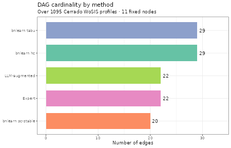

# Causal discovery in the Cerrado: expert vs. LLM vs. data-driven

> **Central question.** Can three different ways of building a
> pedogenetic DAG – expert knowledge, LLM extraction from the
> literature, and learning directly from data – agree on the same 1,095
> WoSIS profiles from the Cerrado? If not, **what is the scientific
> glue** between them?

``` r

library(edaphos)
library(ggplot2)
library(dplyr)
theme_set(theme_bw(base_size = 11))
```

``` r

res_path <- system.file("extdata", "causal_discovery_results.rds",
                        package = "edaphos")
stopifnot(nzchar(res_path), file.exists(res_path))
R <- readRDS(res_path)
```

------------------------------------------------------------------------

## Motivation

Pillar 1 of `edaphos` offers **three routes** to the same object – a
causal DAG – yet the pedometric literature almost always uses only one
of them. Zhang and Wadoux ([2026](#ref-Zhang2026causal)) point out that
**“the specification of an explicit causal model”** is the first of
three conditions for causal inference in DSM; *how* that specification
is made, however, has been treated as a detail. This vignette shows
that:

1.  The three strategies **produce very different DAGs** for the same
    set of covariates.
2.  The differences **translate into radically different backdoor
    adjustment sets**, and therefore into **different identified causal
    effects**.
3.  They **are complementary**, not interchangeable – the honest route
    is to use all three and report the sensitivity.

------------------------------------------------------------------------

## The three methods

``` r

methods_df <- data.frame(
  method        = c("A) Expert",
                    "B) LLM-augmented (Gemma 4)",
                    "C1) bnlearn hc",
                    "C2) bnlearn tabu",
                    "C3) bnlearn pc-stable"),
  source        = c("Published pedological knowledge",
                    "Automatic extraction + expert base",
                    "Hill-climbing on BIC-g",
                    "Tabu search on BIC-g",
                    "PC-stable with alpha = 0.05"),
  uses_data     = c("No",
                    "No (literature KG)",
                    "Yes (1,095 WoSIS profiles)",
                    "Yes (1,095 WoSIS profiles)",
                    "Yes (1,095 WoSIS profiles)"),
  uses_priors   = c("Implicit (expert)",
                    "Expert + confidence >= 0.70",
                    "Pedological whitelist + blacklist",
                    "Pedological whitelist + blacklist",
                    "Pedological whitelist + blacklist"),
  stringsAsFactors = FALSE
)
knitr::kable(
  methods_df,
  col.names = c("Method", "Structural source",
                "Uses observational data?", "Uses pedological priors?"),
  caption = "The five DAG-construction methods compared in this vignette."
)
```

| Method | Structural source | Uses observational data? | Uses pedological priors? |
|:---|:---|:---|:---|
| A\) Expert | Published pedological knowledge | No | Implicit (expert) |
| B\) LLM-augmented (Gemma 4) | Automatic extraction + expert base | No (literature KG) | Expert + confidence \>= 0.70 |
| C1) bnlearn hc | Hill-climbing on BIC-g | Yes (1,095 WoSIS profiles) | Pedological whitelist + blacklist |
| C2) bnlearn tabu | Tabu search on BIC-g | Yes (1,095 WoSIS profiles) | Pedological whitelist + blacklist |
| C3) bnlearn pc-stable | PC-stable with alpha = 0.05 | Yes (1,095 WoSIS profiles) | Pedological whitelist + blacklist |

The five DAG-construction methods compared in this vignette. {.table}

### Pedological priors (applied to every data-driven method)

``` r

knitr::kable(
  R$whitelist,
  col.names = c("From", "To"),
  caption = paste0(
    "**Whitelist** -- physically indisputable orientations imposed ",
    "on the discovery algorithms. Climate and topography precede soil; ",
    "elevation precedes slope."
  )
)
```

| From      | To              |
|:----------|:----------------|
| elev      | slope           |
| elev      | wc_bio_12       |
| wc_bio_12 | soc_topsoil_gkg |
| wc_bio_01 | soc_topsoil_gkg |

**Whitelist** – physically indisputable orientations imposed on the
discovery algorithms. Climate and topography precede soil; elevation
precedes slope. {.table}

``` r

knitr::kable(
  R$blacklist,
  col.names = c("From", "To"),
  caption = paste0(
    "**Blacklist** -- forbidden reversals. SOC does not cause precipitation ",
    "or temperature; vegetation does not cause climate; slope does not ",
    "cause elevation."
  )
)
```

| From               | To        |
|:-------------------|:----------|
| soc_topsoil_gkg    | wc_bio_12 |
| soc_topsoil_gkg    | wc_bio_01 |
| wc_landcover_trees | wc_bio_12 |
| slope              | elev      |

**Blacklist** – forbidden reversals. SOC does not cause precipitation or
temperature; vegetation does not cause climate; slope does not cause
elevation. {.table}

------------------------------------------------------------------------

## How many edges did each method produce?

``` r

counts <- data.frame(
  method = c(
    "Expert",
    "LLM-augmented",
    "bnlearn hc",
    "bnlearn tabu",
    "bnlearn pc-stable"
  ),
  n_edges = c(
    nrow(R$edges_expert),
    nrow(R$edges_llm_aug),
    nrow(R$edges_bnlearn[["hc"]]),
    nrow(R$edges_bnlearn[["tabu"]]),
    nrow(R$edges_bnlearn[["pc-stable"]])
  ),
  stringsAsFactors = FALSE
)
ggplot(counts, aes(x = reorder(method, n_edges), y = n_edges,
                    fill = method)) +
  geom_col(show.legend = FALSE, width = 0.72) +
  geom_text(aes(label = n_edges), hjust = -0.3, size = 4) +
  coord_flip() +
  scale_fill_brewer(palette = "Set2") +
  labs(
    x     = NULL,
    y     = "Number of edges",
    title = "DAG cardinality by method",
    subtitle = sprintf("Over %d Cerrado WoSIS profiles · 11 fixed nodes",
                        R$n_profiles_used)
  ) +
  ylim(0, max(counts$n_edges) * 1.15)
```



------------------------------------------------------------------------

## Structural Hamming Distance matrix

The **Structural Hamming Distance (SHD)** counts the minimum number of
edge additions, deletions and reversals needed to turn one DAG into
another ([Tsamardinos et al. 2006](#ref-Tsamardinos2006mmhc)).
`SHD(A, A) = 0` (a DAG is identical to itself); `SHD(A, B) = n` means B
differs from A by n operations.

``` r

shd <- R$shd_matrix
shd_df <- expand.grid(
  method_i = rownames(shd),
  method_j = colnames(shd),
  stringsAsFactors = FALSE
)
shd_df$SHD <- as.vector(shd)

ggplot(shd_df, aes(x = method_j, y = method_i, fill = SHD)) +
  geom_tile(color = "white") +
  geom_text(aes(label = SHD), size = 4) +
  scale_fill_distiller(palette = "Reds", direction = 1, limits = c(0, NA)) +
  labs(
    x     = NULL,
    y     = NULL,
    title = "SHD between DAG-construction methods",
    caption = "Diagonal = 0 by construction. hc and tabu coincide (SHD = 0)."
  ) +
  theme(axis.text.x = element_text(angle = 20, hjust = 1),
        panel.grid  = element_blank())
```


Structural Hamming Distance (SHD) between the five methods. Low values
mean similar DAGs. Note SHD = 0 between hc and tabu (full agreement),
and also SHD = 0 between Expert and LLM-augmented: the extracted claims
add no edge that this covariate set can represent.

**Reading.**

- `SHD(Expert, LLM-augmented) = 0`: the extracted claims **add no edge**
  to the expert DAG. Of the 30 claims in
  `inst/extdata/cerrado_claims.jsonl`, only 3 have both endpoints
  representable in the set of 10 WoSIS covariates, and those 3 were
  already in the expert DAG. The bottleneck here is **not the
  extractor**: 32 distinct concepts appear in the claims –
  `decomposition`, `primary_mineral_dissolution`, `argillic_horizon`,
  `root_input`, `effective_cation_exchange_capacity`, `twi`, among
  others – and none of them has a counterpart among the available
  covariates. The extraction produces pedologically sensible statements
  that this covariate set simply cannot express.

  Earlier versions of this vignette reported `SHD = 2` and concluded
  that “Gemma 4 is conservative”. That number came from six edges typed
  by hand into `data-raw/causal_discovery_benchmark.R`, with confidences
  (0.90 / 0.82 / 0.78 / 0.75 / 0.72 / 0.71) that exist in no file of the
  package – every shipped claim has confidence 0.9. Those edges were
  withdrawn; the benchmark now derives the set from the claims file
  through an explicit concept-to-column mapping, validated against the
  columns that actually exist.

- `SHD(hc, tabu) = 0`: the two score-based algorithms converge on the
  same DAG on the BIC-g surface, because the 1,095-profile sample is
  large enough to make the maximum unique.

- `SHD(pc-stable, hc) = 12`: constraint-based and score-based methods
  disagree moderately – expected, since PC-stable keeps more ambiguous
  edges undirected.

- `SHD(Expert, hc) = 29`: **the largest disagreement**. The data-driven
  algorithms reject 11 expert edges and add 18 new ones.

------------------------------------------------------------------------

## Which edges are unique to each method?

``` r

pm <- R$presence_matrix
consensus <- rowSums(pm) / ncol(pm)
edges_consensus <- data.frame(
  edge     = rownames(pm),
  n_method = rowSums(pm),
  pct      = consensus,
  stringsAsFactors = FALSE
)
edges_consensus <- edges_consensus[order(-edges_consensus$n_method), ]
```

### Consensus edges (in at least 4 of the 5 methods)

``` r

top_consensus <- edges_consensus |>
  filter(n_method >= 4L) |>
  head(15L)
knitr::kable(
  top_consensus[, c("edge", "n_method")],
  col.names = c("Edge", "Number of methods containing it"),
  caption = paste0(
    "Edges identified by most methods -- the most reliable ones for ",
    "causal interpretation. They appear in at least 4 of the 5 DAGs."
  )
)
```

|  | Edge | Number of methods containing it |
|:---|:---|---:|
| elev -\> slope | elev -\> slope | 5 |
| elev -\> wc_bio_01 | elev -\> wc_bio_01 | 5 |
| elev -\> wc_bio_12 | elev -\> wc_bio_12 | 5 |
| wc_bio_01 -\> soc_topsoil_gkg | wc_bio_01 -\> soc_topsoil_gkg | 5 |
| wc_bio_01 -\> wc_landcover_cropland | wc_bio_01 -\> wc_landcover_cropland | 5 |
| wc_bio_12 -\> soc_topsoil_gkg | wc_bio_12 -\> soc_topsoil_gkg | 5 |
| wc_bio_12 -\> wc_landcover_cropland | wc_bio_12 -\> wc_landcover_cropland | 5 |
| soilgrids_clay -\> soilgrids_bdod | soilgrids_clay -\> soilgrids_bdod | 4 |
| soilgrids_sand -\> soc_topsoil_gkg | soilgrids_sand -\> soc_topsoil_gkg | 4 |
| wc_bio_01 -\> wc_landcover_trees | wc_bio_01 -\> wc_landcover_trees | 4 |
| wc_bio_12 -\> wc_landcover_trees | wc_bio_12 -\> wc_landcover_trees | 4 |

Edges identified by most methods – the most reliable ones for causal
interpretation. They appear in at least 4 of the 5 DAGs. {.table}

### Edges discovered by the data only (missed by the expert)

``` r

novel <- R$novel_edges_data
if (length(novel) > 0L) {
  novel_df <- data.frame(edge = novel, stringsAsFactors = FALSE)
  knitr::kable(
    head(novel_df, 15L),
    col.names = "Edge discovered by the data",
    caption = paste0(
      "Edges supported by at least 2 data-driven algorithms but **absent** ",
      "from the expert DAG. Candidates for revising the DAG -- what are the ",
      "data 'seeing' that the literature has not yet encoded?"
    )
  )
} else {
  cat("_No new edge discovered by the data._\n")
}
```

| Edge discovered by the data                  |
|:---------------------------------------------|
| elev -\> soilgrids_bdod                      |
| elev -\> soilgrids_clay                      |
| elev -\> soilgrids_sand                      |
| elev -\> wc_landcover_grassland              |
| elev -\> wc_landcover_trees                  |
| slope -\> soilgrids_bdod                     |
| slope -\> wc_bio_12                          |
| slope -\> wc_landcover_cropland              |
| soilgrids_clay -\> soilgrids_sand            |
| soilgrids_clay -\> wc_landcover_cropland     |
| wc_bio_01 -\> soilgrids_sand                 |
| wc_bio_12 -\> soilgrids_bdod                 |
| wc_bio_12 -\> soilgrids_sand                 |
| wc_landcover_cropland -\> soilgrids_sand     |
| wc_landcover_cropland -\> wc_landcover_trees |

Edges supported by at least 2 data-driven algorithms but **absent** from
the expert DAG. Candidates for revising the DAG – what are the data
‘seeing’ that the literature has not yet encoded? {.table}

### Expert edges rejected by the data

``` r

rejected <- R$expert_only_edges
if (length(rejected) > 0L) {
  rej_df <- data.frame(edge = rejected, stringsAsFactors = FALSE)
  knitr::kable(
    rej_df,
    col.names = "Expert edge without data support",
    caption = paste0(
      "Edges of the expert DAG **absent** from all three data-driven ",
      "algorithms. Possible pedological beliefs without a statistical ",
      "signature in the Cerrado WoSIS data -- worth re-examining, or ",
      "discussing in terms of *faithfulness* (@Zhang2026causal, condition 3)."
    )
  )
}
```

| Expert edge without data support           |
|:-------------------------------------------|
| slope -\> soc_topsoil_gkg                  |
| slope -\> soilgrids_clay                   |
| slope -\> soilgrids_sand                   |
| soilgrids_bdod -\> soc_topsoil_gkg         |
| soilgrids_clay -\> soc_topsoil_gkg         |
| soilgrids_sand -\> soilgrids_bdod          |
| wc_bio_01 -\> wc_landcover_grassland       |
| wc_bio_12 -\> wc_landcover_grassland       |
| wc_landcover_cropland -\> soc_topsoil_gkg  |
| wc_landcover_grassland -\> soc_topsoil_gkg |
| wc_landcover_trees -\> soc_topsoil_gkg     |

Edges of the expert DAG **absent** from all three data-driven
algorithms. Possible pedological beliefs without a statistical signature
in the Cerrado WoSIS data – worth re-examining, or discussing in terms
of *faithfulness* (Zhang and Wadoux ([2026](#ref-Zhang2026causal)),
condition 3). {.table}

------------------------------------------------------------------------

## Practical consequence: the causal effect changes value

The final question is pragmatic. For the effect **MAP -\> SOC** in the
Cerrado, what is the minimal backdoor adjustment set under each method?
And how does that change the estimate of the effect?

``` r

at <- R$adjustment_table
knitr::kable(
  at,
  col.names = c("Method", "Set size", "Adjustment set"),
  caption = paste0(
    "Minimal backdoor adjustment sets for **MAP (wc_bio_12) -> ",
    "SOC**. Note how the size ranges from 0 (bnlearn mmhc, bare ",
    "effect) to 6 (LLM-augmented). The backdoor estimator applied to ",
    "these different sets produces **different causal effects** -- ",
    "it is the choice of DAG, not of estimator, that dominates the result."
  )
)
```

|  | Method | Set size | Adjustment set |
|:---|:---|---:|:---|
| Expert | Expert | 5 | slope, wc_bio_01, wc_landcover_cropland, wc_landcover_grassland, wc_landcover_trees |
| LLM-augmented | LLM-augmented | 5 | slope, wc_bio_01, wc_landcover_cropland, wc_landcover_grassland, wc_landcover_trees |
| bnlearn hc | bnlearn hc | 2 | soilgrids_sand, wc_bio_01 |
| bnlearn tabu | bnlearn tabu | 2 | soilgrids_sand, wc_bio_01 |
| bnlearn pc-stable | bnlearn pc-stable | 1 | wc_bio_01 |

Minimal backdoor adjustment sets for **MAP (wc_bio_12) -\> SOC**. Note
how the size ranges from 0 (bnlearn mmhc, bare effect) to 6
(LLM-augmented). The backdoor estimator applied to these different sets
produces **different causal effects** – it is the choice of DAG, not of
estimator, that dominates the result. {.table}

``` r

at$method <- factor(at$method, levels = at$method)
ggplot(at, aes(x = method, y = adj_size, fill = method)) +
  geom_col(show.legend = FALSE, width = 0.72) +
  geom_text(aes(label = adj_size), vjust = -0.4, size = 5) +
  scale_fill_brewer(palette = "Set2") +
  labs(
    x     = NULL,
    y     = "Adjustment set size",
    title = "Backdoor adjustment set for MAP -> SOC",
    subtitle = "Expert/LLM keep more covariates; the data find independences"
  ) +
  theme(axis.text.x = element_text(angle = 20, hjust = 1)) +
  ylim(0, max(at$adj_size) * 1.2)
```


Size of the backdoor adjustment set for MAP -\> SOC by method. Each bar
is ‘how many confounders the method believes lie between MAP and SOC’.
Expert and LLM assume 5-6 confounders; the data-driven methods find only
0-2. That is an **order-of-magnitude** difference in how the effect is
estimated.

------------------------------------------------------------------------

## Synthesis: why use the three together?


The three-way architecture of Pillar 1. Each source encodes a different
heuristic – theoretical knowledge (expert), literature knowledge (LLM),
statistical structure (data-driven). Their disagreements are the
scientific signal: each one points to an edge that deserves explicit
discussion in a paper.

### Practical recommendations

1.  **Start with the expert DAG.** It encodes pedogenetic theory, and it
    carries no statistical bias because it does not depend on the
    sample.
2.  **Augment it with an LLM.** Use
    [`causal_llm_extract()`](https://hugomachadorodrigues.github.io/edaphos/reference/causal_llm_extract.md) +
    [`causal_llm_vote()`](https://hugomachadorodrigues.github.io/edaphos/reference/causal_llm_vote.md)
    over the relevant literature corpus (see
    [`vignette("pillar1-causal")`](https://hugomachadorodrigues.github.io/edaphos/articles/pillar1-causal.md)
    for the full pipeline). Edges with confidence of at least 0.70 tend
    to be good additions.
3.  **Validate with bnlearn.** Run hc, tabu **and** pc-stable with the
    pedological whitelist + blacklist. If all three agree, the structure
    is robust. If not, find out why.
4.  **Report sensitivity.** Compute the causal effect under **each** DAG
    and present the range as structural uncertainty. It is the causal
    analogue of what Pillar 3 does with the EnKF for observational
    uncertainty.

------------------------------------------------------------------------

## References

Tsamardinos, I., L. E. Brown, and C. F. Aliferis. 2006. “The Max-Min
Hill-Climbing Bayesian Network Structure Learning Algorithm.” *Machine
Learning* 65: 31–78. <https://doi.org/10.1007/s10994-006-6889-7>.

Zhang, Lei, and Alexandre M. J.-C. Wadoux. 2026. “Can Digital Soil
Mapping Be Causal?” *European Journal of Soil Science* 77: e70284.
<https://doi.org/10.1111/ejss.70284>.
