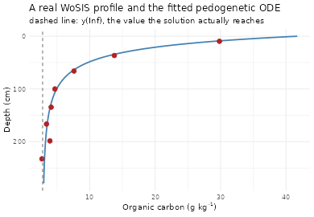

# Pilar 2 — Physics-Informed ML for Soil Depth Profiles

## Abstract

Classical Digital Soil Mapping harmonises horizon observations via
equal-area quadratic splines ([Bishop et al. 1999](#ref-Bishop1999);
[Malone et al. 2009](#ref-Malone2009)) — a purely mathematical object
disconnected from pedogenesis. The **Pillar 2** of `edaphos` replaces
that spline with two Physics-Informed Machine Learning (PIML) ([Raissi
et al. 2019](#ref-Raissi2019); [Karniadakis et al.
2021](#ref-Karniadakis2021); [Willard et al.
2022](#ref-Willcox2021pinns)) models of the soil depth profile: a
parametric pedogenetic Ordinary Differential Equation (ODE), solved in
closed form and fitted through a horizon-average observation operator,
and a Neural ODE ([Chen et al. 2018](#ref-Chen2018neuralode)) trained by
back-propagation through a fixed-step Runge-Kutta integrator on `torch`
([Falbel and Luraschi 2023](#ref-PichlerRtorch)). Both models are
demonstrated on the
[`aqp::sp4`](https://ncss-tech.github.io/aqp/reference/sp4.html)
reference pedons and a hierarchical covariate-conditioned extension
closes the loop with Pillar 5.

## 1. Pedogenetic ODE

Let $`y(z)`$ denote a soil property (e.g. clay fraction, SOC) at depth
$`z\ge 0`$. The one-dimensional kinetic model of translocation ([Jenny
1941](#ref-Jenny1941); [Minasny and McBratney 2016](#ref-Minasny2016))
assumes a depth-dependent relaxation towards an equilibrium coordinate
$`y_{\infty}`$ with rate $`\lambda(z)`$ — a coordinate that, as Section
1 shows below, the solution does **not** reach:
``` math
\frac{dy}{dz}\;=\;-\lambda(z)\,\bigl(y(z)-y_{\infty}\bigr),\qquad
\lambda(z)=\lambda_{0}\,e^{-\mu z}.
\tag{1}
```
Parameters $`(\lambda_{0},\mu,y_{\infty},y_{0})`$ carry explicit
physical meaning: $`\lambda_{0}`$ is the surface pedogenetic rate;
$`\mu`$ controls how quickly that rate decays with depth; and $`y_{0}`$
is the surface intercept.

$`y_{\infty}`$ needs care, because it is **not** the value the profile
reaches. Equation (1) is separable and its solution is
``` math
y(z)=y_{\infty}+(y_{0}-y_{\infty})
      \exp\!\Bigl[-\tfrac{\lambda_{0}}{\mu}\bigl(1-e^{-\mu z}\bigr)\Bigr],
\tag{2}
```
so, with $`\kappa=\lambda_{0}/\mu`$,
$`y(\infty)=y_{\infty}+(y_{0}-y_{\infty})e^{-\kappa}`$. Because the rate
$`\lambda(z)`$ decays with depth, the profile traverses only a fraction
$`1-e^{-\kappa}`$ of the $`y_{0}\to y_{\infty}`$ gap and then stops.
$`y_{\infty}`$ is an equilibrium coordinate of the differential
equation; the parent-material extrapolation is $`y(\infty)`$, and the
two can differ in sign. The fit is carried out in the identified,
positive coordinates $`(y_{0}, y(\infty), \kappa, \mu)`$, with
$`\lambda_{0}`$ and $`y_{\infty}`$ recovered for reporting. The
implementation
\[[`piml_profile_fit()`](https://hugomachadorodrigues.github.io/edaphos/reference/piml_profile_fit.md)\]\[piml_profile_fit\]
evaluates (2) directly — the equation has a solution, so integrating it
numerically is only slower and less accurate — and minimises
``` math
\mathcal{J}(\theta)\;=\;
\sum_{j}\bigl(\bar y(z_{j}^{\text{top}},z_{j}^{\text{bot}};\theta)-y_{j}\bigr)^{2}
\;+\;\eta\|\theta-\theta_{0}\|_{2}^{2},\tag{3}
```
with Nelder–Mead from several starting points. Two details matter. The
forward operator $`\bar y`$ is the model’s **average over the horizon**
$`[z^{\text{top}}_j, z^{\text{bot}}_j]`$, by Gauss–Legendre quadrature
on (2), rather than a point evaluation at the mid-depth — a laboratory
value is a layer average, which is the same observation-operator issue
the equal-area spline literature addresses ([Bishop et al.
1999](#ref-Bishop1999); [Malone et al. 2009](#ref-Malone2009)). And the
Tikhonov term is centred on the data-driven start $`\theta_0`$: on log
coordinates an uncentred penalty shrinks every concentration toward 1,
and in earlier versions, applied to the raw $`y_\infty`$, it scaled with
the square of the property’s units and silently did part of the
fitting.[^1]

## 2. Dataset — `aqp::sp4`

We use the ten reference pedons of
[`aqp::sp4`](https://ncss-tech.github.io/aqp/reference/sp4.html) with
horizon concentrations of clay, sand, Ca, Mg, K, CEC and CF.

``` r

data(sp4, package = "aqp")
sp4$depth <- (sp4$top + sp4$bottom) / 2
head(sp4[, c("id", "name", "top", "bottom", "depth", "clay", "K")])
#>       id name top bottom depth clay   K
#> 1 colusa    A   0      3   1.5   21 0.3
#> 2 colusa  ABt   3      8   5.5   27 0.2
#> 3 colusa  Bt1   8     30  19.0   32 0.1
#> 4 colusa  Bt2  30     42  36.0   55 0.1
#> 5  glenn    A   0      9   4.5   25 0.2
#> 6  glenn   Bt   9     34  21.5   34 0.3
unique(sp4$id)
#>  [1] "colusa"         "glenn"          "kings"          "napa"          
#>  [5] "san benito"     "shasta"         "tehama"         "mariposa"      
#>  [9] "mendocino"      "shasta-trinity"
```

## 3. Mono-pedon fit: a real multi-horizon profile

Earlier versions of this vignette fitted the `napa` pedon and called it
“a canonical argillic-horizon case … converging to a plateau in the
parent material”. It is neither. `napa` has **two** horizons, A (0-6 cm)
and Bt (6-20 cm), with clay 15% and 17%: two points for a four-parameter
model, no plateau to converge to, and no bulge. A monotone increase is
not an argillic horizon — an argillic horizon is a clay *maximum* with
depletion above and below it, and equation (1) is monotone by
construction, so it cannot represent one at all (Section 4).

We therefore fit a real multi-horizon profile from the WoSIS extract the
package ships: 1,105 Cerrado profiles with four or more horizons, built
by `data-raw/piml_wosis_multihorizon.R` from the cached ISRIC WFS
layers. Horizon boundaries are known, so the model is matched to the
layer average of each horizon rather than to a point at its mid-depth.

``` r

# Simulated profiles: this package ships no real soil data.
# See `edaphos_example_profiles()` for how these values are generated.
cand <- edaphos_example_profiles()
#> edaphos: returning SIMULATED profiles for demonstration.
#>   These are not measurements. Fetch real data yourself; see `vignette("getting-started")`.
cand <- cand[order(-cand$n_hor, -cand$z_max), ]
H <- edaphos_example_profiles(what = "horizons")
pedon <- H[H$profile_id == cand$profile_id[1], ]
pedon <- pedon[order(pedon$top), ]
pedon[, c("top", "bottom", "soc_g_kg")]
#>     top bottom soc_g_kg
#> 657   0     19    29.83
#> 658  19     54    13.76
#> 659  54     78     7.59
#> 660  78    122     4.67
#> 661 122    147     4.10
#> 662 147    186     3.39
#> 663 186    211     3.91
#> 664 211    254     2.69

fit_pedon <- piml_profile_fit(
  depths = pedon$depth_mid,
  values = pedon$soc_g_kg,
  top    = pedon$top,
  bottom = pedon$bottom
)
fit_pedon
#> <edaphos_piml_profile>
#>   dy/dz = -lambda0 * exp(-mu*z) * (y - y_inf)
#>   lambda0 = 0.04241   mu = 0.0101  
#>   y0      = 41.72     y(Inf) = 2.795      (kappa = 4.2)
#>   y_inf   = 2.201     (ODE coordinate, not the attained value)
#>   n obs   = 8 (layer)         rmse = 0.3166
#>   converged = TRUE 
#>   NOTE: the observations are not monotone in depth, and this model is monotone
#>         by construction (first-order relaxation, lambda > 0). It cannot represent
#>         an argillic bulge, an E horizon under an A, or a buried A. The fit is a
#>         least-squares compromise, not a description of the profile.
```

The printed object separates two things the package used to conflate:
`y(Inf)`, the value the profile actually reaches, and `y_inf`, a
coordinate of the differential equation that it does not. It also
reports `kappa`, the fraction of the journey the profile completes.

``` r

grid_z <- seq(0, max(pedon$bottom) * 1.1, by = 1)
pred_pedon <- data.frame(depth = grid_z,
                         soc   = predict(fit_pedon, grid_z))
```

``` r

library(ggplot2)
ggplot() +
  geom_line(data = pred_pedon, aes(soc, depth),
            linewidth = 1, colour = "steelblue") +
  geom_point(data = pedon, aes(soc_g_kg, depth_mid),
             size = 3, colour = "firebrick") +
  geom_vline(xintercept = edaphos:::.piml_asymptote(fit_pedon$params),
             linetype = 2, colour = "grey40") +
  scale_y_reverse() +
  labs(x = expression(paste("Organic carbon (g kg"^-1, ")")),
       y = "Depth (cm)",
       title = "A real WoSIS profile and the fitted pedogenetic ODE",
       subtitle = "dashed line: y(Inf), the value the solution actually reaches") +
  theme_minimal(base_size = 12)
```



## 4. Multi-pedon diagnostics

Fitting the full `sp4` dataset recovers an interpretable table where
every row has a direct pedological meaning.

``` r

fits <- piml_profile_fit_group(
  sp4, id = "id", depth = "depth", value = "clay"
)
tab <- do.call(rbind, lapply(names(fits), function(k) {
  p <- fits[[k]]$params
  data.frame(
    pedon   = k,
    lambda0  = signif(p$lambda0, 3),
    mu       = signif(p$mu,      3),
    kappa    = signif(p$kappa,   3),
    y0       = signif(p$y0,      3),
    # the value the profile reaches -- NOT y_inf, which is reported
    # alongside it to show how far apart the two can be
    y_attain = signif(edaphos:::.piml_asymptote(p), 3),
    y_inf    = signif(p$y_inf,   3),
    rmse     = signif(fits[[k]]$rmse, 3)
  )
}))
tab
#>                     pedon lambda0      mu   kappa     y0 y_attain y_inf
#> log_kappa          colusa 0.00441 0.00333  1.3200 19.900    181.0 239.0
#> log_kappa1          glenn 0.05900 0.02330  2.5400 20.100     40.3  42.1
#> log_kappa2          kings 0.03210 0.00887  3.6200  0.124     52.1  53.5
#> log_kappa3       mariposa 1.02000 0.01210 84.0000 40.800     29.5  29.5
#> log_kappa4      mendocino 0.42000 0.03680 11.4000  7.870     23.1  23.1
#> log_kappa5           napa 0.10100 0.03860  2.6100 13.800     18.4  18.8
#> log_kappa6     san benito 0.07720 0.03080  2.5100  6.750     26.0  27.7
#> log_kappa7         shasta 0.00010 0.02330  0.0043 14.000     14.0  14.0
#> log_kappa8 shasta-trinity 0.02500 0.01530  1.6400 18.700    102.0 123.0
#> log_kappa9         tehama 0.01680 0.02560  0.6560 21.800     50.9  82.2
#>                rmse
#> log_kappa  3.55e+00
#> log_kappa1 1.35e-02
#> log_kappa2 1.72e+00
#> log_kappa3 2.95e+00
#> log_kappa4 8.20e-02
#> log_kappa5 3.17e-03
#> log_kappa6 2.80e-02
#> log_kappa7 3.55e-15
#> log_kappa8 1.58e+00
#> log_kappa9 1.03e+00
```

Read this table with `y_attain` — the value the profile reaches — and
not `y_inf`. On `colusa` and `tehama` the two differ by orders of
magnitude, and both are absurd: those pedons have three or four
horizons, all in the top 42 cm, with clay still rising at the deepest
one. There is simply no information in them about where the argillic
horizon levels off, so the curve is fitted through the observations and
then points off to nowhere.
[`print()`](https://rdrr.io/r/base/print.html) flags exactly these two,
reporting how far down the $`y_0 \to y(\infty)`$ journey the deepest
horizon actually got:

``` r

vapply(fits, function(f) f$progress, numeric(1))
#>         colusa          glenn          kings       mariposa      mendocino 
#>      0.1893752      0.6859613      0.5464827      1.0000000      0.9967878 
#>           napa     san benito         shasta shasta-trinity         tehama 
#>      0.6933642      0.6361349      1.0000000      0.5770621      0.3204463
```

On neither flagged pedon does the four-parameter equation improve on a
two-parameter straight line (next section: 3.018 against 3.016, and
0.839 against 0.836), which is the right outcome — the model should not
be credited for a shape it did not determine.

## 5. Non-physical baselines

Two baselines bound the improvement claim: the mean predictor and the
linear-in-depth regression. A meaningful PIML gain should come from the
physical constraint, *not* from extra parameters.

``` r

baseline_rmse <- function(sub, target) {
  y <- sub[[target]]
  c(mean   = sqrt(mean((y - mean(y))^2)),
    linear = sqrt(mean(stats::residuals(
                     stats::lm(y ~ sub$depth))^2)))
}
bench <- do.call(rbind, lapply(split(sp4, sp4$id), function(sub) {
  bl <- baseline_rmse(sub, "clay")
  data.frame(pedon = sub$id[1],
             piml  = fits[[sub$id[1]]]$rmse,
             mean_baseline = bl["mean"],
             linear_baseline = bl["linear"])
}))
bench
#>                         pedon         piml mean_baseline linear_baseline
#> colusa                 colusa 3.548319e+00     12.871966       3.0163775
#> glenn                   glenn 1.352830e-02      4.500000       0.0000000
#> kings                   kings 1.718484e+00      9.797959       2.5628166
#> mariposa             mariposa 2.949986e+00      3.112475       2.7467763
#> mendocino           mendocino 8.202878e-02      4.320494       2.5935243
#> napa                     napa 3.165961e-03      1.000000       0.0000000
#> san benito         san benito 2.799550e-02      3.500000       0.0000000
#> shasta                 shasta 3.552714e-15      0.000000       0.0000000
#> shasta-trinity shasta-trinity 1.575534e+00     16.697305       3.0480840
#> tehama                 tehama 1.034476e+00      3.559026       0.8360796
```

## 6. Neural ODE variant

For profiles where the mono-asymptotic prior is violated — illuviated
bulges, E horizons beneath A, buried paleosols — `edaphos` offers a
Neural ODE alternative ([Chen et al. 2018](#ref-Chen2018neuralode)):
``` math
\frac{dy}{dz}=f_{\theta}(z,y),\qquad
f_{\theta}=\text{MLP}(z,y;\,\theta).
\tag{4}
```
The forward map is a fixed-step RK4 integrator written directly in
`torch`, so training back-propagates the squared-error loss through the
whole trajectory:
``` math
\mathcal{J}_{\text{NODE}}(\theta)
   \;=\;\sum_{j}\Bigl(
      \underbrace{\int_{0}^{z_{j}}f_{\theta}(z,y(z))\,dz
                  +y_{0}}_{\text{RK4 rollout}}
      \;-\;y_{j}\Bigr)^{2}.
```

``` r

nn_fit <- piml_neural_ode_fit(
  depths  = pedon$depth_mid, values = pedon$soc_g_kg,
  hidden  = c(16L, 16L), epochs = 500L,
  seed    = 1L, verbose = FALSE
)
nn_fit
pred_nn <- data.frame(depth = grid_z,
                      soc   = predict(nn_fit, grid_z))
```

``` r

ggplot() +
  geom_line(data = pred_pedon, aes(soc, depth,
            colour = "Parametric ODE"), linewidth = 1) +
  geom_line(data = pred_nn,   aes(soc, depth,
            colour = "Neural ODE"),     linewidth = 1) +
  geom_point(data = pedon, aes(soc_g_kg, depth_mid),
             size = 3, colour = "firebrick") +
  scale_y_reverse() +
  scale_colour_manual(values = c("Parametric ODE" = "steelblue",
                                  "Neural ODE"    = "darkgreen")) +
  labs(x = expression(paste("Organic carbon (g kg"^-1, ")")),
       y = "Depth (cm)", colour = NULL,
       title = "Parametric vs. Neural ODE on the same real profile") +
  theme_minimal(base_size = 12)
```

## 7. Pillar 2 × Pillar 5 — the physics gate

Given a PIML fit (parametric or neural), the helper
\[[`al_physics_gate_piml()`](https://hugomachadorodrigues.github.io/edaphos/reference/al_physics_gate_piml.md)\]\[al_physics_gate_piml\]
constructs a rejection function: candidates whose predicted target falls
outside the range the solution actually spans,
$`[\min(y_{0},y(\infty)),\,\max(y_{0},y(\infty))]`$, inflated by a
`safety_factor`, are eliminated from the greedy Active-Learning
selection (see the Pillar 5 vignette). The envelope used to be built
from $`y_{\infty}`$, which is not a value any profile reaches and is
often negative: on 300 real WoSIS pedons the gate then accepted an
organic carbon of $`-5`$ g/kg on 73 of them. It now floors at zero for a
property the fit itself requires to be positive.

``` r

gate <- al_physics_gate_piml(fit_pedon, safety_factor = 1.2)
cand_dummy <- data.frame(dummy = 1:4)
gate(cand_dummy, predicted_mean = c(10, 25, 200, -5))
```

A hierarchical extension
(\[[`piml_hierarchical_fit()`](https://hugomachadorodrigues.github.io/edaphos/reference/piml_hierarchical_fit.md)\]\[piml_hierarchical_fit\])
jointly fits a covariate-conditioned Neural ODE across pedons,
delivering a **per-location** envelope that
\[[`al_physics_gate_piml_hierarchical()`](https://hugomachadorodrigues.github.io/edaphos/reference/al_physics_gate_piml_hierarchical.md)\]\[al_physics_gate_piml_hierarchical\]
feeds back into Pillar 5.

## 8. Bayesian posterior over the ODE parameters

\[[`piml_profile_fit()`](https://hugomachadorodrigues.github.io/edaphos/reference/piml_profile_fit.md)\]\[piml_profile_fit\]
returns a single point estimate. For any honest downstream use —
propagating parametric uncertainty into a SOC-stock prediction, tuning a
Pillar 5 Active-Learning acquisition under correct epistemic variance,
reporting publishable parameter intervals — we need the **posterior**
$`p(\lambda_0, \mu, y_\infty, y_0 \mid \text{depths}, \text{values})`$,
not just the MAP.

The function
\[[`piml_profile_fit_bayesian()`](https://hugomachadorodrigues.github.io/edaphos/reference/piml_profile_fit_bayesian.md)\]\[piml_profile_fit_bayesian\]
returns that posterior through two nested approximations:

1.  **Laplace approximation** (default, O(ms) per pedon). Gaussian
    posterior whose mean is the MAP and whose covariance is the inverse
    observed Fisher information at the MAP ([Bishop 2006, sec.
    4.4](#ref-Bishop2006PRML)). Accurate when the posterior is
    well-identified; every call pre-samples 2 000 draws from
    $`N(\text{MAP}, \Sigma)`$ for predictive convenience.
2.  **Adaptive random-walk Metropolis** ([Haario et al.
    2001](#ref-Haario2001)) (~seconds per pedon). Proposal covariance
    starts at the Laplace covariance, scaled by the Roberts–Gelman–Gilks
    optimal factor $`(2.38)^2 / d`$, and is updated online by Haario
    recursion after a warm-up period — so non-Gaussian or multimodal
    posteriors are captured faithfully where Laplace would paper over
    them.

**Which to use, measured rather than asserted.** On the WoSIS pedon the
manuscript reports (1115679, nine horizons to 550 cm, lognormal family,
horizon-average operator, same seed), the two paths were compared
parameter by parameter. Five of the seven 95% intervals are narrower
under Laplace — $`\kappa`$ and $`y_\infty`$ by more than a factor of
two, the observation noise by 1.8, so its coefficient of variation reads
0.168 against 0.230 from the sampler.

The split is not arbitrary. The attainable deep value $`y(\infty)`$,
which these data identify, is essentially unchanged (width ratio 1.01),
and $`\mu`$ is actually wider under Laplace. What moves is what is not
identified. The derived $`y_\infty = (A - y_0 e^{-\kappa})/(1 -
e^{-\kappa})`$ has a pole at $`\kappa \to 0`$; the sampler puts 5.3% of
its draws below $`\kappa = 0.5`$ and reaches 0.080, while Laplace puts
0.5% there and stops at 0.285. Conditioning both on $`\kappa \ge
0.5`$ brings them into agreement.

So the practical rule is the one the description above already implies,
now with a measurement behind it: Laplace is fine for the identified
coordinates and for anything you intend to use as a point estimate, and
it is not fine for a derived quantity whose map is unstable in a tail it
cannot reach. The package’s reported numbers use MCMC.

``` r

library(edaphos)

depths <- c(5, 15, 30, 60, 100)
values <- c(25, 18, 12, 8, 6.5)

fit_bayes <- piml_profile_fit_bayesian(depths, values,
                                         method = "laplace", seed = 1L)
fit_bayes
#> <edaphos_piml_bayes>
#>   method     : laplace
#>   n draws    : 2000
#>   sigma (noise): 0.009692
#>   posterior summary (natural scale):
#>  parameter      mean        sd       q2.5       q50    q97.5
#>    lambda0   0.03740  0.012180   0.018942  0.035352  0.06675
#>         mu   0.03509  0.005514   0.025552  0.034733  0.04736
#>      y_inf -10.64234 11.818452 -41.257663 -8.089489  3.62039
#>         y0  30.98891  0.602453  29.837477 31.006206 32.15824
#>      kappa   1.14603  0.571184   0.399185  1.016122  2.59166
#>     y_asym   6.05674  0.177663   5.707088  6.056401  6.41648
#>      sigma   0.01029  0.003757   0.004745  0.009672  0.01924
```

``` r

predict(fit_bayes,
         newdepths         = c(10, 20, 40, 80),
         interval          = 0.95,
         include_obs_noise = TRUE,
         seed              = 1L)
#>   depth      mean        sd     lower     upper lower_sim upper_sim
#> 1    10 20.589711 0.5581681 19.319254 21.293824 18.788348 21.458065
#> 2    20 15.054671 0.5770224 13.482066 15.709122 12.862055 15.794151
#> 3    40  9.883594 0.3760792  8.874115 10.306881  8.553220 10.379022
#> 4    80  6.905800 0.1433822  6.555402  7.121222  6.436077  7.160627
```

`include_obs_noise = TRUE` adds Gaussian observation noise with the
MAP-estimated $`\sigma`$ onto every predictive draw, so the returned
interval represents the predictive distribution of a *future
observation* rather than the uncertainty on the mean function alone.

For the Neural-ODE variant the variational analogue is a **deep
ensemble** ([Lakshminarayanan et al.
2017](#ref-Lakshminarayanan2017ensemble)): `K` independent networks
trained from different random seeds produce an empirical posterior whose
mean and variance approximate the Bayesian predictive posterior ([Wilson
and Izmailov 2020](#ref-Wilson2020bayesian)).

``` r

ens <- piml_neural_ode_fit_ensemble(depths, values,
                                       K = 5L, epochs = 300L, seed = 1L)
predict(ens, newdepths = c(10, 20, 40, 80), interval = 0.9)
```

## 9. Discussion and roadmap

The parametric ODE is mono-asymptotic and therefore optimal for
properties that decay monotonically toward a parent-material value (SOC,
some nutrients) but suboptimal for bimodal profiles, which the Neural
ODE handles by construction. Three complementary directions remain on
the roadmap:

- **Mass-conservation soft constraints** — augment the Neural ODE loss
  with a term penalising deviations from an integrated mass balance
  ([Minasny et al. 2017](#ref-Minasny2017)).
- **Adjoint-method Neural ODE** — for pedons deeper than 2 m, the
  back-propagation graph becomes memory-bound; the adjoint method of
  ([Chen et al. 2018](#ref-Chen2018neuralode)) eliminates that scaling.
- **Hierarchical Bayesian pooling** — extending
  \[[`piml_hierarchical_fit()`](https://hugomachadorodrigues.github.io/edaphos/reference/piml_hierarchical_fit.md)\]\[piml_hierarchical_fit\]
  to the posterior regime that
  \[[`piml_profile_fit_bayesian()`](https://hugomachadorodrigues.github.io/edaphos/reference/piml_profile_fit_bayesian.md)\]\[piml_profile_fit_bayesian\]
  already exposes for single pedons, with covariate-conditioned priors
  over $`(\lambda_0, \mu, y_\infty, y_0)`$.

## References

Bishop, C. M. 2006. *Pattern Recognition and Machine Learning*.
Springer.

Bishop, T. F. A., A. B. McBratney, and G. M. Laslett. 1999. “Modelling
Soil Attribute Depth Functions with Equal-Area Quadratic Smoothing
Splines.” *Geoderma* 91 (1-2): 27–45.
<https://doi.org/10.1016/S0016-7061(99)00003-8>.

Chen, R. T. Q., Y. Rubanova, J. Bettencourt, and D. K. Duvenaud. 2018.
“Neural Ordinary Differential Equations.” *Advances in Neural
Information Processing Systems* 31.

Falbel, D., and J. Luraschi. 2023. *Torch: Tensors and Neural Networks
with ’GPU’ Acceleration*.

Haario, H., E. Saksman, and J. Tamminen. 2001. “An Adaptive Metropolis
Algorithm.” *Bernoulli* 7 (2): 223–42.
<https://doi.org/10.2307/3318737>.

Jenny, Hans. 1941. *Factors of Soil Formation: A System of Quantitative
Pedology*. McGraw-Hill.

Karniadakis, G. E., I. G. Kevrekidis, L. Lu, P. Perdikaris, S. Wang, and
L. Yang. 2021. “Physics-Informed Machine Learning.” *Nature Reviews
Physics* 3: 422–40. <https://doi.org/10.1038/s42254-021-00314-5>.

Lakshminarayanan, B., A. Pritzel, and C. Blundell. 2017. “Simple and
Scalable Predictive Uncertainty Estimation Using Deep Ensembles.”
*Advances in Neural Information Processing Systems* 30: 6402–13.

Malone, B. P., A. B. McBratney, B. Minasny, and G. M. Laslett. 2009.
“Mapping Continuous Depth Functions of Soil Carbon Using Equal-Area
Splines.” *Geoderma* 154 (1-2): 138–52.
<https://doi.org/10.1016/j.geoderma.2009.10.007>.

Minasny, B., B. P. Malone, A. B. McBratney, et al. 2017. “Soil Carbon 4
Per Mille.” *Geoderma* 292: 59–86.
<https://doi.org/10.1016/j.geoderma.2017.01.002>.

Minasny, B., and A. B. McBratney. 2016. “Digital Soil Mapping: A Brief
History and Some Lessons Learned.” *Geoderma* 264: 301–11.
<https://doi.org/10.1016/j.geoderma.2015.07.017>.

Raissi, M., P. Perdikaris, and G. E. Karniadakis. 2019.
“Physics-Informed Neural Networks: A Deep Learning Framework for Solving
Forward and Inverse Problems Involving Nonlinear Partial Differential
Equations.” *Journal of Computational Physics* 378: 686–707.
<https://doi.org/10.1016/j.jcp.2018.10.045>.

Willard, J., X. Jia, S. Xu, M. Steinbach, and V. Kumar. 2022.
“Integrating Scientific Knowledge with Machine Learning for Engineering
and Environmental Systems.” *ACM Computing Surveys* 55 (4): 66:1–37.
<https://doi.org/10.1145/3514228>.

Wilson, A. G., and P. Izmailov. 2020. “Bayesian Deep Learning and a
Probabilistic Perspective of Generalization.” *Advances in Neural
Information Processing Systems* 33: 4697–708.

[^1]: Physics is imposed by the *forward model itself* — the optimiser
    cannot produce a profile that violates the exponential approach to
    $`y_{\infty}`$, irrespective of data. This is the strong-PIML regime
    sensu ([Karniadakis et al. 2021](#ref-Karniadakis2021)).
