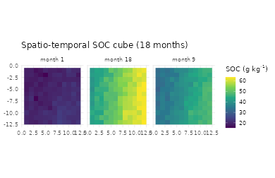
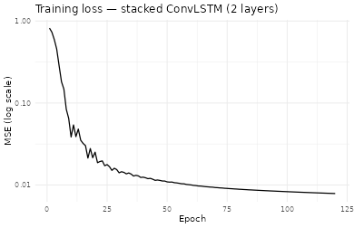
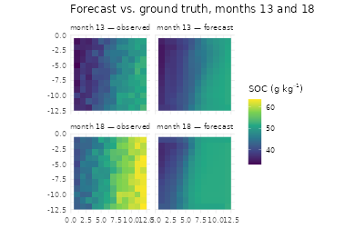

# Pilar 3 — 4D Pedometry: Stacked ConvLSTM Forecasts of SOC

## Abstract

Most digital soil maps report a time-invariant property field, which
ignores the evidence that topsoil Soil Organic Carbon (SOC) responds
measurably to climate forcing on monthly to annual scales ([Lehmann and
Kleber 2015](#ref-Lehmann2015); [Minasny et al.
2017](#ref-Minasny2017)). The **Pillar 3** of `edaphos` addresses that
gap with a stacked Convolutional LSTM ([Shi et al. 2015](#ref-Shi2015))
trained in sequence-to-sequence mode plus a multi-step rollout wrapper
for forward forecasting under known future drivers. A physics-informed
mass-balance regulariser optionally penalises violations of an
analytical SOC kinetic, fusing Pillar 2 into Pillar 3 ([Raissi et al.
2019](#ref-Raissi2019); [Reichstein et al.
2019](#ref-ReichsteinDL2019)).

## 1. From 3D to 4D pedometry

Let $`y(\mathbf{s},t)`$ denote a topsoil property at location
$`\mathbf{s}`$ and time $`t\in\{1,\ldots,T\}`$. Traditional DSM
([McBratney et al. 2003](#ref-McBratney2003)) estimates
$`y(\mathbf{s})=\bar y(\mathbf{s},\cdot)`$ by collapsing over time. A 4D
model retains the time dimension and predicts the full spatio-temporal
field $`y(\mathbf{s},t)\mid \mathbf{X}(\mathbf{s},t^{\prime}\le t)`$,
where $`\mathbf{X}`$ is the driver stack (climate, vegetation, static
topography).

The **Convolutional LSTM cell** ([Shi et al. 2015](#ref-Shi2015))
operationalises spatial memory: at each time step the hidden state
$`\mathbf{H}_{t}`$ and the cell state $`\mathbf{C}_{t}`$ are tensors of
the same spatial size as the input, so memory propagates *with* its
location:
``` math
\begin{aligned}
\mathbf{i}_{t}&=\sigma(W_{xi}*\mathbf{X}_{t}+W_{hi}*\mathbf{H}_{t-1}+b_{i}),\\
\mathbf{f}_{t}&=\sigma(W_{xf}*\mathbf{X}_{t}+W_{hf}*\mathbf{H}_{t-1}+b_{f}),\\
\mathbf{g}_{t}&=\tanh(W_{xg}*\mathbf{X}_{t}+W_{hg}*\mathbf{H}_{t-1}+b_{g}),\\
\mathbf{o}_{t}&=\sigma(W_{xo}*\mathbf{X}_{t}+W_{ho}*\mathbf{H}_{t-1}+b_{o}),\\
\mathbf{C}_{t}&=\mathbf{f}_{t}\odot\mathbf{C}_{t-1}+\mathbf{i}_{t}\odot\mathbf{g}_{t},\\
\mathbf{H}_{t}&=\mathbf{o}_{t}\odot\tanh(\mathbf{C}_{t}),
\end{aligned}
\tag{1}
```
with `*` a 2-D convolution and $`\odot`$ the Hadamard product. Stacking
$`L`$ cells feeds $`\mathbf{H}_{t}^{(\ell)}`$ as the input to layer
$`\ell+1`$, yielding a hierarchy of spatial receptive fields.

## 2. Synthetic SOC dynamics cube

To keep the vignette self-contained and reproducible,
\[[`temporal_synth_soc_cube()`](https://hugomachadorodrigues.github.io/edaphos/reference/temporal_synth_soc_cube.md)\]\[temporal_synth_soc_cube\]
integrates the driver-response kinetic
``` math
\mathrm{SOC}_{t+1}=\mathrm{SOC}_{t}+k_{\text{in}}P_{t}
                   -k_{\text{out}}\,\mathrm{SOC}_{t}\,P_{t}/\bar P
                   +\varepsilon,
\tag{2}
```
with $`P_{t}`$ the monthly precipitation field and $`\bar P`$ its
long-term mean. The numerator $`k_{\text{in}}P_{t}`$ models organic
input proportional to wet-season biomass turnover; the denominator
$`k_{\text{out}}\mathrm{SOC}\,P/\bar P`$ captures humidity-modulated
decomposition ([Lehmann and Kleber 2015](#ref-Lehmann2015); [Minasny et
al. 2017](#ref-Minasny2017)).

``` r

cube <- temporal_synth_soc_cube(H = 12L, W = 12L, T_total = 18L,
                                seed = 7L)
str(cube)
#> List of 3
#>  $ elev  : num [1:12, 1:12] 42.8 32.6 42.4 51.1 55.6 ...
#>  $ precip: num [1:18, 1:12, 1:12] 16.3 28.7 53.2 71.1 87.7 ...
#>  $ soc   : num [1:18, 1:12, 1:12] 18.9 19.4 20.1 21.3 23.3 ...
```

``` r

library(ggplot2)
to_df <- function(mat, month) {
  dd <- expand.grid(row = seq_len(nrow(mat)), col = seq_len(ncol(mat)))
  dd$soc <- as.vector(mat); dd$month <- month
  dd
}
soc_df <- rbind(to_df(cube$soc[1L, , ],  "month 1"),
                 to_df(cube$soc[9L, , ],  "month 9"),
                 to_df(cube$soc[18L, , ], "month 18"))
ggplot(soc_df, aes(col, -row, fill = soc)) +
  geom_raster() + facet_wrap(~ month) +
  scale_fill_viridis_c(name = expression("SOC ("*g~kg^{-1}*")")) +
  coord_equal() + theme_minimal(base_size = 12) +
  labs(x = NULL, y = NULL,
       title = "Spatio-temporal SOC cube (18 months)")
```



## 3. Train / forecast split

We reserve the last six months for an out-of-sample forecast evaluation
and train on the first twelve.

``` r

past_tensor   <- temporal_cube_to_tensor(cube, t_slice = 1:12)
future_tensor <- temporal_cube_to_tensor(cube, t_slice = 13:18)
dim(past_tensor$sequence)
#> [1]  1 12  2 12 12
dim(past_tensor$target)
#> [1]  1 12 12 12
```

## 4. Stacked ConvLSTM in sequence-to-sequence mode

``` r

fit <- temporal_convlstm_fit(
  sequence        = past_tensor$sequence,
  target          = past_tensor$target,
  hidden_dims     = c(12L, 6L),
  kernel_size     = 3L,
  return_sequence = TRUE,
  epochs          = 120L, lr = 0.02,
  seed            = 1L, verbose = FALSE
)
fit
#> <edaphos_temporal_convlstm>
#>   input_dim = 2   hidden = [12, 6]   kernel = 3
#>   return_sequence = TRUE   epochs = 120   final loss = 0.007865
```

``` r

loss_df <- data.frame(epoch = seq_along(fit$loss_history),
                       loss  = fit$loss_history)
ggplot(loss_df, aes(epoch, loss)) +
  geom_line(linewidth = 0.7) + scale_y_log10() +
  theme_minimal(base_size = 12) +
  labs(title = "Training loss — stacked ConvLSTM (2 layers)",
       x = "Epoch", y = "MSE (log scale)")
```



## 5. Multi-step rollout forecast

When future driver channels are known (e.g. climate forecasts
([Reichstein et al. 2019](#ref-ReichsteinDL2019))), a single forward
pass of the trained ConvLSTM on the concatenated past + future window
returns the per-step prediction.

``` r

forecast <- temporal_convlstm_rollout(
  fit,
  past_sequence  = past_tensor$sequence,
  future_drivers = future_tensor$sequence
)
dim(forecast)
#> [1]  1  6 12 12
```

``` r

tgt_norm  <- future_tensor$target[1L, , , ]
pred_norm <- forecast[1L, , , ]
rmse_month <- sapply(seq_len(6), function(t)
  sqrt(mean((pred_norm[t, , ] - tgt_norm[t, , ])^2)))
data.frame(forecast_month = 13:18, rmse_norm = signif(rmse_month, 3))
#>   forecast_month rmse_norm
#> 1             13     0.105
#> 2             14     0.115
#> 3             15     0.128
#> 4             16     0.183
#> 5             17     0.331
#> 6             18     0.543
per_pixel <- sqrt(apply((pred_norm - tgt_norm)^2, c(2, 3), mean))
summary(as.vector(per_pixel))
#>    Min. 1st Qu.  Median    Mean 3rd Qu.    Max. 
#> 0.04832 0.15511 0.22278 0.25133 0.32635 0.56169
```

``` r

df <- rbind(
  to_df(future_tensor$scaling$soc_mu +
          future_tensor$scaling$soc_sd * tgt_norm[1L, , ],
        "month 13 — observed"),
  to_df(future_tensor$scaling$soc_mu +
          future_tensor$scaling$soc_sd * pred_norm[1L, , ],
        "month 13 — forecast"),
  to_df(future_tensor$scaling$soc_mu +
          future_tensor$scaling$soc_sd * tgt_norm[6L, , ],
        "month 18 — observed"),
  to_df(future_tensor$scaling$soc_mu +
          future_tensor$scaling$soc_sd * pred_norm[6L, , ],
        "month 18 — forecast")
)
df$month <- factor(df$month, levels = c(
  "month 13 — observed", "month 13 — forecast",
  "month 18 — observed", "month 18 — forecast"))
ggplot(df, aes(col, -row, fill = soc)) +
  geom_raster() + facet_wrap(~ month, nrow = 2) +
  scale_fill_viridis_c(name = expression("SOC ("*g~kg^{-1}*")")) +
  coord_equal() + theme_minimal(base_size = 12) +
  labs(x = NULL, y = NULL,
       title = "Forecast vs. ground truth, months 13 and 18")
```



## 6. Physics-informed ConvLSTM

For Pillars 2 × 3 fusion, a mass-balance prior of the form (2) can be
injected into the loss as a soft constraint ([Raissi et al.
2019](#ref-Raissi2019); [Karniadakis et al. 2021](#ref-Karniadakis2021);
[Willard et al. 2022](#ref-Willcox2021pinns)):
``` math
\mathcal{L}=\underbrace{\mathrm{MSE}(\hat y,y)}_{\text{data}}
           +\lambda_{\text{phys}}\,
           \mathrm{MSE}\!\bigl(\Delta\hat y_{t},
               k_{\text{in}}P_{t}-k_{\text{out}}\hat y_{t}P_{t}/\bar P\bigr).
```
In
\[[`temporal_convlstm_fit()`](https://hugomachadorodrigues.github.io/edaphos/reference/temporal_convlstm_fit.md)\]\[temporal_convlstm_fit\]
this is enabled by setting `physics_lambda > 0`. Two auxiliary traces —
`loss_fit_history` and `loss_phys_history` — are stored so the data and
physics contributions can be monitored independently during training.

## 7. Discussion

Pillar 3 establishes the scaffold for a genuinely 4-D DSM pipeline —
distinct from repeated 3-D snapshots — and connects it back to Pillar 2
through the shared kinetic (2). Production-scale use cases require real
spatio-temporal stacks (MODIS, ERA5, MapBiomas), multi-step
autoregressive rollout, and hysteresis regularisers; those are scheduled
for future releases.

## References

Karniadakis, G. E., I. G. Kevrekidis, L. Lu, P. Perdikaris, S. Wang, and
L. Yang. 2021. “Physics-Informed Machine Learning.” *Nature Reviews
Physics* 3: 422–40. <https://doi.org/10.1038/s42254-021-00314-5>.

Lehmann, J., and M. Kleber. 2015. “The Contentious Nature of Soil
Organic Matter.” *Nature* 528: 60–68.
<https://doi.org/10.1038/nature16069>.

McBratney, A. B., M. L. Mendonça Santos, and B. Minasny. 2003. “On
Digital Soil Mapping.” *Geoderma* 117 (1-2): 3–52.
<https://doi.org/10.1016/S0016-7061(03)00223-4>.

Minasny, B., B. P. Malone, A. B. McBratney, et al. 2017. “Soil Carbon 4
Per Mille.” *Geoderma* 292: 59–86.
<https://doi.org/10.1016/j.geoderma.2017.01.002>.

Raissi, M., P. Perdikaris, and G. E. Karniadakis. 2019.
“Physics-Informed Neural Networks: A Deep Learning Framework for Solving
Forward and Inverse Problems Involving Nonlinear Partial Differential
Equations.” *Journal of Computational Physics* 378: 686–707.
<https://doi.org/10.1016/j.jcp.2018.10.045>.

Reichstein, M., G. Camps-Valls, B. Stevens, et al. 2019. “Deep Learning
and Process Understanding for Data-Driven Earth System Science.”
*Nature* 566: 195–204. <https://doi.org/10.1038/s41586-019-0912-1>.

Shi, X., Z. Chen, H. Wang, D.-Y. Yeung, W.-K. Wong, and W.-C. Woo. 2015.
“Convolutional LSTM Network: A Machine Learning Approach for
Precipitation Nowcasting.” *Advances in Neural Information Processing
Systems* 28: 802–10.

Willard, J., X. Jia, S. Xu, M. Steinbach, and V. Kumar. 2022.
“Integrating Scientific Knowledge with Machine Learning for Engineering
and Environmental Systems.” *ACM Computing Surveys* 55 (4): 66:1–37.
<https://doi.org/10.1145/3514228>.
