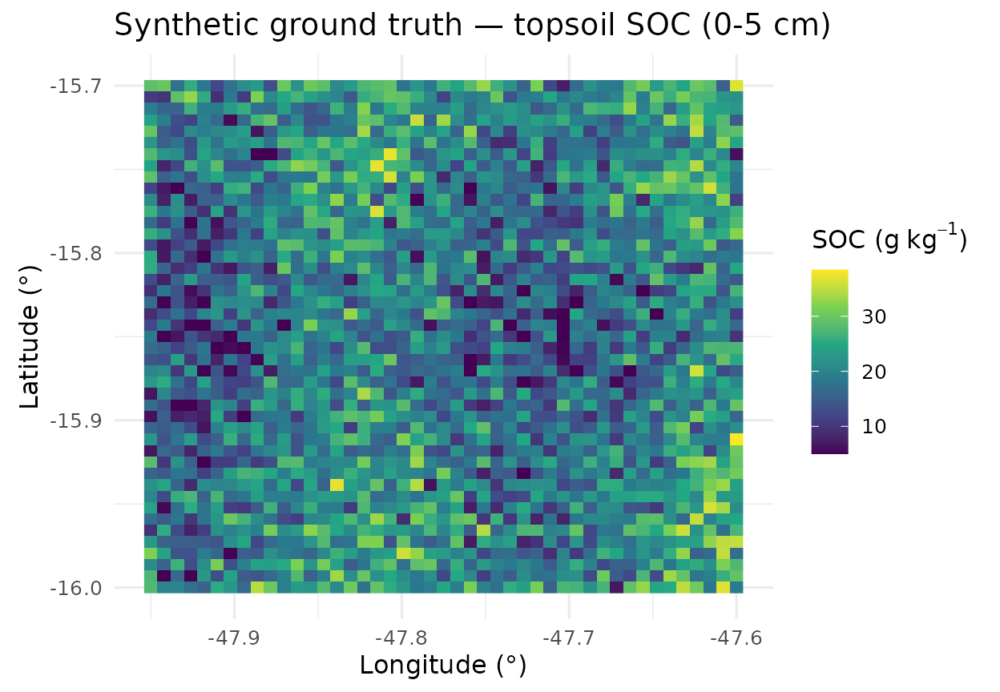
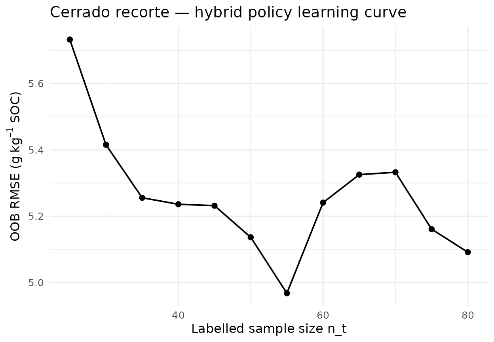
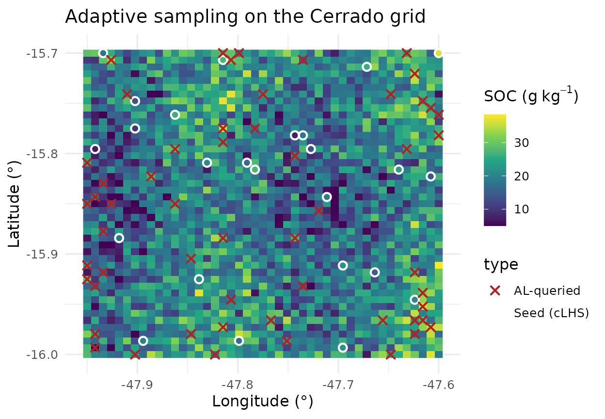

# Pilar 5 — Active Learning on a Brazilian Cerrado Transect

## Abstract

We apply the Pillar 5 Active Learning loop of `edaphos` to the bundled
`br_cerrado` sample — a reproducible 45 × 45 pixel synthetic surrogate
for a 30 km square near Brasília (Distrito Federal, Brazil). The
exercise mirrors the realistic cost structure of a DSM project in the
Cerrado biome ([Arrouays et al. 2014](#ref-Arrouays2014globalsoilmap);
[Minasny et al. 2017](#ref-Minasny2017)): limited sampling budget,
non-trivial covariate interactions, and a soil organic carbon response
driven by topography, climate and vegetation cover.

## 1. Bundled surrogate dataset

`br_cerrado` is generated by the script `data-raw/prepare_br_cerrado.R`,
which also includes a ready-to-run live-fetch block against SoilGrids
250 m ([Hengl et al. 2017](#ref-HenglWoSIS)), WorldClim and SRTM via the
`geodata` package. Synthetic data are used here only to ensure that the
vignette builds offline, reproducibly, in every CI environment.

``` r

library(edaphos)
data(br_cerrado, package = "edaphos")
str(br_cerrado)
#> 'data.frame':    2025 obs. of  8 variables:
#>  $ x     : num  -48 -47.9 -47.9 -47.9 -47.9 ...
#>  $ y     : num  -16 -16 -16 -16 -16 -16 -16 -16 -16 -16 ...
#>  $ elev  : num  904 928 900 912 934 ...
#>  $ slope : num  2.59 9.9 14.19 6.23 11.89 ...
#>  $ twi   : num  10.32 11.23 11.47 11.28 8.12 ...
#>  $ map_mm: num  1197 1239 1209 1160 1225 ...
#>  $ ndvi  : num  0.719 0.619 0.531 0.586 0.517 0.648 0.668 0.529 0.648 0.693 ...
#>  $ soc   : num  27.6 20.1 20.2 17.2 15.7 ...
summary(br_cerrado[, c("soc", "elev", "twi", "ndvi", "map_mm")])
#>       soc             elev             twi              ndvi      
#>  Min.   : 5.00   Min.   : 682.9   Min.   : 1.023   Min.   :0.314  
#>  1st Qu.:15.19   1st Qu.: 862.3   1st Qu.: 7.799   1st Qu.:0.481  
#>  Median :19.47   Median : 932.8   Median :10.062   Median :0.539  
#>  Mean   :19.50   Mean   : 937.5   Mean   : 9.933   Mean   :0.542  
#>  3rd Qu.:24.06   3rd Qu.:1015.1   3rd Qu.:12.058   3rd Qu.:0.598  
#>  Max.   :38.41   Max.   :1254.2   Max.   :15.000   Max.   :0.872  
#>      map_mm    
#>  Min.   :1056  
#>  1st Qu.:1326  
#>  Median :1498  
#>  Mean   :1500  
#>  3rd Qu.:1673  
#>  Max.   :1908
```

``` r

library(ggplot2)
ggplot(br_cerrado, aes(x, y, fill = soc)) +
  geom_raster() +
  scale_fill_viridis_c(option = "D",
                        name = expression("SOC ("*g~kg^{-1}*")")) +
  coord_equal() +
  labs(title = "Synthetic ground truth — topsoil SOC (0-5 cm)",
       x = "Longitude (°)", y = "Latitude (°)") +
  theme_minimal(base_size = 12)
```



## 2. Sampling scenario

Budget $`N=80`$: $`n_{0}=25`$ initial samples selected by cLHS ([Minasny
and McBratney 2006](#ref-Minasny2006clhs)) and $`N-n_{0}=55`$ additional
samples chosen by the Pillar 5 hybrid policy (Section 1 of
`pilar5-active-learning`).

``` r

covs <- c("elev", "slope", "twi", "map_mm", "ndvi")
set.seed(101)
seed_idx   <- al_initial_design(br_cerrado, covariates = covs,
                                n = 25, iter = 1500)
labeled0   <- br_cerrado[ seed_idx, ]
candidates <- br_cerrado[-seed_idx, ]
c(n_labeled = nrow(labeled0), n_candidates = nrow(candidates))
#>    n_labeled n_candidates 
#>           25         2000
```

## 3. Closed-loop run

``` r

set.seed(101)
model <- al_loop(
  labeled    = labeled0, candidates = candidates,
  target     = "soc", covariates = covs,
  coords     = c("x", "y"),
  budget     = 55, batch = 5,
  strategy   = "hybrid", alpha = 0.7,
  num.trees  = 500L, verbose = FALSE
)
model
#> <edaphos_al_model>
#>   target     : soc 
#>   covariates : elev, slope, twi, map_mm, ndvi 
#>   coords     : x, y 
#>   n labeled  : 80 
#>   iterations : 11 
#>   last RMSE  : 5.091
```

## 4. Learning curve

``` r

h <- al_history(model)
h
#>    iter n_labeled rmse_oob mean_uncertainty
#> 1     0        25 5.733250               NA
#> 2     1        30 5.415597          29.5840
#> 3     2        35 5.255724          22.3180
#> 4     3        40 5.236142          20.1740
#> 5     4        45 5.231821          21.0400
#> 6     5        50 5.136356          21.8200
#> 7     6        55 4.967628          19.6020
#> 8     7        60 5.240995          18.9420
#> 9     8        65 5.325520          19.5980
#> 10    9        70 5.332727          20.1256
#> 11   10        75 5.160961          19.0220
#> 12   11        80 5.091422          18.3340
```

``` r

ggplot(h, aes(n_labeled, rmse_oob)) +
  geom_line(linewidth = 0.7) + geom_point(size = 2) +
  labs(x = "Labelled sample size n_t",
       y = expression("OOB RMSE ("*g~kg^{-1}*" SOC)"),
       title = "Cerrado recorte — hybrid policy learning curve") +
  theme_minimal(base_size = 12)
```



## 5. Where did the algorithm decide to sample?

Superimposing seed locations on the queried set visualises the policy’s
preference for covariate-transition zones — the hallmark of uncertainty
sampling ([Settles 2009](#ref-Settles2009); [Lagacherie et al.
2022](#ref-Lagacherie2022)).

``` r

seed_xy <- labeled0[, c("x", "y")]; seed_xy$type <- "Seed (cLHS)"
queried_xy <- model$labeled[-seq_len(nrow(labeled0)), c("x", "y")]
queried_xy$type <- "AL-queried"
samp <- rbind(seed_xy, queried_xy)

ggplot() +
  geom_raster(data = br_cerrado, aes(x, y, fill = soc)) +
  scale_fill_viridis_c(option = "D",
                        name = expression("SOC ("*g~kg^{-1}*")")) +
  geom_point(data = samp, aes(x, y, shape = type, colour = type),
             size = 2.2, stroke = 1.1) +
  scale_colour_manual(values = c("Seed (cLHS)" = "white",
                                  "AL-queried" = "firebrick")) +
  scale_shape_manual(values  = c("Seed (cLHS)" = 1, "AL-queried" = 4)) +
  coord_equal() +
  labs(title = "Adaptive sampling on the Cerrado grid",
       x = "Longitude (°)", y = "Latitude (°)") +
  theme_minimal(base_size = 12)
```



## 6. Transitioning to live SoilGrids data

To re-run this vignette on live SoilGrids 250 m data ([Hengl et al.
2017](#ref-HenglWoSIS)) plus WorldClim precipitation and SRTM elevation:

1.  Open `data-raw/prepare_br_cerrado.R` and toggle `if (FALSE)` to
    `if (TRUE)` — the block fetches the real covariate stack for the
    same bounding box.
2.  Optionally enrich with MapBiomas land-use/land-cover as a
    categorical covariate.
3.  Re-save with `usethis::use_data(br_cerrado, overwrite = TRUE)`.
4.  Re-knit this vignette unchanged.

## 7. Discussion

Two observations follow. First, cLHS alone already achieves a
respectable seed RMSE because it is designed to span the joint covariate
distribution ([Minasny and McBratney 2006](#ref-Minasny2006clhs)).
Second, the marginal gain from Active Learning is largest in the
transition zones where soil processes change regime — precisely where
expert judgement historically placed transects. The formalism in Pillar
5 replaces that judgement with a reproducible, model-driven criterion.

## References

Arrouays, D., M. G. Grundy, A. E. Hartemink, et al. 2014.
“GlobalSoilMap: Toward a Fine-Resolution Global Grid of Soil
Properties.” *Advances in Agronomy* 125: 93–134.
<https://doi.org/10.1016/B978-0-12-800137-0.00003-0>.

Hengl, T., J. Mendes de Jesus, G. B. M. Heuvelink, et al. 2017.
“SoilGrids250m: Global Gridded Soil Information Based on Machine
Learning.” *PLoS ONE* 12 (2): e0169748.
<https://doi.org/10.1371/journal.pone.0169748>.

Lagacherie, P., D. Arrouays, H. Bourennane, C. Gomez, and L.
Nkuba-Kasanda. 2022. “Analysing the Impact of Soil Spatial Sampling on
the Performances of Digital Soil Mapping Models and Their Evaluation: A
Numerical Experiment on Quantile Random Forest Using Clay Contents
Obtained from Vis-NIR-SWIR Hyperspectral Imagery.” *Geoderma* 375:
114503. <https://doi.org/10.1016/j.geoderma.2020.114503>.

Minasny, B., B. P. Malone, A. B. McBratney, et al. 2017. “Soil Carbon 4
Per Mille.” *Geoderma* 292: 59–86.
<https://doi.org/10.1016/j.geoderma.2017.01.002>.

Minasny, B., and A. B. McBratney. 2006. “A Conditioned Latin Hypercube
Method for Sampling in the Presence of Ancillary Information.”
*Computers & Geosciences* 32 (9): 1378–88.
<https://doi.org/10.1016/j.cageo.2005.12.009>.

Settles, B. 2009. *Active Learning Literature Survey*. No. 1648.
University of Wisconsin–Madison, Department of Computer Sciences.
