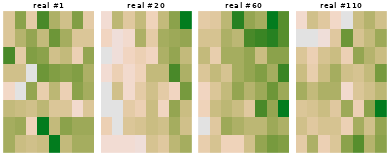
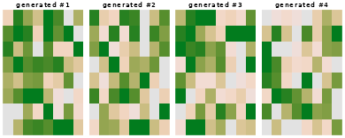

# Pilar 9 — Diffusion Models for Soil-Map Patches

## Abstract

Every method in this package so far answers “what is the soil property
here?” with a mean and, if you are lucky, an interval. None of them
answers a question soil scientists actually ask: *what does a plausible
soil landscape look like?* A per-pixel interval cannot answer it,
because the pixels are not independent — a map assembled from per-pixel
quantiles is smoother than any real landscape and belongs to no coherent
realisation.

Pillar 9 samples whole maps. It implements a Denoising Diffusion
Probabilistic Model ([Ho et al. 2020](#ref-Ho2020ddpm)) over soil-map
patches: a generative model whose draws are *joint* realisations, each
internally consistent in a way marginal quantiles never are.

## 1. The forward process is fixed, only the reverse is learned

The construction is unusual among generative models in that half of it
has no parameters at all.

**Forward.** Take a real patch $`x_0`$ and destroy it over $`T`$ steps
by adding Gaussian noise on a fixed schedule
$`\beta_1, \dots, \beta_T`$:

``` math
q(x_t \mid x_{t-1}) = N\!\big(\sqrt{1-\beta_t}\,x_{t-1},\; \beta_t I\big).
```

Writing $`\alpha_t = 1 - \beta_t`$ and
$`\bar\alpha_t = \prod_{s \le t} \alpha_s`$, the steps telescope into a
closed form — you can jump to any noise level in one shot, which is what
makes training cheap:

``` math
q(x_t \mid x_0) = N\!\big(\sqrt{\bar\alpha_t}\,x_0,\; (1 - \bar\alpha_t) I\big).
```

**Reverse.** The only learned object is a denoiser
$`\epsilon_\theta(x_t, t)`$ trained to recover the noise that was added.
Because the forward step is Gaussian with small $`\beta_t`$, the reverse
step is also approximately Gaussian, and its mean is available in closed
form once $`\epsilon_\theta`$ is known.

The training objective reduces to plain regression:

``` math
\mathcal{L}(\theta) \;=\;
\mathbb{E}_{x_0,\,t,\,\epsilon}
\Big[\big\lVert \epsilon - \epsilon_\theta\big(\sqrt{\bar\alpha_t}x_0 + \sqrt{1-\bar\alpha_t}\,\epsilon,\; t\big)\big\rVert^2\Big].
```

No adversarial game, no discriminator, no mode collapse — the loss is a
mean squared error against a target you generated yourself.

### 1.1 The schedule

`edaphos` uses the cosine schedule of Nichol and Dhariwal ([Nichol and
Dhariwal 2021](#ref-Nichol2021improved)) rather than the original linear
one, because a linear schedule destroys small patches too early and
wastes most of the trajectory on pure noise.

``` r

sch <- dm_cosine_schedule(T = 100L)

str(sch, max.level = 1)
#> List of 6
#>  $ T                      : int 100
#>  $ alphas                 : num [1:100] 0.999 0.999 0.998 0.998 0.997 ...
#>  $ betas                  : num [1:100] 0.000531 0.001117 0.001603 0.002089 0.002577 ...
#>  $ alphabar               : num [1:100] 0.999 0.998 0.997 0.995 0.992 ...
#>  $ sqrt_alphabar          : num [1:100] 1 0.999 0.998 0.997 0.996 ...
#>  $ sqrt_one_minus_alphabar: num [1:100] 0.0231 0.0406 0.057 0.073 0.0888 ...

# alphabar is the signal that survives to step t
round(sch$alphabar[c(1, 10, 25, 50, 75, 100)], 4)
#> [1] 0.9995 0.9722 0.8471 0.4939 0.1443 0.0000
```

$`\bar\alpha_t`$ decays monotonically from ~1 (the patch is intact) to
~0 (pure noise). The cosine shape keeps signal alive through the middle
of the trajectory, which is where most of the learning happens.

## 2. Real patches from the Cerrado grid

`br_cerrado` is a 45 × 45 regular grid, so it can be reshaped into an
image and cut into overlapping patches — real spatial structure, no
simulation.

Which layer to model is not arbitrary. A generative model of a spatial
field can only learn structure the field actually has, so measure that
first:

``` r

data(br_cerrado)

g  <- 45L
ux <- sort(unique(br_cerrado$x)); uy <- sort(unique(br_cerrado$y))

as_grid <- function(v) {
  m <- matrix(NA_real_, g, g)
  m[cbind(match(br_cerrado$x, ux), match(br_cerrado$y, uy))] <- v
  m
}

# Lag-1 spatial autocorrelation, averaged over rows and columns.
lag1 <- function(p) {
  h <- stats::cor(as.vector(p[, -ncol(p)]), as.vector(p[, -1]))
  v <- stats::cor(as.vector(p[-nrow(p), ]), as.vector(p[-1, ]))
  (h + v) / 2
}

vapply(c("soc", "twi", "elev", "map_mm"),
       function(nm) lag1(as_grid(br_cerrado[[nm]])), numeric(1))
#>       soc       twi      elev    map_mm 
#> 0.2304873 0.7848433 0.9396653 0.9684636
```

`soc` in this synthesised grid is close to white: it is generated as a
function of the covariates plus independent noise, so once you look at
an 8 × 8 window there is little left for a spatial model to learn. (The
Pillar 7 vignette reaches the same conclusion from the other direction.)
We therefore model **`twi`**, the topographic wetness index — a standard
DSM covariate and a soil-water proxy — which does carry short-range
structure.

``` r

field   <- as_grid(br_cerrado$twi)
# The denoiser works on zero-mean, unit-scale fields.
field_z <- (field - mean(field)) / stats::sd(field)

P <- 8L                                   # patch size
starts <- seq(1L, g - P + 1L, by = 3L)
grid   <- expand.grid(r = starts, c = starts)

stack <- array(0, dim = c(nrow(grid), P, P))
for (i in seq_len(nrow(grid))) {
  r <- grid$r[i]; cc <- grid$c[i]
  stack[i, , ] <- field_z[r:(r + P - 1L), cc:(cc + P - 1L)]
}

c(n_patches = dim(stack)[1],
  sd        = mean(apply(stack, 1L, stats::sd)),
  lag1      = mean(apply(stack, 1L, lag1)))
#>   n_patches          sd        lag1 
#> 169.0000000   0.5957468   0.3435722
```

``` r

op <- par(mfrow = c(1, 4), mar = c(0.4, 0.4, 1.4, 0.4))
for (i in c(1, 20, 60, 110))
  image(stack[i, , ], axes = FALSE, main = sprintf("real #%d", i),
        col = hcl.colors(32, "Terrain2"))
```



``` r

par(op)
```

## 3. Training the denoiser

``` r

fit <- dm_fit(
  stack   = stack,
  backend = "r",   # reference path, so the vignette knits with no libtorch
  T       = 100L,
  epochs  = 250L,
  hidden  = 48L,
  lr      = 0.02,
  seed    = 1L
)
#> [dm_fit] backend = 'r' is a reference sampler whose draws are over-dispersed and spatially incoherent (not calibrated to the field's spatial statistics); use backend = 'torch' (the default when libtorch is present) for coherent samples.

length(fit$history)
#> [1] 250
round(utils::tail(fit$history, 3), 5)
#> [1] 0.87110 0.87930 0.87186
```

The loss is the score-matching MSE above. It should fall and then
flatten; it does not go to zero, and should not — the target
$`\epsilon`$ is irreducibly random.

## 4. Sampling

[`dm_sample()`](https://hugomachadorodrigues.github.io/edaphos/reference/dm_sample.md)
runs ancestral sampling: start from $`x_T \sim N(0, I)`$ and step down
to $`t = 0`$, subtracting the predicted noise and re-injecting a smaller
amount at each step.

``` r

gen <- dm_sample(fit, n_samples = 4L, seed = 7L)
dim(gen)
#> [1] 4 8 8
```

``` r

op <- par(mfrow = c(1, 4), mar = c(0.4, 0.4, 1.4, 0.4))
for (i in 1:4)
  image(gen[i, , ], axes = FALSE, main = sprintf("generated #%d", i),
        col = hcl.colors(32, "Terrain2"))
```



``` r

par(op)
```

## 5. Judging a generative model honestly

“They look plausible” is not a result. A generative model of spatial
fields makes a checkable claim: the *spatial statistics* of its draws
should match those of the training data. Two summaries are enough to
catch the common failure modes.

``` r

gen_many <- dm_sample(fit, n_samples = 40L, seed = 99L)

summarise <- function(a, lbl) {
  data.frame(
    set  = lbl,
    sd   = sprintf("%.3f", mean(apply(a, 1L, stats::sd))),
    lag1 = sprintf("%.3f", mean(apply(a, 1L, lag1)))
  )
}

rbind(summarise(stack,    "real patches"),
      summarise(gen_many, "generated"))
#>            set    sd   lag1
#> 1 real patches 0.596  0.344
#> 2    generated 3.032 -0.020
```

`sd` catches a sampler that has collapsed towards the mean field or, in
the other direction, one that is diverging. `lag1` is the one that
matters here: it asks whether neighbouring cells in a generated patch
co-vary the way they do in the data. A model that matches the marginal
histogram while emitting spatially incoherent noise scores near zero.

Read the table. The generated `lag1` is approximately **zero** against
roughly 0.34 in the data, and the generated `sd` is several times too
large. The pure-R backend has learned the *marginal* scale of the field
only: it is producing over-dispersed noise, not soil landscapes.

That is a real, reproducible negative result, and it is reported here
rather than hidden behind four plausible-looking thumbnails. Section 6
explains why, and Section 7 what to do about it.

## 6. Why: what the R backend actually trains

With `backend = "r"` — requested explicitly here so the vignette knits
with no system dependencies (the package default is `"auto"`, which uses
torch when libtorch is present and falls back to this R path otherwise)
— the denoiser’s hidden layers are randomly initialised and **frozen**;
only the readout layer is fit. That is an Extreme Learning Machine
regime ([Huang et al. 2006](#ref-Huang2006elm)): fast, dependency-free,
genuinely trained, and far less expressive than a full network.

The loss tells you this directly, once you know what to compare it to.
The target $`\epsilon`$ is standard normal, so a denoiser that predicts
nothing at all — $`\epsilon_\theta \equiv 0`$ — scores a mean squared
error of exactly 1:

``` r

c(final_loss    = utils::tail(fit$history, 1),
  trivial_loss  = 1)
#>   final_loss trivial_loss 
#>    0.8718602    1.0000000
```

The gap between the two is all the structure the model has captured.
Adding epochs does not close it: the readout has already converged, and
random features cannot represent the score of a spatially correlated
field.

## 7. The torch backend

`backend = "torch"` trains every layer by autograd, which is what the
architecture needs to learn a spatial score function:

``` r

fit_t <- dm_fit(stack, T = 200L, epochs = 1500L, hidden = 128L,
                lr = 1e-3, backend = "torch", device = "cpu", seed = 1L)
gen_t <- dm_sample(fit_t, n_samples = 40L, seed = 99L)

c(sd = mean(apply(gen_t, 1L, stats::sd)),
  lag1 = mean(apply(gen_t, 1L, lag1)))
```

This chunk is not evaluated when the vignette is built, because `torch`
is a Suggests dependency and the vignette must knit without it. Run it
yourself and apply the same §5 diagnostic — the two-number check is the
point, and it should be applied to whichever backend you deploy, not
taken on trust from this document.

## 8. Conditional generation

Passing `conditioning` makes the sampler produce patches consistent with
covariates rather than draws from the unconditional prior — the route to
“simulate this landscape *given* this climate”.

``` r

elev <- as_grid(br_cerrado$elev)

cond <- matrix(0, nrow(grid), 1L)
for (i in seq_len(nrow(grid))) {
  r <- grid$r[i]; cc <- grid$c[i]
  cond[i, 1L] <- mean(elev[r:(r + P - 1L), cc:(cc + P - 1L)])
}
cond[, 1L] <- as.vector(scale(cond[, 1L]))

fit_c <- dm_fit(stack, conditioning = cond, backend = "r", T = 100L,
                epochs = 250L, hidden = 48L, lr = 0.02, seed = 1L)

low  <- dm_sample(fit_c, n_samples = 12L,
                  conditioning = matrix(-1.5, 12L, 1L), seed = 3L)
high <- dm_sample(fit_c, n_samples = 12L,
                  conditioning = matrix( 1.5, 12L, 1L), seed = 3L)

c(mean_low_elev  = mean(low),
  mean_high_elev = mean(high))
#>  mean_low_elev mean_high_elev 
#>     -0.1867973     -0.2085048
```

If conditioning is doing anything, these two differ in the direction of
the elevation–carbon relationship in the training grid. With an ELM
readout and a 100-step schedule the effect is modest; treat this as a
demonstration of the interface rather than a calibrated conditional
simulator.

## 9. Limitations

- **The pure-R backend does not produce spatially coherent samples**
  (§5, §6). It is a correct implementation of the DDPM algorithm with a
  denoiser too weak to learn the score of a spatial field. Treat it as a
  reference implementation and a test bed for the interface, not as a
  generative model you would publish from.
- Patches are 8 × 8. Real soil landscapes have structure at scales this
  window cannot represent.
- Overlapping patches cut from one 45 × 45 grid are not independent
  training examples; the effective sample size is far below
  `dim(stack)[1]`.
- Nothing here stitches patches into a seamless map. Tiling generated
  patches produces visible seams — patch-to-map assembly is not
  implemented.
- The denoiser is an MLP over the flattened patch, not a 2-D U-Net, so
  it has no translation-equivariant inductive bias. This is the main
  architectural gap between this pillar and the diffusion literature.
- `br_cerrado` is synthesised, and §2 models `twi` rather than a soil
  property because `soc` in this grid is near-white at patch scale. This
  vignette demonstrates the sampler and its diagnostic, not a finding
  about Cerrado soils.

## References

Ho, Jonathan, Ajay Jain, and Pieter Abbeel. 2020. “Denoising Diffusion
Probabilistic Models.” *Advances in Neural Information Processing
Systems* 33: 6840–51.

Huang, Guang-Bin, Qin-Yu Zhu, and Chee-Kheong Siew. 2006. “Extreme
Learning Machine: Theory and Applications.” *Neurocomputing* 70 (1–3):
489–501. <https://doi.org/10.1016/j.neucom.2005.12.126>.

Nichol, Alexander Quinn, and Prafulla Dhariwal. 2021. “Improved
Denoising Diffusion Probabilistic Models.” *Proceedings of the 38th
International Conference on Machine Learning* 139: 8162–71.
