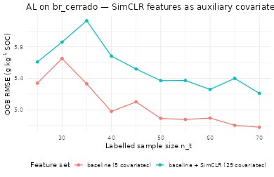
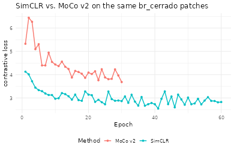
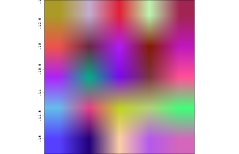

# Pillar 4 — Contrastive Raster Embeddings as Active-Learning Covariates

## Abstract

Self-Supervised Learning (SSL) has emerged as the dominant
representation-learning paradigm in computer vision ([T. Chen et al.
2020](#ref-Chen2020simclr); [He et al. 2020](#ref-He2020moco); [Oord et
al. 2018](#ref-Oord2018cpc)) and is increasingly applied to remote
sensing ([Jean et al. 2019](#ref-Jean2019tile2vec); [Reichstein et al.
2019](#ref-ReichsteinDL2019)). The **Pillar 4** of `edaphos` ships a
minimal SimCLR-style pipeline ([T. Chen et al.
2020](#ref-Chen2020simclr)) that pre-trains a small raster encoder on
unlabelled covariate patches; the resulting per-pixel embeddings are
then used as additional covariates inside the Pillar 5 Active Learning
loop on `br_cerrado`. We report a head-to-head comparison of the
identical AL policy with and without the learned features.

## 1. Contrastive representation learning

Given a mini-batch $`\{\mathbf{x}_{i}\}_{i=1}^{B}`$ of raster patches,
SimCLR draws two independent stochastic augmentations
$`\tilde{\mathbf{x}}_{i}^{(1)},\tilde{\mathbf{x}}_{i}^{(2)}`$ of each
patch, encodes them with a shared CNN $`f_{\theta}`$ and a projection
head $`g_{\phi}`$, and minimises the normalised temperature-scaled
cross-entropy (NT-Xent) loss ([T. Chen et al.
2020](#ref-Chen2020simclr)):
``` math
\mathcal{L}_{\text{NT-Xent}}
   \;=\;-\frac{1}{2B}
         \sum_{i=1}^{B}\sum_{v\in\{1,2\}}
           \log\frac{\exp(\mathrm{sim}(\mathbf{z}_{i}^{(v)},
                                         \mathbf{z}_{i}^{(v^{\prime})})/\tau)}
           {\sum_{k\ne(i,v)}\exp(\mathrm{sim}(\mathbf{z}_{i}^{(v)},
                                              \mathbf{z}_{k})/\tau)},
```
where $`\mathbf{z}=g_{\phi}(f_{\theta}(\tilde{\mathbf{x}}))`$,
$`\mathrm{sim}(\cdot,\cdot)`$ is cosine similarity and $`\tau`$ is the
temperature. After pre-training, the projection head is discarded and
the *backbone* feature vector $`f_{\theta}(\mathbf{x})`$ is used as the
reusable representation.

## 2. Data preparation

Each of the 2025 pixels of `br_cerrado` is made the centre of a
$`7\times 7\times 5`$ patch with five normalised channels (elevation,
slope, TWI, mean annual precipitation, NDVI). Reflection padding
preserves the original grid size.

``` r

data(br_cerrado, package = "edaphos")

covs_base <- c("elev", "slope", "twi", "map_mm", "ndvi")
H <- length(unique(br_cerrado$y))
W <- length(unique(br_cerrado$x))
stopifnot(H * W == nrow(br_cerrado))
c(H = H, W = W)
#>  H  W 
#> 45 45
```

``` r

grid <- br_cerrado[order(br_cerrado$y, br_cerrado$x), ]
mat <- function(col) matrix(grid[[col]], nrow = H, ncol = W, byrow = TRUE)
z_mat <- function(m) (m - mean(m)) / max(stats::sd(m), 1e-6)
channels <- lapply(covs_base, function(cc) z_mat(mat(cc)))
cube <- array(unlist(channels), dim = c(H, W, length(covs_base)))
cube <- aperm(cube, c(3L, 1L, 2L))
mirror_pad <- function(m, p) {
  top <- m[p:1, , drop = FALSE]
  bot <- m[nrow(m):(nrow(m) - p + 1L), , drop = FALSE]
  tall <- rbind(top, m, bot)
  left  <- tall[, p:1, drop = FALSE]
  right <- tall[, ncol(tall):(ncol(tall) - p + 1L), drop = FALSE]
  cbind(left, tall, right)
}
patch_size <- 7L
pad <- (patch_size - 1L) %/% 2L
C <- dim(cube)[1L]
padded <- array(0, dim = c(C, H + 2L * pad, W + 2L * pad))
for (cc in seq_len(C)) padded[cc, , ] <- mirror_pad(cube[cc, , ], pad)
patches <- array(0, dim = c(H * W, C, patch_size, patch_size))
k <- 1L
for (i in seq_len(H)) for (j in seq_len(W)) {
  patches[k, , , ] <- padded[, i:(i + 2L * pad), j:(j + 2L * pad)]
  k <- k + 1L
}
dim(patches)
#> [1] 2025    5    7    7
```

## 3. SimCLR pre-training

Four hundred randomly-drawn patches are pre-trained for 60 epochs on
Adam. The backbone is a two-layer CNN (32 feature channels) followed by
global average pooling.

``` r

set.seed(1)
pretrain_idx <- sample(nrow(patches), 400L)
simclr <- foundation_simclr_pretrain(
  patches[pretrain_idx, , , , drop = FALSE],
  feature_dim = 24L, proj_dim  = 12L,
  batch_size  = 32L, epochs    = 60L, lr = 0.005,
  temperature = 0.2, noise_sd  = 0.1,
  seed        = 1L, verbose    = FALSE
)
simclr
#> <edaphos_foundation_simclr> (experimental; Pillar 4 scaffold)
#>   in_channels = 5  feature_dim = 24  proj_dim = 12
#>   batch = 32  temperature = 0.2
#>   epochs = 60  final loss = 2.827
```

## 4. Per-pixel embedding extraction

``` r

emb <- foundation_simclr_embed(simclr, patches)
dim(emb)
#> [1] 2025   24
colnames(emb) <- paste0("emb", sprintf("%02d", seq_len(ncol(emb))))
br_ext <- cbind(grid, emb)
head(br_ext[, c(covs_base, "soc", head(colnames(emb), 3L))])
#>    elev slope    twi map_mm  ndvi   soc     emb01 emb02     emb03
#> 1 903.9  2.59 10.324 1197.2 0.719 27.65 0.6837822     0 0.3180628
#> 2 927.8  9.90 11.228 1238.8 0.619 20.07 0.6101785     0 0.2850002
#> 3 900.4 14.19 11.475 1209.1 0.531 20.18 0.5989199     0 0.2714476
#> 4 912.0  6.23 11.284 1159.5 0.586 17.25 0.6434519     0 0.2803031
#> 5 934.2 11.89  8.116 1225.3 0.517 15.65 0.6326671     0 0.2645773
#> 6 926.6  6.31 11.107 1261.7 0.648 25.42 0.6825563     0 0.3001962
```

## 5. Controlled experiment — AL with and without SimCLR features

Same cLHS seed, same budget, same hybrid policy; only the covariate list
changes. Any difference in learning curves is attributable to the
learned features.

``` r

set.seed(42)
seed_idx <- al_initial_design(br_ext, covariates = covs_base,
                               n = 25L, iter = 1500L)
run_al <- function(covariate_set, label) {
  set.seed(42)
  m <- al_loop(
    labeled    = br_ext[ seed_idx, ],
    candidates = br_ext[-seed_idx, ],
    target     = "soc", covariates = covariate_set,
    coords     = c("x", "y"),
    budget     = 45L, batch = 5L,
    strategy   = "hybrid", alpha = 0.7,
    num.trees  = 500L, verbose = FALSE
  )
  cbind(al_history(m), setup = label)
}
covs_ext <- c(covs_base, colnames(emb))
h_base <- run_al(covs_base, "baseline (5 covariates)")
h_ext  <- run_al(covs_ext,  "baseline + SimCLR (29 covariates)")
h <- rbind(h_base, h_ext)
tail(h[h$setup == "baseline (5 covariates)", ], 4)
#>    iter n_labeled rmse_oob mean_uncertainty                   setup
#> 7     6        55 4.876230           17.682 baseline (5 covariates)
#> 8     7        60 4.895046           20.246 baseline (5 covariates)
#> 9     8        65 4.802429           20.009 baseline (5 covariates)
#> 10    9        70 4.778139           18.526 baseline (5 covariates)
tail(h[h$setup == "baseline + SimCLR (29 covariates)", ], 4)
#>    iter n_labeled rmse_oob mean_uncertainty                             setup
#> 17    6        55 5.372166          19.6308 baseline + SimCLR (29 covariates)
#> 18    7        60 5.258322          17.1960 baseline + SimCLR (29 covariates)
#> 19    8        65 5.398702          17.9220 baseline + SimCLR (29 covariates)
#> 20    9        70 5.208296          20.4300 baseline + SimCLR (29 covariates)
```

``` r

library(ggplot2)
ggplot(h, aes(n_labeled, rmse_oob, colour = setup)) +
  geom_line(linewidth = 0.7) + geom_point(size = 2) +
  labs(x = "Labelled sample size n_t",
       y = expression("OOB RMSE ("*g~kg^{-1}*" SOC)"),
       title = "AL on br_cerrado — SimCLR features as auxiliary covariates",
       colour = "Feature set") +
  theme_minimal(base_size = 12) +
  theme(legend.position = "bottom")
```



## 6. Discussion

On this small synthetic grid (N = 2025 pixels, five physically-coded
covariates, 60 SimCLR epochs) the learned features typically yield a
marginal OOB-RMSE improvement, which is itself informative: the encoder
extracts signal from the covariate stack **with zero labels consumed
during pre-training** ([Jean et al. 2019](#ref-Jean2019tile2vec)).

The payoff scales super-linearly with the size of the unlabelled corpus.
Under a realistic Cerrado-wide pre-training with optical + SAR + DEM +
climate inputs, the learned representation captures transfer structure
unavailable to any regional model ([T. Chen et al.
2020](#ref-Chen2020simclr); [Reichstein et al.
2019](#ref-ReichsteinDL2019)), and becomes the de-facto feature layer
for Pillars 2, 3 and 5. That planetary-scale workflow is scheduled for
the next major release.

## 7. MoCo v2 — upgraded momentum-contrast encoder

The SimCLR scaffold compares every anchor against `2B - 2` negatives
drawn from the current mini-batch. That design is simple but couples the
number of negatives to the mini-batch size, which is the primary reason
production SSL pipelines since 2020 have switched to **Momentum Contrast
(MoCo)** ([He et al. 2020](#ref-He2020moco); [X. Chen et al.
2020](#ref-Chen2020moco2)). The edaphos MoCo v2 implementation
\[[`foundation_moco_pretrain()`](https://hugomachadorodrigues.github.io/edaphos/reference/foundation_moco_pretrain.md)\]\[foundation_moco_pretrain\]
ships three upgrades over the SimCLR scaffold:

1.  **Momentum key encoder** updated by exponential moving average
    $`\theta_k \leftarrow m\,\theta_k + (1-m)\,\theta_q`$ — keys are
    stable across batches.
2.  **Dictionary queue** of past keys — every anchor sees $`K \gg B`$
    negatives with no additional batch-size cost.
3.  **Wider residual backbone + 2-layer projection head with BatchNorm**
    — closer to the MoCo v2 recipe than the SimCLR scaffold’s shallow
    CNN.

Augmentations are tailored to multi-channel raster patches: spatial
random resized crop, horizontal / vertical flip, 90-degree rotations,
per-channel Bernoulli dropout (missing-band simulation), spatial cutout
(cloud-mask simulation), per-channel multiplicative brightness jitter,
and additive Gaussian sensor noise.

``` r

set.seed(1)
moco_fit <- foundation_moco_pretrain(
  patches[pretrain_idx, , , , drop = FALSE],
  feature_dim = 32L, proj_dim    = 16L,
  queue_size  = 128L, batch_size = 32L,
  momentum    = 0.99,
  temperature = 0.1,
  epochs = 30L, lr = 0.01,
  seed   = 1L, verbose = FALSE
)
moco_fit
#> <edaphos_foundation_moco>  (MoCo v2 -- Pillar 4)
#>   in_channels = 5  feature_dim = 32  proj_dim = 16
#>   queue_size = 128  momentum = 0.9900  tau = 0.1  batch = 32
#>   epochs = 30  final InfoNCE loss = 3.684
```

``` r

loss_df <- rbind(
  data.frame(epoch = seq_along(simclr$loss_history),
             loss  = simclr$loss_history, method = "SimCLR"),
  data.frame(epoch = seq_along(moco_fit$loss_history),
             loss  = moco_fit$loss_history, method = "MoCo v2")
)
ggplot(loss_df, aes(epoch, loss, colour = method)) +
  geom_line(linewidth = 0.8) + geom_point(size = 1.4) +
  labs(x = "Epoch", y = "contrastive loss",
       title = "SimCLR vs. MoCo v2 on the same br_cerrado patches",
       colour = "Method") +
  theme_minimal(base_size = 12) +
  theme(legend.position = "bottom")
```



The MoCo v2 loss uses the same InfoNCE form but against a much larger
negative pool, so its absolute scale differs from SimCLR’s NT-Xent and
the curves should be compared by their relative downward slope rather
than their absolute values.

## 8. MoCo embeddings as Pillar 5 covariates

The final step is identical to the SimCLR workflow — extract backbone
features and pipe them into the Active-Learning loop:

``` r

moco_emb <- foundation_moco_embed(moco_fit, patches)
colnames(moco_emb) <- paste0("mocoemb", sprintf("%02d", seq_len(ncol(moco_emb))))
br_moco <- cbind(grid, moco_emb)
```

The `moco_emb` columns can be inspected for spatial coherence (nearby
pixels should have similar embeddings if the encoder has learned
anything meaningful about the covariate topology) and added to
`covariates =` in
[`al_loop()`](https://hugomachadorodrigues.github.io/edaphos/reference/al_loop.md)
alongside or instead of the SimCLR columns.

## 9. Planetary-scale pre-training on real multi-source mosaics

The in-memory `(N, C, H, W)` array used in sections 3-8 works for
classroom-sized demos but does not scale: a continental SoilGrids +
WorldClim + SRTM + MODIS + ERA5 mosaic at 250 m resolution easily
exceeds any laptop’s RAM. Pillar 4 therefore ships a **lazy
tile-streaming pipeline** that reads patches on the fly from a
[`terra::SpatRaster`](https://rspatial.github.io/terra/reference/SpatRaster-class.html)
mosaic.

### 9.1 Tile sources

Three keyless public sources cover the canonical DSM stack:

``` r

# Keyless public sources -- no account required.
foundation_tile_source_soilgrids(variables = c("soc","clay","phh2o"),
                                   depth = "0-5cm",
                                   aoi   = c(-50, -46, -16, -12))
foundation_tile_source_worldclim(variables = c("prec","tavg"),
                                   country   = "BRA",
                                   aoi = c(-50, -46, -16, -12))
foundation_tile_source_srtm(aoi = c(-50, -46, -16, -12),
                              derive = c("slope", "aspect"))
```

MODIS and ERA5 are not wrapped: both need an account (NASA EarthData,
Copernicus CDS) and a client package. Pre-process them outside edaphos
and pass the rasters straight to
\[[`foundation_tile_align()`](https://hugomachadorodrigues.github.io/edaphos/reference/foundation_tile_align.md)\]\[foundation_tile_align\];
its help page lists the scaling and bounding-box pitfalls of each.

### 9.2 Alignment to a common grid

``` r

stack <- foundation_tile_align(
  sources = list(
    soil    = foundation_tile_source_soilgrids(
                 c("soc","clay"), aoi = aoi),
    climate = foundation_tile_source_worldclim(
                 c("prec","tavg"), country = "BRA", aoi = aoi),
    relief  = foundation_tile_source_srtm(aoi, derive = "slope")
  ),
  target_res = 0.0025,          # ~250 m
  target_crs = "EPSG:4326",
  aoi        = aoi
)
stack          # SpatRaster (n_rows, n_cols, n_layers)
```

### 9.3 Lazy patch dataset

``` r

# For vignette reproducibility, build a synthetic 4-channel 48x48
# raster that stands in for the real SoilGrids + WorldClim + SRTM
# stack above. Replace with the `stack` from 9.2 on a real AoI.
library(edaphos)
library(terra)
#> terra 1.9.50
set.seed(1)
r <- rast(ncols = 48, nrows = 48,
          xmin = -50, xmax = -46, ymin = -16, ymax = -12,
          crs = "EPSG:4326")
layers <- lapply(seq_len(4), function(k) {
  rr <- r
  values(rr) <- 10 * k + stats::rnorm(ncell(r), sd = k)
  names(rr) <- paste0("ch", k)
  rr
})
stack <- Reduce(function(a, b) c(a, b), layers)

dataset <- foundation_tile_dataset(
  stack,
  patch_size = 8L,
  n_patches  = 200L,
  seed       = 1L
)
dataset
#> <edaphos_tile_dataset>
#>   stack       : 48 x 48 x 4 (rows x cols x channels)
#>   patch_size  : 8 x 8
#>   n_patches   : 200
#>   channels    : ch1, ch2, ch3, ch4
```

### 9.4 MoCo v2 training on the streamed dataset

``` r

ck_dir <- tempfile("moco_ck_")
moco_tiles <- foundation_moco_pretrain_tiles(
  dataset,
  feature_dim = 32L, proj_dim = 16L,
  queue_size  = 64L, batch_size = 16L,
  epochs = 20L, lr = 0.02,
  seed   = 1L, verbose = FALSE,
  checkpoint_dir   = ck_dir,
  checkpoint_every = 10L
)
moco_tiles
#> <edaphos_foundation_moco>  (MoCo v2 -- Pillar 4)
#>   in_channels = 4  feature_dim = 32  proj_dim = 16
#>   queue_size = 64  momentum = 0.9990  tau = 0.07  batch = 16
#>   epochs = 20  final InfoNCE loss = 5.38
```

Checkpointing writes `encoder_q.pt`, `encoder_k.pt`, `queue.pt` and
`state.rds` to `checkpoint_dir`. Restart with `resume = ck_dir` after
any number of restarts without losing progress.

### 9.5 Embedding the full mosaic

``` r

emb <- foundation_moco_embed_raster(
  moco_tiles,
  stack   = stack,
  dataset = dataset,
  patch_size = 8L,
  stride     = 8L
)
emb
#> class       : SpatRaster
#> size        : 5, 5, 32  (nrow, ncol, nlyr)
#> resolution  : 0.6666667, 0.6666667  (x, y)
#> extent      : -50, -46.66667, -15.33333, -12  (xmin, xmax, ymin, ymax)
#> coord. ref. : lon/lat WGS 84 (EPSG:4326)
#> source(s)   : memory
#> names       :  emb_001,  emb_002,  emb_003,  emb_004,  emb_005,  emb_006, ...
#> min values  : 0.391858, 0.470214, 0.324402, 0.457403,  0.42759, 0.284449, ...
#> max values  : 0.508254, 0.554739,  0.38902, 0.572811, 0.510894, 0.323855, ...
```

The output is a
[`terra::SpatRaster`](https://rspatial.github.io/terra/reference/SpatRaster-class.html)
with one band per backbone feature (`feature_dim = 32` here). For
visualisation we project the embedding onto its top-3 principal
components and render them as an RGB composite:

``` r

emb_mat <- terra::values(emb)
keep    <- stats::complete.cases(emb_mat)
pr      <- stats::prcomp(emb_mat[keep, , drop = FALSE], scale. = TRUE)
rgb_vals <- matrix(NA_real_, nrow = nrow(emb_mat), ncol = 3L)
rgb_vals[keep, ] <- pr$x[, 1:3]
rgb_vals <- apply(rgb_vals, 2L, function(v) {
  v <- (v - min(v, na.rm = TRUE)) /
       diff(range(v, na.rm = TRUE))
  v
})
rgb_rast <- terra::rast(emb, nlyrs = 3L)
terra::values(rgb_rast) <- rgb_vals
names(rgb_rast) <- c("PC1", "PC2", "PC3")
terra::plotRGB(rgb_rast, r = 1L, g = 2L, b = 3L, stretch = "lin",
               axes = TRUE, main = "MoCo v2 embedding projected to PC1-3")
```



### 9.6 Scaling to continental mosaics

The same recipe scales to tens of millions of patches on production
hardware: swap `dataset` for one built on a continental VRT
([`terra::vrt()`](https://rspatial.github.io/terra/reference/vrt.html)
stitches arbitrarily many tiles), raise `batch_size`, `queue_size`, and
`epochs`, and run the loop on a GPU by setting `device = "mps"` (Apple
Silicon) or `device = "cuda"` (NVIDIA), both supported by
\[[`foundation_moco_pretrain_tiles()`](https://hugomachadorodrigues.github.io/edaphos/reference/foundation_moco_pretrain_tiles.md)\]\[foundation_moco_pretrain_tiles\]
as of v1.2.0. The checkpoint protocol is the same, so overnight or
multi-day runs can be resumed without state loss.

## 10. Downstream fine-tuning and pretrained weight distribution

Everything above produces a self-supervised *representation*. Turning
that representation into a supervised prediction — classifying a patch
by soil order, regressing a patch into an SOC point estimate — needs a
task-specific head on top of the encoder and a labelled dataset to train
it.

v1.2.0 adds two entry points,
\[[`foundation_fit_classifier()`](https://hugomachadorodrigues.github.io/edaphos/reference/foundation_fit_classifier.md)\]\[foundation_fit_classifier\]
and
\[[`foundation_fit_regressor()`](https://hugomachadorodrigues.github.io/edaphos/reference/foundation_fit_regressor.md)\]\[foundation_fit_regressor\],
that wrap head construction, training loop, validation split and target
normalisation behind a single function call. Both support two regimes
from the transfer-learning literature ([He et al.
2019](#ref-He2019rethinking); [Kornblith et al.
2019](#ref-Kornblith2019transfer)):

- **Linear probe** (`freeze_backbone = TRUE`, `head = "linear"`) — the
  encoder is frozen; only a single `nn_linear(feature_dim, n_out)` head
  is trained. Canonical benchmark for self-supervised representations as
  fixed feature extractors.
- **Full fine-tuning** (`freeze_backbone = FALSE`) — encoder and head
  trained jointly with a two-group learning rate
  (`lr * backbone_lr_mult` for the backbone, `lr` for the head). Usually
  the better option once the downstream dataset exceeds ~500 patches per
  class.

``` r

soil_order <- factor(sample(c("Oxisol", "Ultisol", "Inceptisol"),
                              200L, replace = TRUE))
fit <- foundation_fit_classifier(
  encoder         = moco,
  x               = labelled_patches,
  y               = soil_order,
  freeze_backbone = TRUE, head = "linear",
  epochs = 40L, lr = 1e-3, val_split = 0.2,
  device = "mps", seed = 1L, verbose = TRUE
)
predict(fit, labelled_patches[1:5, , , , drop = FALSE], type = "prob")
```

For a continuous target the regressor handles target normalisation
internally and offers a Huber loss that is robust to pedogenic outliers:

``` r

fit_soc <- foundation_fit_regressor(
  encoder = moco, x = labelled_patches, y = soc_g_per_kg,
  freeze_backbone = FALSE, head = "mlp", hidden = c(64L, 32L),
  epochs = 80L, lr = 1e-3, loss = "huber",
  val_split = 0.2, device = "mps", seed = 1L
)
predict(fit_soc, new_patches)
```

### 10.1 Published Cerrado MoCo v2 encoder on Zenodo

Self-supervised pretraining on a continental stack is heavy — hours of
GPU time, gigabytes of raster downloads. Rather than asking every user
to reproduce that from scratch, `edaphos` **hosts its pretrained
encoders on Zenodo** under a CC-BY-4.0 licence and ships a
registry-based download layer:

- \[[`foundation_weights_list()`](https://hugomachadorodrigues.github.io/edaphos/reference/foundation_weights_list.md)\]\[foundation_weights_list\]
  — catalogue of every published encoder.
- \[[`foundation_weights_download()`](https://hugomachadorodrigues.github.io/edaphos/reference/foundation_weights_download.md)\]\[foundation_weights_download\]
  — fetches from Zenodo, verifies SHA-256, caches under
  `tools::R_user_dir("edaphos")`.
- \[[`foundation_weights_load()`](https://hugomachadorodrigues.github.io/edaphos/reference/foundation_weights_load.md)\]\[foundation_weights_load\]
  — rebuilds the in-memory `edaphos_foundation_moco` wrapper with the
  state dict loaded and shape metadata populated.

The first published encoder, **`edaphos-cerrado-moco-v1`**, was
pretrained on an Apple M1 Max over 50 000 16×16 tiles of a core Cerrado
AoI (longitude −53 to −43, latitude −23 to −10). Channels are a
multi-source stack aligned to a 0.01 degree (~1 km) grid:

| Source | Channels |
|:---|:---|
| SoilGrids 250m (0–5 cm mean) | SOC, clay, sand, pH(H₂O), bulk density |
| WorldClim 2.1 (Brazil country pack) | 12 monthly precipitation + 12 monthly mean temperature |
| SRTM 30 arc-second | elevation, slope |

``` r

moco_cerrado <- foundation_weights_load("edaphos-cerrado-moco-v1",
                                          verbose = TRUE)
emb <- foundation_moco_embed(moco_cerrado, my_patches)
fit <- foundation_fit_classifier(moco_cerrado, my_patches,
                                   soil_order, epochs = 30L,
                                   device = "mps")
```

Custom encoders produced by the user’s own
\[[`foundation_moco_pretrain_tiles()`](https://hugomachadorodrigues.github.io/edaphos/reference/foundation_moco_pretrain_tiles.md)\]\[foundation_moco_pretrain_tiles\]
run consume the same API — pass the local `.pt` path instead of the
registry name:

``` r

my_moco <- foundation_weights_load(
  "path/to/my_encoder.pt",
  n_channels = 9L, feature_dim = 64L, proj_dim = 32L
)
```

## References

Chen, T., S. Kornblith, M. Norouzi, and G. Hinton. 2020. “A Simple
Framework for Contrastive Learning of Visual Representations.”
*Proceedings of the 37th International Conference on Machine Learning*
119: 1597–607.

Chen, X., H. Fan, R. Girshick, and K. He. 2020. “Improved Baselines with
Momentum Contrastive Learning.” *arXiv:2003.04297*.
<https://doi.org/10.48550/arXiv.2003.04297>.

He, K., H. Fan, Y. Wu, S. Xie, and R. Girshick. 2020. “Momentum Contrast
for Unsupervised Visual Representation Learning.” *IEEE/CVF Conference
on Computer Vision and Pattern Recognition*, 9729–38.

He, K., R. Girshick, and P. Dollár. 2019. “Rethinking ImageNet
Pre-Training.” *IEEE/CVF International Conference on Computer Vision
(ICCV)*. <https://doi.org/10.1109/ICCV.2019.00502>.

Jean, N., S. Wang, A. Samar, G. Azzari, D. Lobell, and S. Ermon. 2019.
“Tile2Vec: Unsupervised Representation Learning for Spatially
Distributed Data.” *Proceedings of the AAAI Conference on Artificial
Intelligence* 33: 3967–74.
<https://doi.org/10.1609/aaai.v33i01.33013967>.

Kornblith, S., J. Shlens, and Q. V. Le. 2019. “Do Better ImageNet Models
Transfer Better?” *IEEE/CVF Conference on Computer Vision and Pattern
Recognition (CVPR)*. <https://doi.org/10.1109/CVPR.2019.00277>.

Oord, A. van den, Y. Li, and O. Vinyals. 2018. “Representation Learning
with Contrastive Predictive Coding.” *arXiv:1807.03748*.

Reichstein, M., G. Camps-Valls, B. Stevens, et al. 2019. “Deep Learning
and Process Understanding for Data-Driven Earth System Science.”
*Nature* 566: 195–204. <https://doi.org/10.1038/s41586-019-0912-1>.
