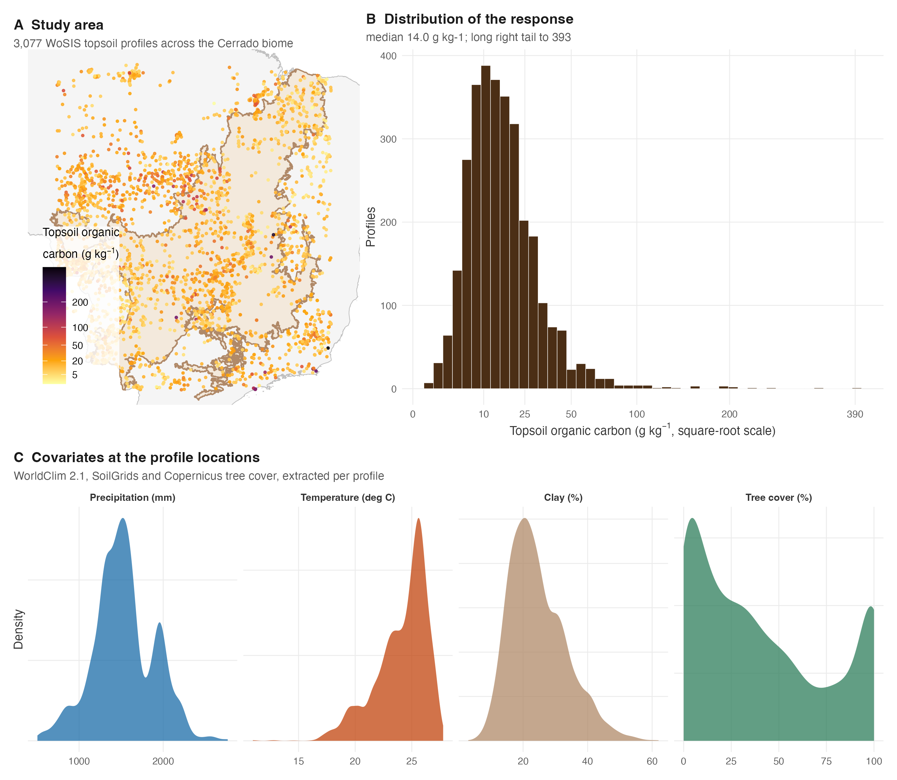
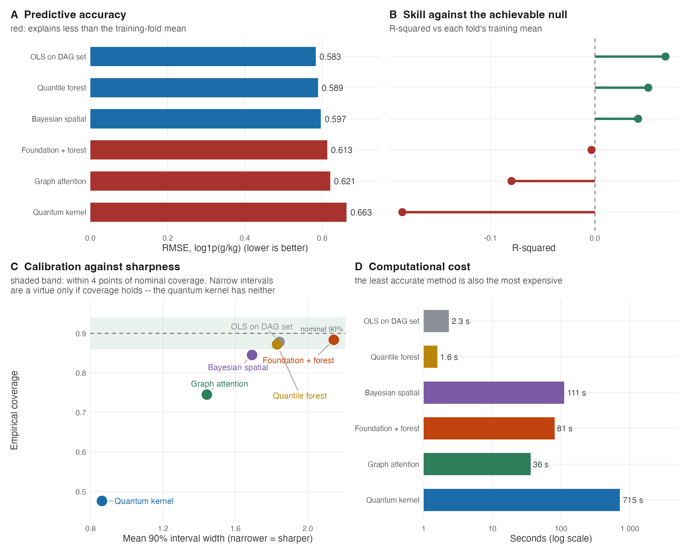
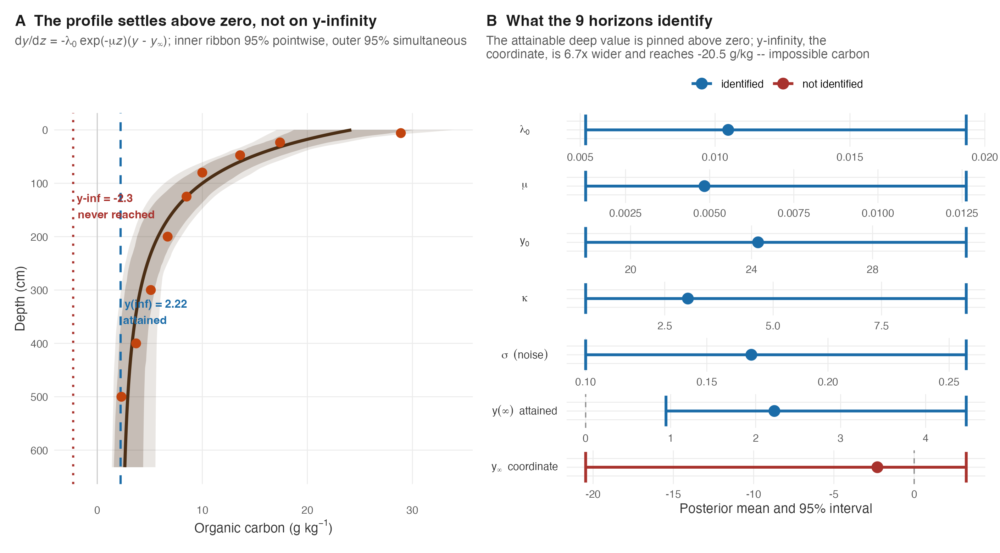
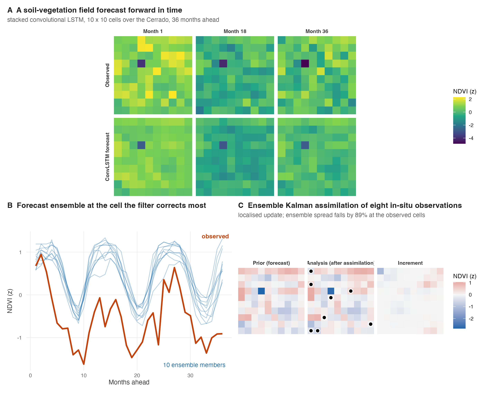
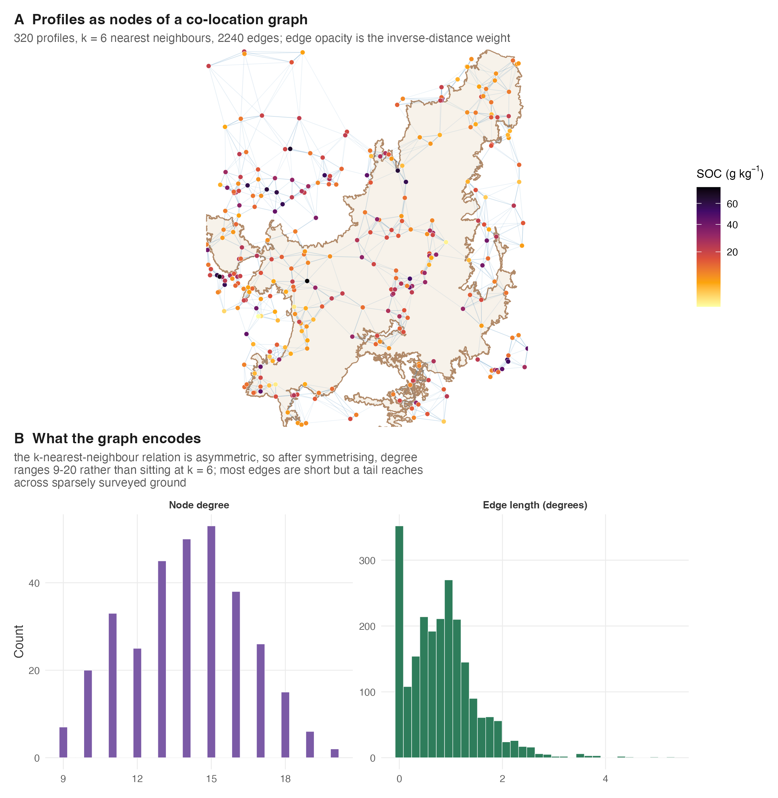
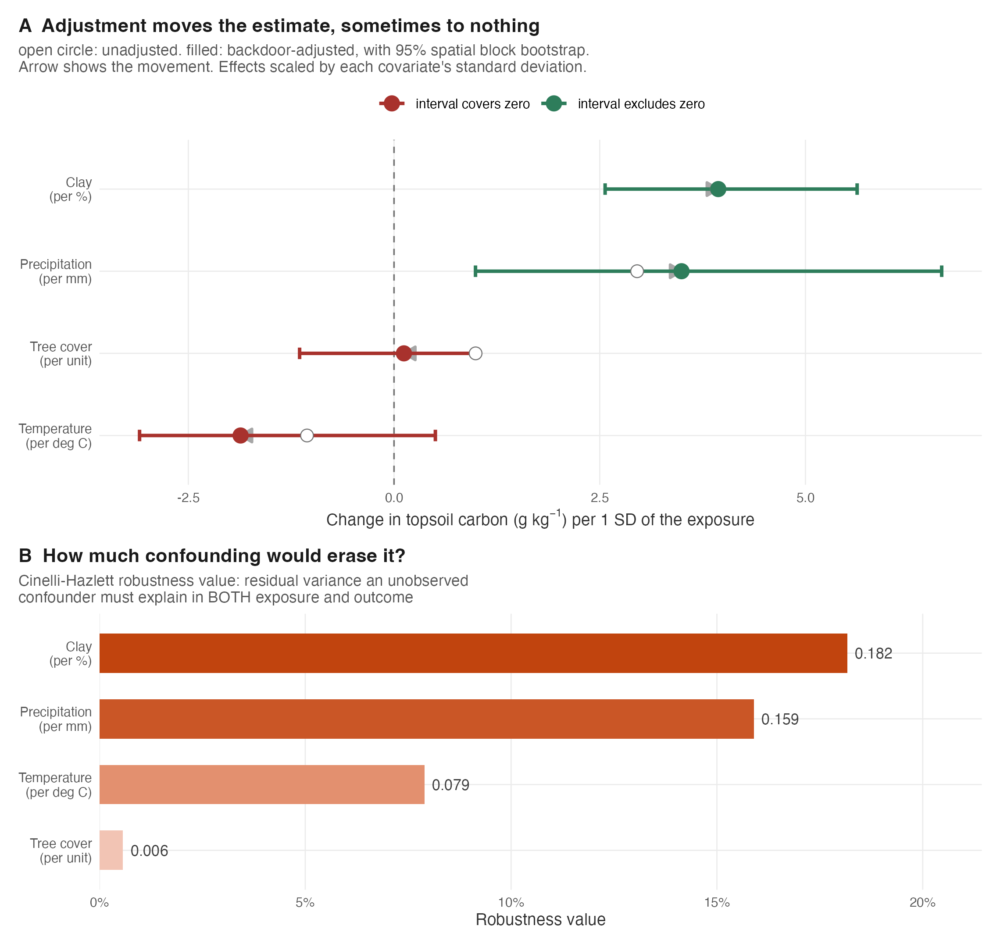
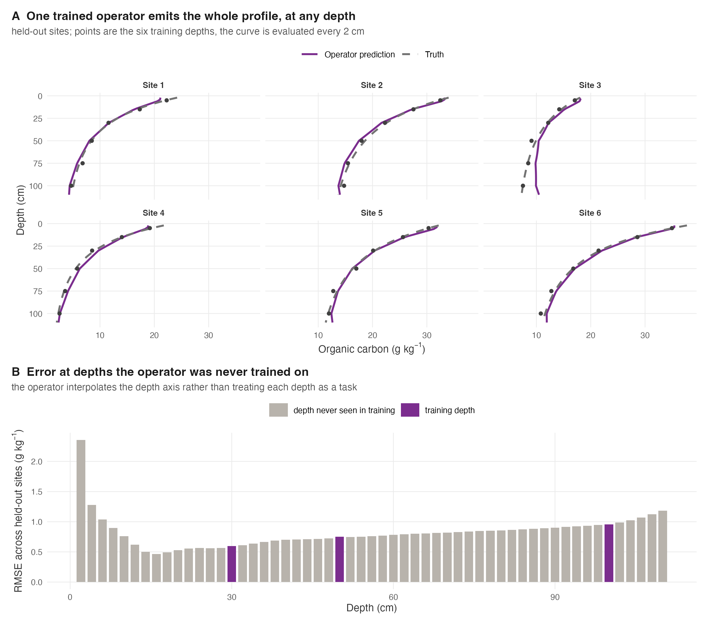

```{r setup, include = FALSE}
knitr::opts_chunk$set(echo = FALSE, message = FALSE, warning = FALSE,
                      fig.width = 6.5, fig.height = 4.2, dpi = 300)
suppressMessages(pkgload::load_all("..", quiet = TRUE))
ex  <- function(f) readRDS(system.file("extdata", f, package = "edaphos"))
fmt <- function(x, d = 3) formatC(x, format = "f", digits = d)
CAU <- ex("causal_cerrado_real_v2.rds")
B6  <- ex("benchmark_wosis_6pilar.rds")
EXTRA <- ex("interval_width_vs_extrapolation.rds")
CAP <- ex("capstone_campaign_results.rds")
GAT <- ex("pilar10_gat_tuning.rds")
```

Hugo Machado Rodrigues^1^\*

^1^ Range Cattle Research and Education Center, Institute of Food and Agricultural Sciences, University of Florida, Ona, Florida, United States of America

\* Corresponding author

E-mail: rodrigues.machado.hugo@gmail.com (HR)

# Abstract

Digital soil mapping has moved well beyond regression trees. Causal inference, physics-informed and generative deep learning, graph neural networks and quantum kernels have all been proposed for soil prediction, yet they are rarely compared under a common protocol, their predictive uncertainty is rarely calibrated, and the software that implements them is rarely reproducible end to end. We present edaphos, an R framework that implements ten families of such methods behind a single predictive-posterior class, so that any of them can be scored with the same proper and diagnostic measures, and whose every published figure is regenerated from data bundled with the package. We use the framework to run a matched, spatially blocked benchmark of six methods on real topsoil organic-carbon profiles from the World Soil Information Service over the Brazilian Cerrado, and to conduct a causal analysis on a larger draw of profiles from the same region. Four results follow. First, a mechanistic depth model helps on the typical profile and fails without warning on a small minority, and no scope statement available at fit time separates the two: over 1,105 real multi-horizon profiles the pedogenetic equation dy/dz = −λ₀e^(−μz)(y − y∞) predicts a held-out deepest horizon with a median absolute error of 0.76 g/kg and beats every baseline tested on paired comparison, while ten profiles carrying buried organic horizons — 1.1% of the set — account for 99% of its squared error, and the size of that failure correlates with nothing measurable in the horizons above it (|r| < 0.03). We also show that the equation's own solution does not converge to y∞ — the attainable deep value is y∞ + (y₀ − y∞)e^(−λ₀/μ), which the data identify while y∞ itself is unidentified and reaches into negative carbon — that a Gaussian likelihood on g/kg is the wrong observation model for a positive skewed concentration and costs real predictive accuracy, since replacing it wins on 720 of 1,105 profiles; and that an alternative derived from a steady-state carbon balance, in which the depth-dependence sits in the asymptote rather than in the rate, is mechanistically defensible at no cost in accuracy, the two being statistically indistinguishable once both are correctly specified. Second, the benchmark is deflationary: an ordinary-least-squares model restricted to a covariate set selected by an explicit pedogenetic directed acyclic graph is the most accurate and among the best calibrated of the six methods, and none of the five more elaborate methods beats it; two of them fall below the achievable null of the training-fold mean. That comparison is made on spatially blocked folds carrying a 68 km buffer, chosen as the longest identified variogram range in these data; without the buffer the graph attention network scores half a rank higher, which is what a method built on a spatial neighbour graph would be expected to gain from training points immediately across a block boundary. We further show that a pooled coverage rate hides where an interval is wrong: over held-out profiles lying 68 to 870 km from the nearest training profile, the geostatistical model's interval width tracks that distance (Spearman 0.74, and 0.72 after removing covariate-space distance) while the graph network's does not (-0.05, and -0.08 partial) even though its error does (0.11, p = 0.0004) -- so the only method whose predictive variance is a function of where the prediction is being made is the only one that widens where it should. Third, backdoor adjustment yields robust associations with explicit sensitivity bounds rather than identified causal effects, and adjustment collapses an apparent tree-cover association to near zero, demonstrating confounding directly; we also report that in these data the exposure postdates the outcome by a median of 38 years, which forecloses a causal reading on temporal grounds alone and which no adjustment set can repair. Fourth, instrumenting soil carbon with the embedding of a trained contrastive foundation encoder yields extremely relevant but invalid instruments: a first-stage F statistic in the thousands alongside a decisive rejection of the over-identification test, showing empirically that a learned representation does not manufacture a valid instrument. We argue that the contribution of a framework such as edaphos is not a new best predictor but a reproducible, calibration-consistent apparatus for asking which method helps, and for reporting honestly when none does.

# Introduction

Digital soil mapping predicts soil properties at unvisited locations from spatially exhaustive covariates that proxy the soil-forming factors of the scorpan framework [@McBratney2003]. Its workhorse — the random forest and its quantile variants — is accurate, fast, and well understood, and an expanding literature proposes to improve on it with methods borrowed from causal inference, deep learning, and quantum machine learning. That expansion has outrun the infrastructure needed to evaluate it.

Three problems recur. First, new methods are seldom compared under a common protocol. Differences in cross-validation scheme, in target transform, in ensemble budget and in the null against which skill is measured make published gains hard to attribute to the method rather than to the harness that surrounds it. A spatially blocked fold and a randomly assigned fold do not measure the same quantity; an R-squared computed against the global mean of the very rows being scored is an oracle, not a baseline. Second, point accuracy is reported far more often than calibrated uncertainty, even though a soil map is used to make decisions under that uncertainty, and even though a method can be simultaneously more accurate and badly overconfident. Third, the software that implements these methods is frequently not reproducible: results are reported from bundles whose inputs are not distributed, or from code paths whose defaults differ from the ones described.

A fourth problem is conceptual rather than infrastructural, and concerns causality. It is common in digital soil mapping to read a covariate's importance in a predictive model as evidence that the covariate causes the soil property [@Wadoux2020]. Zhang and Wadoux [@Zhang2026causal] argue that causal inference from observational soil data is possible only under conditions — an explicit causal model, causal sufficiency, and faithfulness — that such data rarely satisfy, and that the generative, process-informed view of causation is the one most compatible with those conditions. They caution in particular that causal sufficiency, the absence of unobserved confounding, is seldom achievable in practice.

This article presents edaphos, an R framework built around the position that these four problems are one problem. If ten method families are made to return the same kind of object, they can be scored by the same diagnostics; if the benchmark that scores them ships with its data, it can be re-run; and if the causal machinery reports sensitivity bounds rather than point effects, it states its own reliance on an assumption it cannot verify. We make three contributions, each reproducible from data bundled with the package.

1. A unified predictive-posterior and calibration interface (Materials and methods) that reduces the output of ten otherwise incompatible method families — quantile forests, Gibbs samplers, neural operators, diffusion models, graph networks — to a common currency, so that accuracy, coverage and proper scores are comparable across all of them.
2. A matched, spatially blocked, uncertainty-aware benchmark of six methods on real profiles (Results), whose honest conclusion is that a directed-acyclic-graph-informed ordinary least squares is the strongest method in the comparison.
3. A causal analysis (Results) that reports backdoor-adjusted associations paired with Cinelli–Hazlett robustness values, demonstrates confounding directly by adjustment, and reports a negative instrumental-variable result obtained with a real trained foundation encoder.

We deliberately foreground the negative findings. A framework that makes it easy to run a dozen methods is useful only if it makes it equally easy to see when they do not help.

# Materials and methods

## Origin and design principles

edaphos began as an attempt to reproduce, in one place, a set of methods that the digital soil mapping literature had proposed separately. That attempt surfaced a recurring obstacle: each method returned a different kind of object. A quantile random forest returns quantiles; a Gibbs sampler returns draws; a diffusion model returns whole simulated fields; a neural operator returns a function of depth. None of them could be scored against the others without first deciding, case by case, what "the uncertainty" meant. The comparisons that did exist in the literature had made those decisions implicitly and differently, which is one reason their conclusions were hard to reconcile.

The framework is organised around three design commitments that follow from that observation.

**One posterior, many methods.** Every predictive method returns, or can be coerced to, a single class, `edaphos_posterior`, that carries either a predictive sample or a mean and standard deviation for each target. Scoring is then a property of the class, not of the method, and a single routine applies the same measures to all of them. This is the framework's load-bearing abstraction: without it there is no honest cross-method benchmark.

**Honest defaults.** Several pillars ship two computational backends: a dependency-free implementation in pure R, and one built on `torch`. Where the pure-R path is a reference implementation rather than the trained architecture its function name implies, the package says so at run time and in the documentation, and the default resolves to the real implementation when its dependency is available. A user who calls a function named after a Fourier neural operator should either get a Fourier neural operator or be told plainly that they did not.

**Measured, not asserted.** Every quantitative claim in the package's own documentation is generated from a live measurement rather than transcribed. The benchmark tables, the check status and the test counts in the repository's status document are rendered from a machine-readable snapshot; the figures in this article are computed from bundled data at compile time. This is a deliberate response to a failure mode we encountered in our own earlier development, in which published tables and shipped result bundles drifted apart without any test noticing.

## The unified predictive posterior and calibration interface

An `edaphos_posterior` records, for a set of target locations, either a matrix of posterior draws or a mean-and-standard-deviation summary, together with metadata describing the query type. `uncertainty_calibrate()` scores any such object with measures that are meaningful for all of them: the continuous ranked probability score (CRPS), a strictly proper score that rewards sharp and calibrated predictive distributions together; the prediction-interval coverage probability (PICP) at a nominal level, which should approach that level; the mean prediction-interval width (MPIW), which measures sharpness and is only interpretable alongside coverage; and a reliability curve relating nominal to empirical coverage.

The value of forcing every method through this interface is that it makes overconfidence visible. A method can win on root-mean-square error while producing intervals that contain the truth far less often than they claim, and a table reporting accuracy alone will rank it first. Both behaviours appear in our benchmark.

## Backend resolution

Pillars whose methods are neural in nature accept a `backend` argument that resolves in three ways. `"auto"`, the default, selects the `torch` implementation when a working `libtorch` is present and otherwise falls back to the pure-R path, so that the package remains installable and checkable on machines without a deep-learning toolchain. `"torch"` requests the trained implementation and fails with an explicit message if its dependency is absent. `"r"` forces the reference path and emits a one-time note describing what that path actually computes. This arrangement keeps a continuous-integration machine and a reviewer's laptop able to run the package while ensuring that a scientific result is never silently produced by a scaffold.

## Data

All analyses use real soil profiles, not simulated ones. Topsoil organic-carbon observations were retrieved from the World Soil Information Service [@Batjes2024wosis] through the public Web Feature Service of the International Soil Reference and Information Centre, restricted to the Brazilian Cerrado and to horizons whose upper boundary lies within the topsoil, and reduced to one shallowest horizon per profile. Covariates were extracted at each profile location from WorldClim version 2.1 [@Fick2017worldclim] for mean annual temperature, mean annual precipitation and elevation; from SoilGrids [@Hengl2017soilgrids] for clay, sand and bulk density in the surface layer; and from a Copernicus fractional tree-cover product. Slope was derived from the elevation surface.

The study area and the data are shown in Fig 1.

```{r fig1, out.width="100%"}

```

**Fig 1. Study area, response and covariates.** (A) The Cerrado biome (shaded) within Brazil, with the WoSIS topsoil profiles used in the causal analysis coloured by organic carbon on a square-root scale. (B) The response is strongly right-skewed, which is why the benchmark models a log transform. (C) Marginal distributions of the four covariates that appear in the causal analysis, extracted at the profile locations.

Two draws are used. The benchmark uses `r B6$n_profiles` profiles, the sample on which the cross-pillar comparison and all method-tuning work were carried out. The causal analysis uses a larger and more recent retrieval of `r CAU$n_profiles` profiles over the same region and the same covariate stack, assembled after the pipeline was rewritten to fetch every covariate from its public source. Every covariate is open-licensed and retrieved from a public endpoint, so the entire dataset is regenerable from profile coordinates alone by the scripts distributed with the package.

## The ten method families

Table 1 lists the ten pillars, the method each implements, and the object each returns. The subsections that follow give, for each, a minimal example that runs against data distributed with the package together with its real output, so that a reader can see what the interface looks like before deciding whether the method is worth their data. Every example below was executed to produce the output shown.

**Table 1. The ten method families implemented in edaphos.** "Returns" names the object a user receives; all of them can be coerced to the common predictive-posterior class.

| Pillar | Method | Principal entry points | Returns |
|:--|:--|:--|:--|
| 1 | Causal inference: backdoor adjustment on a pedogenetic graph, sensitivity analysis, instrumental variables | `causal_adjustment_set`, `causal_estimate_effect`, `causal_sensitivity_from_lm`, `causal_iv_fit_2sls` | adjusted association, robustness value |
| 2 | Physics-informed: a pedogenetic ordinary differential equation for the depth profile, and a neural variant | `piml_profile_fit`, `piml_profile_fit_bayesian`, `piml_neural_ode_fit` | attainable deep value, ODE parameters, posterior profile |
| 3 | Four-dimensional pedometry: convolutional recurrent forecasting and ensemble Kalman assimilation. *Demonstrated on a vegetation-index cube; no repeated soil series exists here* | `temporal_convlstm_fit`, `temporal_convlstm_rollout`, `temporal_kalman_update` | forecast ensemble, analysis field |
| 4 | Foundation models: momentum-contrastive pre-training on unlabelled raster patches | `foundation_tile_dataset`, `foundation_moco_pretrain_tiles`, `foundation_embed_at_coords` | encoder, per-site embedding |
| 5 | Active learning: hypercube seeding plus uncertainty-and-diversity batch selection | `al_initial_design`, `al_fit`, `al_query`, `al_update` | ranked sampling sites |
| 6 | Quantum machine learning: a simulated feature-map kernel and its ridge regressor | `quantum_feature_map`, `quantum_kernel`, `quantum_krr_posterior` | Gram matrix, predictive posterior |
| 7 | Bayesian hierarchical spatial model with a Gibbs sampler and exact kriging prediction | `bhs_fit`, `predict.edaphos_bhs` | posterior draws, kriged surface |
| 8 | Neural operators over depth-function space | `no_deeponet_fit`, `no_fno_fit` | operator mapping covariates to a profile |
| 9 | Diffusion models generating whole map patches | `dm_cosine_schedule`, `dm_fit`, `dm_sample` | joint spatial realisations |
| 10 | Graph attention over profile co-location graphs | `gnn_build_graph`, `gnn_fit`, `gnn_embed` | node predictions, embeddings |

### Causal inference

The first pillar converts a pedologist's hand-drawn structural model into a machine-checked identification step. Given a graph and an exposure–outcome pair, it derives the minimal backdoor adjustment set, fits the adjusted model, and returns the adjusted estimate alongside the unadjusted one and a robustness value.

```r
b   <- readRDS(system.file("extdata", "causal_cerrado_real_v2.rds", package = "edaphos"))
d   <- b$profiles                       # 3077 WoSIS topsoil profiles, Cerrado
dag <- causal_cerrado_real_dag()        # 11-node pedogenetic graph
causal_adjustment_set(dag, "wc_landcover_trees", "soc_topsoil_gkg", effect = "total")
#> [1] "wc_bio_01" "wc_bio_12"
causal_estimate_effect(d, dag, "wc_landcover_trees", "soc_topsoil_gkg", effect = "total")
#> <edaphos_causal_effect>
#>   wc_landcover_trees -> soc_topsoil_gkg   (estimator: lm)
#>   adjustment set : {wc_bio_01, wc_bio_12}
#>   total effect   : 0.3469   (95% CI: -1.79, 2.484)
#>   naive effect   : 2.864   (un-adjusted, likely confounded)
```

Fig 2 renders the graph, the adjustment set the criterion returns, and the graph's own falsification test.

```{r fig2, out.width="100%"}

```

**Fig 2. A pedogenetic graph and its test.** (A) The shipped Cerrado graph, with the exposure, the outcome, and the adjustment set the backdoor criterion returns for the total effect of tree cover highlighted. (B) Every conditional independence the graph implies, tested against the profiles: most are rejected, so the graph as drawn is not compatible with the data it is applied to.

The adjustment set is derived, not chosen by the analyst, and the eightfold collapse from the unadjusted to the adjusted estimate is the pillar's central demonstration. Reported alongside it, the robustness value states that a confounder explaining 18.2% of residual variance in both exposure and outcome would be needed to nullify the clay association, and under 1% to nullify the tree-cover one.

The printed label names the estimand that was requested, which matters more than it may appear: on these data the total effect of clay on carbon is 0.449 g/kg per percent while its direct effect, additionally blocking the texture and bulk-density mediators, is 0.044 with an interval covering zero. The two differ by an order of magnitude, and reporting one under the other's name would misstate the finding.

### Physics-informed machine learning

The second pillar represents a depth profile not as a regression on depth but as the solution of a pedogenetic differential equation. This is the pillar closest to the generative, process-informed view of causation that Zhang and Wadoux [@Zhang2026causal] advocate: the mechanism is written down, and the data inform its parameters. It is also where writing a mechanism down turns out to make three separate claims checkable, and where two of them fail.

**The data.** The pillar is fitted to 1,105 real multi-horizon soil profiles from the World Soil Information Service over the Brazilian Cerrado — 5,853 horizons, reaching a median of 150 cm and a maximum of 740 cm. This matters enough to state plainly: earlier versions of this software illustrated the pillar on a seven-point profile with no provenance, while these profiles sat unused in the same repository because the preparation scripts kept only the shallowest horizon of each. Every result below is on the real profiles.

**The equation, and what its parameters mean.** The model is

$$\frac{dy}{dz} = -\lambda_0 e^{-\mu z}\,(y - y_\infty),$$

a relaxation whose rate decays with depth. It is separable, and integrating gives

$$y(z) = y_\infty + (y_0 - y_\infty)\exp\!\left[-\kappa\left(1 - e^{-\mu z}\right)\right], \qquad \kappa = \lambda_0/\mu,$$

so that $y(\infty) = y_\infty + (y_0 - y_\infty)e^{-\kappa}$.

**The profile does not reach $y_\infty$.** Because the rate decays, the exponent saturates and the profile traverses only a fraction $1 - e^{-\kappa}$ of the $y_0 \to y_\infty$ gap before the dynamics run out. $y_\infty$ is an equilibrium coordinate of the differential equation, not a soil property; the attainable deep value is $y(\infty)$. The distinction is not cosmetic. Across the 1,105 profiles the median $\kappa$ is 1.6, so the median profile closes 80% of its gap and stops, and on shallow profiles the two quantities routinely differ in sign.

Three consequences follow, and the implementation is built around them. First, $\lambda_0$ and $\mu$ are near-collinear: the likelihood constrains their ratio $\kappa$ far better than either alone. Second, a prior on $y_\infty$ is a prior on an unattained quantity that enters the fit through a ratio the data barely determine. Third, nothing in a free-sign parameterisation keeps $\mu \ge 0$ or the concentrations positive. We therefore estimate the model in the coordinates $(y_0, A, \kappa, \mu)$ with $A = y(\infty)$, all exponentiated, and recover $\lambda_0$ and $y_\infty$ for reporting. Refitting all 1,105 profiles under both parameterisations, the original returned a physically inadmissible fit for 56% of them — 113 of 207 in a matched subset had $\mu < 0$, a decay rate that *grows* exponentially with depth — against none under the positive coordinates.

Three further specification choices follow from having real horizons. First, a laboratory value is the average of a property over a horizon, not a point reading at its mid-depth; because the solution is closed-form, the depth-average over each horizon is available by Gauss–Legendre quadrature at negligible cost, and is used throughout. This is the same observation-operator problem equal-area splines address explicitly [@Bishop1999; @Malone2009]. Second, the observation noise $\sigma$ is sampled with a half-$t$ prior rather than plugged in from the residuals of the mode, which widens the predictive interval on the pedon below from 3.6 to 7.1 g/kg.

Third, and least obviously, the likelihood is not Gaussian. Organic carbon is positive and right-skewed, and a Gaussian on g/kg with one $\sigma$ makes three errors: it places predictive mass below zero, it assumes additive error where laboratory error is multiplicative, and — the consequential one — it weights every horizon by the same *absolute* discrepancy. A profile running from 29 g/kg at the surface to 2.3 g/kg at 5 m is then fitted almost entirely by its topsoil, and the deep horizons that carry all the information about the asymptote contribute almost nothing. We use a lognormal likelihood parameterised so that the model's prediction is the *mean* of the observation, which matters because that prediction is a horizon average and therefore a mass-preserving quantity; a median-preserving parameterisation would bias every layer downward.

The change is not cosmetic. On the pedon below the Gaussian fit misses the deepest horizon by 90% of its value while the lognormal caps its worst relative residual at 23%. On leave-the-deepest-horizon-out prediction across all 1,105 profiles the lognormal wins on 720 of them (paired Wilcoxon $p = 2\times10^{-30}$), improving mean absolute error from 2.20 to 2.00 g/kg, and it wins even on root-mean-square error — the criterion the Gaussian optimises by construction — because over-weighting the topsoil is precisely what makes a profile extrapolate its deepest horizon badly.

```r
pedon <- readRDS(system.file("extdata", "capstone_campaign_results.rds",
                             package = "edaphos"))$piml_profile_obs
fit <- piml_profile_fit(pedon$depth_mid, pedon$soc_g_kg,
                        top = pedon$top, bottom = pedon$bottom)
print(fit)
#> <edaphos_piml_profile>
#>   dy/dz = -lambda0 * exp(-mu*z) * (y - y_inf)
#>   lambda0 = 0.009613  mu = 0.004151
#>   y0      = 23.45     y(Inf) = 1.982      (kappa = 2.32)
#>   y_inf   = -0.3678   (ODE coordinate, not the attained value)
#>   n obs   = 9 (layer)         rmse = 2.517
#>   converged = TRUE
```

Table 2 gives the posterior for that pedon — WoSIS profile 1115679, nine horizons to 550 cm.

**Table 2. Posterior summary of the pedogenetic equation's parameters.** Laplace approximation over a real nine-horizon WoSIS profile reaching 550 cm, fitted through the horizon-average operator with a lognormal likelihood. Intervals are 2.5% and 97.5% posterior quantiles. The first four rows are the equation's symbols, the next two the coordinates the model is estimated in, and the last the sampled observation noise, here a coefficient of variation.

```{r piml-table}
tb <- ex("capstone_campaign_results.rds")$piml_params_table
knitr::kable(data.frame(
  Parameter = tb$param, Meaning = tb$meaning,
  Mean = fmt(tb$mean, 4), SD = fmt(tb$sd, 4),
  `2.5%` = fmt(tb$ci_lo, 3), `97.5%` = fmt(tb$ci_hi, 3),
  check.names = FALSE), align = "llrrrr")
```

```{r fig3, out.width="100%"}

```

**Fig 3. A depth profile as the solution of a pedogenetic equation.** (A) The fitted mean (line) against the nine measured horizons (points), with the attained deep value $y(\infty)$ and the unattained coordinate $y_\infty$ marked. Two ribbons are drawn because they claim different things: the inner is the 95% *pointwise* band, which covers each depth taken separately, and the outer is the 95% *simultaneous* (sup-t) band [@MontielOlea2019], which covers the whole curve. Over the `r length(CAP$piml_profile_depths)` depths plotted the distinction is not decorative — resampling the posterior draws through this fit, the pointwise ribbon contains a complete curve only 80% of the time. A single ribbon labelled "the 95% band" for a profile is the pointwise one, and it overstates its coverage. (B) Posterior mean and 95% interval for each parameter; the attainable deep value is identified and strictly positive, while $y_\infty$ is not identified and its interval crosses into impossible territory.

The surface concentration is 24.2 g/kg with an interval 12.6 g/kg wide, and the attainable deep value is identified and admissible at 2.22 g/kg, interval [0.95, 4.48]. The coordinate $y_\infty$ is not identified: its interval, [−20.5, 3.2], is 6.7 times wider and reaches into negative carbon. Nine horizons to 550 cm do constrain where the profile is heading; what they cannot do is locate a coordinate the profile never visits. The last row is the observation noise, a coefficient of variation of 0.17 — a 17% relative error, which is the right order for laboratory organic carbon and would have been an uninterpretable 1.5 g/kg under the Gaussian.

**Does the mechanism buy anything?** This is the question a depth model must answer. We ran two pre-declared tasks over all 1,105 profiles — hold out an interior horizon (interpolation), and hold out the deepest horizon (extrapolation) — against six competitors including an equal-area spline, a pooled depth-as-covariate random forest that sees other profiles' data, and two zero-parameter baselines. The equal-area spline does not extrapolate below the observed range and abstains from the second task; that is reported rather than papered over by clamping it to its last value.

Root-mean-square error is the wrong statistic to lead with here, and saying why is part of the result. On the extrapolation task every method lands near 14 g/kg — the ODE at 14.04, copying the nearest measured horizon at 14.05, the random forest at 14.05 — and those numbers are not measuring the methods. Ten profiles out of 935, 1.1% of the set, account for 99% of the ODE's sum of squares; removing them takes its RMSE from 14.74 to 1.54. The extreme case is a profile whose horizon at 125 cm holds 430 g/kg of carbon with 3.0 g/kg immediately above it: a buried organic horizon, which a monotone depth function cannot represent and, more importantly, cannot anticipate. We therefore report mean absolute error as the primary criterion and RMSE alongside it, and treat the difference between them as the finding rather than as a nuisance.

On that criterion the mechanism does help (Table 3). The ODE reaches MAE 1.82 g/kg with a median absolute error of 0.76, against 2.06 for copying the nearest horizon, 2.07 for its own nested $\mu = 0$ special case and 2.67 for the pooled random forest. Paired across profiles it beats copying the nearest horizon on 579 of 935 (Wilcoxon $p = 3\times10^{-16}$), its nested special case on 646 (${p = 1\times10^{-42}}$) and the random forest on 679 (${p = 4\times10^{-50}}$).

**Table 3. Leave-the-deepest-horizon-out prediction on 935 WoSIS profiles.** The profiles whose *training* horizons are monotone — the model's declared validity domain, judged without reading the horizon being predicted. MAE is the primary criterion: RMSE on this task is dominated by ten profiles with buried organic horizons and separates the methods by less than 0.5%.

```{r piml-bench}
bt <- ex("piml_depth_benchmark.rds")$extrapolation_monotone$table
bt <- bt[order(bt$MAE), ]
knitr::kable(data.frame(
  Method = bt$method, MAE = fmt(bt$MAE, 3), RMSE = fmt(bt$RMSE, 2),
  `Mean error` = fmt(bt$ME, 3), CCC = fmt(bt$CCC, 3),
  check.names = FALSE), align = "lrrrr")
```

**What declaring the validity domain does, and does not, buy.** $\lambda_0 > 0$ with a first-order relaxation makes $y(z)$ monotone by construction, so an argillic bulge, an E horizon beneath an A, or a buried A cannot be represented at all; 15.4% of these profiles are not monotone even in their training horizons. It is tempting to read that as a scope statement that rescues the model, and an earlier version of this analysis did exactly that, reporting that restricting to the monotone profiles moved the RMSE from 14.04 to 1.51.

That reduction was an artefact of how the restriction was computed. Judging a profile monotone from its *complete* record — including the deepest horizon, the one the extrapolation task holds out — excludes precisely those profiles whose held-out horizon jumps, which are the hard cases. Sixty of the 935 profiles are monotone in their training horizons but not in the full record, and they are enough to carry the result: the largest jump of the held-out horizon is 17 g/kg among the profiles the leaking criterion admits and 427 g/kg among those the honest one admits. Computing the criterion from training horizons only, as it must be, leaves the RMSE at 14.74 rather than 1.51.

The honest conclusion is narrower than the one that stratification appeared to license, and more useful. The model predicts the typical held-out horizon well — median absolute error 0.76 g/kg — and fails catastrophically on about one profile in a hundred, and nothing available at fit time distinguishes the two. The absolute correlation between the size of the jump in the held-out horizon and the number of training horizons, the depth of the prediction, or the model's own extrapolation diagnostic is below 0.03 in every case. A depth function fitted to the horizons above cannot know that a buried organic horizon is coming, and declaring a validity domain does not change that, because the declaration would have to be made from the same information.

**A derivable alternative, and it wins.** The equation above is not derived from anything. There is no process in soil physics that yields a relaxation rate decaying exponentially with depth; what the equation *is*, exactly, is the Russell and Moore exponential depth function [reviewed in @Minasny2016] carrying a fourth shape parameter. The defensible steady-state balance for soil carbon is an advection–reaction–diffusion equation [@Elzein1995; @Braakhekke2011]. Dropping bioturbation, valid below the mixed surface layer, and writing $v$ for the advection velocity and $k$ for the decomposition rate constant,

$$v\frac{dC}{dz} = I(z) - kC \qquad\Longleftrightarrow\qquad \frac{dC}{dz} = -\lambda\left(C - \frac{I(z)}{k}\right), \quad \lambda = k/v.$$

That is a relaxation with a **constant** rate toward a **depth-varying** target. The depth-dependence belongs in the asymptote, not in the rate. Root carbon input declines exponentially with depth [@Gale1987; @Jackson1996], $I(z) = I_0e^{-z/z_r}$, so with a mineral-associated floor $A$ the target is $A + Be^{-z/z_r}$ where $B = I_0/k$. This too is closed-form, its layer averages are analytic, and every parameter is positive with a literature prior — $z_r$ from the Jackson et al. rooting parameter, $A$ from mineral-association saturation.

On the same 935 profiles the derived model leads the table on mean absolute error, 1.76 against 1.82 g/kg, but the difference is not significant: it wins on 486 profiles against 449, paired Wilcoxon $p = 0.25$. On the nine-horizon pedon it does fit markedly better, 0.44 against 2.52 g/kg.

That null result is worth stating carefully, because an earlier version of this analysis reached the opposite conclusion. Under a Gaussian likelihood the derived model appeared to win decisively ($p = 2\times10^{-6}$). Correcting the likelihood for both models removed the difference — the Gaussian was penalising the attenuating-rate form more, because over-weighting the topsoil hurts the model whose flexibility lies in the deep tail. The two forms are, on this evidence, equally accurate at predicting a held-out deepest horizon.

We therefore recommend the derived form on the grounds it can actually be defended — it follows from a carbon balance, its parameters are positive and priorable from published rooting and stabilisation values, and its asymptote is a parameter of the equation rather than a coordinate the profile never reaches — and not on grounds of accuracy, where the honest answer is a tie. The attenuating-rate equation is retained because it is what the depth-function literature has used and it is the fair comparator.

**Can the fitted profile be mapped?** A pedometrician handed a per-pedon depth model reaches for the obvious two-stage workflow: fit the equation at every profile, then krige its parameters onto a grid. That workflow needs the fitted parameters to be spatially structured, and nobody had checked whether they are. Fitting all 1,105 profiles and computing the empirical variogram of each parameter over 386,729 point pairs gives an answer that is neither the hoped-for yes nor a flat no (Fig 4).

Two of the four parameters have an identified variogram. The attainable deep value reaches a sill with a nugget-to-sill ratio of 0.63 at a range of 68 km, and the depth attenuation 0.56 at 55 km — moderate spatial dependence in the sense of Cambardella et al. [@Cambardella1994]. The other two, the surface value and the total relaxation, fit ranges of 12 and 9 km, which lie *below the closest pair of profiles in the archive*: the nearest lag these 1,105 profiles support is 35 km, so a range shorter than that is interpolated through empty space rather than measured. Their spatial structure, whatever it is, operates at a scale this survey cannot see.

The consequence for mapping is the same in both cases and it is unfavourable. Even the two identified ranges, 55 and 68 km, are far shorter than the median separation between profiles in this archive, so kriging the parameters would be extrapolating almost everywhere. Regressing each on climate and terrain first does not rescue the situation: those covariates explain between 1.4% and 8.1% of the parameters' variance, and the residual variograms are no better structured than the raw ones.

We therefore report the two-stage workflow as inadequate on these data, and for a reason that is about sampling design rather than about the equation: the depth function varies over tens of kilometres while the profiles are hundreds of kilometres apart. The remedy is not a better kriging model but a one-stage hierarchical one, in which the profile parameters are regressed on covariates and share a spatial random effect, so that the shape of a profile at an unvisited site is borrowed rather than interpolated. We flag that as the pillar's next step rather than claim it here.

```{r fig4, out.width="100%"}
knitr::include_graphics("figures/Fig4.png")
```

**Fig 4. The depth function varies faster than the survey can see.** Empirical variograms of the four fitted parameters across 1,105 profiles, 386,729 point pairs, with fitted exponential models. Two parameters reach a sill within the observed separations at ranges of 55 and 68 km; the other two fit ranges shorter than the 35 km nearest lag the archive supports, and are therefore not identified. Point size is the number of pairs in each lag.

**Do the parameters mean what they are called?** The pillar claims its parameters are identified and interpretable. Identified we demonstrate; interpretable we had only asserted. Two directional predictions test it, both falsifiable, and they come out differently.

The first concerns the deep floor. Hassink [-@Hassink1997] showed that a soil's capacity to preserve carbon in association with its fine fraction rises with the mass of that fraction, so if $y(\infty)$ is a mineral-associated floor it must increase with clay plus silt; if it is only a shape parameter, there is no reason it should. Across 812 monotone profiles with a texture estimate within 5 km, it does: the slope of $\log y(\infty)$ on clay + silt is $+0.0067$ per percentage point ($p = 0.03$; Spearman $\rho = 0.10$, $p = 0.004$), which over the observed 17–93% range corresponds to a 1.7-fold change in the fitted floor. The direction is the predicted one and the association is not an artefact of one parameterisation — the attained value of the attenuating-rate form gives the same sign more strongly ($p = 0.002$).

The magnitude, however, is negligible: texture explains 0.5% of the variance in the fitted floor. With 812 profiles a relation this weak clears significance easily, and the texture is a SoilGrids prediction rather than a measurement, from a product trained partly on the same WoSIS archive. We report this as consistent with the mechanism and as very much weaker than a confirmation of it.

The second anchor fails, and how it fails is the more useful result. Jobbágy and Jackson [-@Jobbagy2000] summarise the vertical distribution of soil carbon by $\beta$ in $Y(d) = 1 - \beta^d$, a whole-profile shape statistic defined without reference to any of our parameters, and their central finding is that vegetation shapes it. Our fitted depth functions imply a $\beta$ with a median of 0.971 and a 5–95% range of 0.957–0.980 — a narrow, pedologically unremarkable band. But it moves with nothing outside the fit. Regressed on tree cover it gives a slope of $-4\times10^{-5}$ ($p = 0.97$, $R^2 = 0.00003$); on clay, $R^2 < 0.0001$; on mean annual precipitation, $R^2 = 0.0005$. The one external variable it does track is the depth to which the profile happened to be dug ($R^2 = 0.024$, $p = 1\times10^{-5}$), which is a property of the survey rather than of the soil.

What it does track is us. Sixty-three percent of the variance in the implied $\beta$ is explained by the fitted surface concentration alone. That is mechanically unsurprising once stated — within this model family the cumulative curve is pinned by the contrast between the surface and the deep value, which is what the parameterisation encodes — but it is decisive for the anchor's purpose. A statistic that is two-thirds determined by a parameter of the model it is meant to validate is not external evidence, and we withdraw it as such. It remains a useful check that the fitted profiles are not absurd; it is not a check that they are right.

**What we do not claim.** Four limits belong with this pillar. The model is monotone and cannot represent horizon differentiation; the 15.4% of profiles whose training horizons already violate monotonicity are not a rounding error but the pedologically most interesting ones, and the profiles that violate it only in the horizon being predicted cannot be excluded in advance at all. Carbon *stock*, not concentration, is the quantity that is conserved and mapped, and we cannot validate against it here: WoSIS bulk density covers 3.9% of these horizons and only eight profiles completely, so a stock comparison would rest on a pedotransfer function rather than on measurement. Depth is not time — Jenny's kinetics are written in $t$, and substituting $z$ for $t$ is legitimate only through the advection velocity $v$, which appears in the derived form above and nowhere in the original equation. And the interpretation of the parameters rests, on the evidence above, on one weak directional association and one anchor that turned out to be internal.


### Four-dimensional pedometry: machinery without a soil test case

The third pillar treats a gridded environmental property as a space–time field. A stacked convolutional recurrent network propagates a spatial hidden state through a cube of monthly drivers to produce a multi-step gridded forecast, and a stochastic ensemble Kalman filter with Gaspari–Cohn localisation assimilates point observations into that field.

We state at the outset what the target of the real-data demonstration is, because the machinery is general and the demonstration is not. The cube in Fig 5 is MODIS MOD13Q1 vegetation index driven by NASA POWER precipitation and temperature; **no soil quantity appears in it**. The reason is not that the pillar was built for vegetation but that the archive cannot support the soil version: across the 1,095 Cerrado profiles, exactly six locations were sampled in more than one year, all of them a single 1981-versus-1986 pair. Six two-point series are not a space–time field. Pillar 3 is therefore a demonstrator of the forecasting and assimilation machinery on a real, densely observed cube, not a validated soil-carbon forecast, and nothing in Results rests on it.

```r
cube <- temporal_synth_soc_cube(H = 8, W = 8, T_total = 12, seed = 1)
tt   <- temporal_cube_to_tensor(cube)
dim(tt$sequence)   # (batch, time, channel, row, col)
#> [1]  1 12  2  8  8
ens <- array(rnorm(30 * 8 * 8, 20, 2), c(30, 8, 8))   # 30-member prior
post <- temporal_kalman_update(ens, obs_value = c(24, 18), obs_row = c(3, 6),
                               obs_col = c(3, 6), obs_sd = 0.5,
                               localization_radius = 3, seed = 1)
```

The filter is exact at observed cells and the localisation radius controls how far an observation is allowed to influence the field, which on small ensembles is what prevents spurious long-range corrections. Fig 5 shows both halves of the pillar on a real Cerrado vegetation-index cube.

```{r fig5, out.width="100%"}

```

**Fig 5. Forecasting a field and assimilating observations into it.** The target throughout is MODIS vegetation index, not soil carbon. (A) Observed and forecast vegetation index at three lead times over a 10 x 10 Cerrado grid. (B) The ten-member forecast ensemble at the cell the filter corrects most, against the observed trajectory. (C) Ensemble Kalman assimilation of eight point observations: the prior field, the analysis, and the increment between them. Those eight points are **synthetic** — the withheld truth field plus Gaussian noise of 0.15 z-units — because no repeated in-situ series exists here to assimilate; panel C therefore demonstrates that the filter is exact at observed cells and correctly localised, and cannot speak to its skill against real measurements. The update is localised, so distant cells are left alone.

### Foundation models

The fourth pillar pre-trains a convolutional encoder on unlabelled raster patches with a momentum-contrastive objective, then extracts a fixed-length embedding at arbitrary profile coordinates for use as covariates downstream.

```r
data(br_cerrado)
stack <- terra::rast(...)                       # any multi-channel covariate stack
ds    <- foundation_tile_dataset(stack, patch_size = 8L, n_patches = 512L, seed = 1L)
enc   <- foundation_moco_pretrain_tiles(ds, feature_dim = 32L, proj_dim = 16L,
                                        queue_size = 256L, batch_size = 16L,
                                        epochs = 400L, device = "cpu", seed = 1L)
range(enc$loss_history)
#> [1] 3.656 6.271        # InfoNCE falls from 6.27 towards 3.66
```

Fig 6 shows what the objective does and what the resulting embedding organises by.

```{r fig6, out.width="100%"}

```

**Fig 6. Self-supervised pre-training on unlabelled raster patches.** (A) The InfoNCE objective over patches drawn from the bundled covariate grid, against the uninformative reference log(1 + K) for a queue of K negatives. (B) The first two principal components of the encoder output, coloured by the mean topographic wetness of each patch — a covariate the encoder is never given as a target, yet which the representation separates.

The contrastive loss falls well below the uninformative reference of log(1 + K) = 5.55 for a queue of 256 negatives, confirming that the objective is learning rather than collapsing. We are explicit that a demonstration of this size — a few hundred optimiser steps over a few hundred small patches — establishes that the machinery works, not that a useful foundation model has been trained; the encoder used for the instrumental-variable analysis in Results is a substantially larger one, and it is still small by the standards of the term.

**The encoder is shown a prediction of its own label.** The 31-channel stack the pre-trained encoder consumes begins with SoilGrids organic carbon, alongside clay, sand, pH and bulk density, and that stack is cut into a patch centred on each profile at *inference* time as well as during pre-training. The embeddings handed to the downstream head are therefore a nonlinear function of another product's published estimate of the quantity being predicted, evaluated at the coordinate being predicted, and SoilGrids is itself fitted partly to WoSIS. Spatial blocking does not break this path: the raster is global and fold-independent. This is feature leakage, and it must be declared for any embedding number in this paper to be read correctly.

We measured what it is worth rather than reasoning about it. Extracting the SoilGrids 0–5 cm carbon layer at all 1,095 profile coordinates gives a correlation with the WoSIS topsoil measurement of only $r = 0.25$ (Spearman 0.26), and a linear model using that leaked layer *alone*, scored on the same buffered blocks, reaches an NSE of $-0.012$ — below the achievable null. The leaked channel carries essentially no skill for this label, most likely for the same reason as in the causal analysis: it is a 2020 estimate of a 1982 measurement. So the leakage cannot account for the embeddings' position in the benchmark, and correcting it would not rescue them.

If anything the finding runs the other way, and it is worth stating plainly: the foundation embeddings rank fourth of six *even with a prediction of the label inside their input*, behind an ordinary least-squares fit on ten covariates that never sees it. The clean experiment — an encoder pre-trained on a stack with the carbon channel removed — requires retraining and is not reported here; we flag it as the fix rather than claim to have performed it.

### Active learning

The fifth pillar closes the survey loop. It seeds a design by conditioned Latin hypercube sampling over the covariate space, fits a quantile regression forest to the labelled profiles, and selects the next batch of field sites by trading predictive-interval width against diversity, optionally rejecting candidates that violate physical plausibility gates.

```r
data(br_cerrado)
seed_idx <- al_initial_design(br_cerrado, c("elev","slope","twi","map_mm"), n = 30)
fit  <- al_fit(br_cerrado[seed_idx, ], target = "soc",
               covariates = c("elev","slope","twi","map_mm"))
nxt  <- al_query(fit, candidates = br_cerrado[-seed_idx, ], n_select = 6)
```

Fig 7 shows the decision the pillar exists to make.

```{r fig7, out.width="100%"}
knitr::include_graphics("figures/Fig7.png")
```

**Fig 7. Choosing where to sample next.** (A) The predictive-interval width over the demonstration grid, the profiles already labelled, and the batch of eight the policy selects. (B) The batch is drawn from the uncertain tail of the candidate pool. (C) Where that batch falls in covariate space: it spreads along wetness but concentrates at high precipitation, because the policy chases variance and variance here is not uniformly distributed.

The selected batch has a mean 80% prediction-interval width of 21.3 g/kg against 14.2 g/kg for the candidate pool as a whole, confirming that the query is drawn from the uncertain part of the covariate space rather than from the bulk.

### Quantum machine learning

The sixth pillar simulates the ZZ feature-map encoding circuit on a classical state-vector simulator, forms the fidelity Gram matrix, and uses it as the kernel of a closed-form ridge regressor with a Gaussian-process-equivalent posterior.

```r
data(br_cerrado)
X <- quantum_scale(as.matrix(br_cerrado[1:40, c("elev","twi","map_mm")]))
K <- quantum_kernel(X, n_qubits = 3L, reps = 2L)
dim(K); round(K[1:3, 1:3], 4)
```

The simulator is exact: against the analytic single-qubit kernel cos²(x − y) the maximum deviation is 4 × 10⁻¹⁶, and against an independently written Kronecker-product simulator 3 × 10⁻¹⁶. Fig 8 contrasts the resulting similarity structure with a Gaussian kernel on the same profiles.

```{r fig8, out.width="100%"}

```

**Fig 8. What the quantum feature map does to similarity.** (A) Gram matrices over the same 60 profiles, ordered by organic carbon. (B) Kernel value against distance in covariate space: the Gaussian kernel decays monotonically, while the ZZ feature map does not — the non-monotone structure is the property the method is proposed for, and on this task also the reason it generalises worst of the six methods compared below.

Two things should be said plainly. No quantum hardware is involved — this is a simulation of a quantum kernel, not a quantum computation — and the simulator's cost is exponential in qubit count, which bounds practical use to small feature sets.

### Bayesian hierarchical spatial models

The seventh pillar fits the geostatistical linear model with an exponentially correlated latent Gaussian process by a conjugate Gibbs sampler, and predicts at unsampled sites through the exact Gaussian conditional applied per posterior draw — Bayesian kriging with the parameter uncertainty carried through.

```r
data(br_cerrado)
d <- br_cerrado[1:120, ]; d$lon <- d$x; d$lat <- d$y
fit <- bhs_fit(d, soc ~ twi + map_mm, coords = c("lon","lat"),
               nmcmc = 2000, burn = 500, seed = 1)
print(fit)
pred <- predict(fit, newdata = d[1:5, ])
```

Fig 9 shows the surface and, more importantly, its uncertainty.

```{r fig9, out.width="100%"}
knitr::include_graphics("figures/Fig9.png")
```

**Fig 9. Bayesian kriging with the parameter uncertainty carried through.** (A) Posterior mean surface conditioned on 150 observations. (B) Posterior standard deviation: it contracts near data and widens away from it. (C) The same relationship directly — predictive uncertainty against distance to the nearest observation. A nugget-only interval would be flat here, which is how the omission in an earlier version of this package was caught.

The predictive variance at a new site is the full kriging expression, σ² + τ² − σ⁴r₀ᵀΣ⁻¹r₀, rather than the nugget alone; an earlier version of this package omitted the kriging term, which inflated predictive intervals and is the kind of error that a calibration diagnostic catches immediately.

### Neural operators

The eighth pillar learns the map from a site's covariates to its entire depth profile as a function, so that a single trained operator emits carbon at any depth, including depths never sampled in training.

```r
don <- no_deeponet_fit(depths, targets, covariates, backend = "r",
                       branch_hidden = 24L, trunk_hidden = 24L, epochs = 400L)
pred <- predict(don, newcov, newdepths = c(10, 35, 70))   # off-grid depths
```

Fig 10 shows the property that distinguishes an operator from a per-depth regression.

```{r fig10, out.width="100%"}

```

**Fig 10. One operator, evaluated at any depth.** (A) Held-out sites: the trained operator's profile (solid) against the generating profile (dashed), with the six training depths marked. The curve is evaluated every 2 cm, including depths never seen in training. (B) Error by depth, distinguishing the six trained depths from the rest — the operator interpolates the depth axis rather than treating each depth as a separate task.

Two honest qualifications belong with this pillar. The pure-R DeepONet freezes its first hidden layers and trains a random-feature readout, which does learn the operator on our synthetic profiles; the pure-R Fourier operator, by contrast, freezes its spectral multipliers and does not learn the operator at all, which is why the default now resolves to the trained implementation when it is available and the reference path announces itself. And no real multi-horizon depth data ships with the package, so this pillar is demonstrated on profiles generated by the pedogenetic equation of Pillar 2 rather than on measured pedons.

### Diffusion models

The ninth pillar fits a denoising diffusion probabilistic model over small patches cut from a gridded layer and draws new whole-patch realisations, so that uncertainty is expressed as joint spatial realisations rather than as independent per-pixel intervals.

```r
sch <- dm_cosine_schedule(T = 100L)
fit <- dm_fit(patches, backend = "r", T = 100L, epochs = 250L, seed = 1L)
gen <- dm_sample(fit, n_samples = 40L, seed = 99L)
```

Fig 11 shows why this pillar needs a quantitative check rather than a visual one.

```{r fig11, out.width="100%"}
knitr::include_graphics("figures/Fig11.png")
```

**Fig 11. Generated map patches and the check that separates them.** (A) Real patches and draws from the pure-R reference sampler and the trained sampler; colour is clipped so the reference sampler's saturated cells are themselves diagnostic. (B) Within-patch standard deviation against lag-one spatial autocorrelation, one point per patch, with 80% ellipses. The trained sampler's cloud overlaps the real patches; the reference sampler sits far from both axes' targets.

The evaluation we recommend, and implement, is a two-number check: the standard deviation and the lag-one spatial autocorrelation of generated patches against real ones. It is what reveals that the pure-R reference sampler produces fields that are over-dispersed and spatially incoherent while the trained implementation produces coherent ones — a failure that visual inspection of a generated map would not catch. This pillar is demonstrated on a terrain index rather than on carbon, because carbon in the bundled demonstration grid is near-white at patch scale and therefore offers a generative model nothing spatial to learn.

### Graph attention networks

The tenth pillar treats profiles as nodes of a co-location graph, with edges from k-nearest neighbours in geographic or covariate space, and fits a multi-head graph attention network transductively so that each profile's prediction draws on its neighbours through learned attention weights.

```r
d <- br_cerrado; d$lon <- d$x; d$lat <- d$y
g <- gnn_build_graph(d, k = 6L, feature_cols = c("elev","slope","twi","map_mm"))
fit <- gnn_fit(g, targets = d$soc, backend = "r", hidden = 16L, n_heads = 4L,
               epochs = 120L, seed = 1L)
emb <- gnn_embed(fit)
```

Fig 12 shows the graph that this pillar builds before any learning happens.

```{r fig12, out.width="100%"}

```

**Fig 12. The co-location graph.** (A) A sample of profiles as nodes over the Cerrado, joined to their six nearest neighbours in geographic space, with edge opacity proportional to the inverse-distance weight and nodes coloured by organic carbon. (B) Degree and edge-length distributions: symmetrising the nearest-neighbour relation lifts degree above k, and while most edges are short, a tail of long edges spans sparsely surveyed ground.

The implementation carries two mechanisms without which it underperforms a linear model: a skip connection that hands the raw node covariates to the readout alongside the aggregated embedding, and early stopping selected on an internal validation split rather than on training loss. Both were added after measurement showed the aggregated-only, training-loss-selected variant scoring below the mean predictor.

## Evaluation protocol

The benchmark scores all six methods on the same `r length(B6$folds)` spatially blocked cross-validation folds, obtained by k-means clustering of profile coordinates, and on the `r B6$response_scale` scale of organic carbon. Blocking matters: profiles close together are not independent, and random folds allow a model to interpolate between near-duplicate neighbours, inflating apparent skill.

Skill is measured against the *achievable* null — the mean of each fold's **training** partition — rather than against the mean of the rows being scored. The distinction is not pedantic, and we report both because we got it wrong ourselves. The conventional R-squared divides by the variance of the test values about *their own* mean, which is computed from the very observations being scored: a model compared against it is compared against an oracle. That is the harder bar, since the test mean is by construction the best constant predictor of the test set, and a method can clear the achievable null while failing the oracle one. Under the achievable null a method that explains nothing scores zero and a method worse than predicting the training mean scores negative; two of our six methods do, and three fall below the oracle. `edaphos_nse()` takes the null as a required argument for exactly this reason.

Folds are spatially blocked *with a buffer*. Blocking alone leaves training rows immediately across the block boundary from test rows — on these coordinates the nearest was 12.3 km away, well inside the 55–68 km range at which the fitted depth-function parameters are still correlated — and blocking without a dead zone under-states generalisation error [@Roberts2017]. `spatial_block_folds()` discards training rows within 68 km of any test row, reports how many it discarded, and returns the realised minimum distance so the exclusion is auditable rather than implicit.

Ensemble size is reported rather than forced equal. Methods differ in how many posterior draws or ensemble members they naturally produce, and equalising them would penalise or flatter methods arbitrarily; reading a ranking without the budget column compares budgets rather than methods.

## Causal protocol

The causal analysis proceeds from an explicit directed acyclic graph encoding published Cerrado pedogenesis: elevation influences climate and slope; climate influences land cover; climate, land cover, texture and bulk density influence topsoil carbon. For each exposure, the minimal sufficient adjustment set is computed from that graph by the backdoor criterion. The adjusted association is estimated by ordinary least squares including the exposure and its adjustment set, with confidence intervals from a spatial block bootstrap of 500 resamples over 20 k-means clusters, which respects the spatial dependence that an ordinary bootstrap would ignore.

Because backdoor adjustment identifies an effect only under causal sufficiency — the assumption Zhang and Wadoux [@Zhang2026causal] identify as seldom achievable — every estimate is reported alongside a Cinelli–Hazlett robustness value [@CinelliHazlett2020]. The robustness value is the proportion of residual variance that an unobserved confounder would have to explain in *both* the exposure and the outcome in order to drive the estimate to zero. It converts an unverifiable assumption into a quantity a reader can weigh against their own knowledge of what might have been omitted.

We additionally attempt instrumental-variable estimation, which identifies an effect under a different assumption: that the instrument influences the outcome only through the exposure. We use the leading principal components of a trained contrastive foundation encoder's landscape embedding as instruments for mean annual precipitation, estimate by two-stage least squares, and test the exclusion restriction with the Sargan over-identification test.

## Reproducibility

The article, the package and its data form one artefact. The manuscript is compiled from an R Markdown source whose code chunks read the result bundles distributed inside the package, so no number in the text is transcribed by hand and none can drift from the data that produced it. Those bundles are in turn regenerated from their public sources by scripts distributed in the repository. The package's test suite includes assertions that bind published figures to the shipped bundles, so a change to either without the other fails the suite.

# Results

## A directed-acyclic-graph-informed linear model is the strongest method

Table 4 reports the matched benchmark. Read across the row rather than down the first column: accuracy (root-mean-square error, lower is better), skill against each of two nulls, calibration (coverage near the nominal 0.90 and interval width), the proper score, and wall-clock cost.

Two columns report skill because the choice of null decides the headline, and the two are easy to conflate. **NSE** is measured against the mean of each fold's *training* rows — a null a deployed map could actually use. **R-squared** is measured against the mean of the *test* rows, which is what the conventional formula does and which no map has access to; it is the harder bar, because the test mean is by construction the best constant predictor of the test set. An earlier version of this paper reported the second under the first's name, and the difference is not cosmetic: three methods fall below the oracle null and two below the achievable one.

**Table 4. Matched cross-pillar benchmark on real Cerrado profiles.** Six methods on the same spatially blocked folds and the same target transform. Folds carry a 68 km buffer: training rows within that distance of any test row are discarded, which cost 88 training rows across the five folds (2.0% of the fold-wise training rows) and raised the realised minimum training-to-test distance from 15.2 to 68.5 km. Those distances are for the 1,095 benchmark profiles; the denser 3,077-profile causal extract, which is a different data set, would give 12.3 km unbuffered. RMSE and CRPS: lower is better. NSE is skill against the training-fold mean, R-squared against the test-fold mean; PICP should approach 0.90. Rows are ordered by RMSE.

```{r bench-table}
tb <- B6$cv_aggregate[order(B6$cv_aggregate$rmse_mean), ]
knitr::kable(data.frame(
  Method = tb$method, RMSE = fmt(tb$rmse_mean, 3), NSE = fmt(tb$nse_mean, 3),
  `R-squared` = fmt(tb$r2_mean, 3),
  PICP = fmt(tb$picp90_mean, 3), MPIW = fmt(tb$mpiw90_mean, 3),
  CRPS = fmt(tb$crps_mean, 3), `Time (s)` = fmt(tb$elapsed_sum, 1),
  check.names = FALSE), align = "lrrrrrrr")
```

```{r bench-nums, include = FALSE}
ba <- B6$cv_aggregate[order(B6$cv_aggregate$rmse_mean), ]
n_below_nse <- sum(ba$nse_mean < 0); n_below_r2 <- sum(ba$r2_mean < 0)
below_nse <- sub(" .*", "", ba$method[ba$nse_mean < 0])
```

Ordinary least squares restricted to the covariates in the backdoor adjustment set has the lowest error (`r fmt(ba$rmse_mean[1],3)`) and the highest skill against both nulls (NSE `r fmt(ba$nse_mean[1],3)`), and its coverage (`r fmt(ba$picp90_mean[1],3)`) is close to nominal. The quantile random forest is a close second at a comparable cost. The three methods with the greatest representational capacity — foundation-model embeddings, the graph attention network, and the quantum kernel — rank last. `r n_below_r2` of them fall below the oracle null and `r n_below_nse` below the achievable one (`r paste(below_nse, collapse = " and ")`): on spatially blocked folds those two explain less of the variation than predicting each training partition's mean. The quantum kernel is simultaneously among the least accurate and, at `r fmt(max(ba$elapsed_sum),0)` s against `r fmt(ba$elapsed_sum[1],1)` s for the baseline, several hundred times the most expensive.

The buffer earns its place in that ranking. Without it the graph attention network reaches RMSE 0.621 and sits fifth; with it, 0.686 and last. A network whose representation is a graph over spatial neighbours is precisely the method that gains most from training points immediately across a block boundary, and the unbuffered comparison flattered it by half a rank. None of the other five moved by more than 0.01.

Fig 13 shows the same result geometrically, and makes the calibration and cost arguments that the accuracy column alone cannot.

```{r fig13, out.width="100%"}
knitr::include_graphics("figures/Fig13.png")
```

**Fig 13. Six methods on the same buffered folds.** (A) Predictive accuracy; bars are red where the method explains less than the achievable null of the training-fold mean. (B) Skill against that null, with the oracle null shown for contrast. (C) Calibration against sharpness: the shaded band is within four points of nominal 90% coverage, and the quantum kernel is both the sharpest and the least covered, an overconfidence invisible in panel A. (D) Wall-clock cost on a log scale; the least accurate method is also the most expensive.

The spread among the leading methods is small relative to the fold-to-fold variability (a standard deviation of about `r fmt(mean(B6$cv_aggregate$rmse_sd),2)` in RMSE), so we do not read the ordering finely. The headline is robust to that caution: added representational capacity did not pay on this task, and two of the added methods were actively harmful.

## Coverage is a rate, not a map: does the interval know where it is extrapolating?

A single PICP is a pooled rate. It reports what fraction of test profiles fell inside their interval; it does not report whether the interval was wide in the right *places*. On spatially blocked folds that distinction carries the whole question, because a test profile here sits anywhere from `r fmt(min(EXTRA$per_profile$d_km),0)` to `r fmt(max(EXTRA$per_profile$d_km),0)` km from the nearest training profile (median `r fmt(stats::median(EXTRA$per_profile$d_km),0)` km). A method emitting the same width at both ends is quoting a constant that happens to average out.

We measured it. For every test profile we recorded the width of its 90% interval and the distance to its nearest training profile, and we report the rank correlation both raw and after partialling out the Mahalanobis distance of that profile's covariates from the training covariate centroid — because a method can widen for covariate novelty while remaining blind to geography, and only the partial correlation licenses a spatial claim.

```{r tab-extrap}
et <- EXTRA$summary
knitr::kable(data.frame(
  Method = et$method,
  `Width vs distance` = fmt(et$width_rho, 3),
  `partial` = fmt(et$width_rho_pc, 3),
  `Error vs distance` = fmt(et$error_rho, 3),
  `p` = signif(et$error_p, 2), check.names = FALSE),
  align = "lrrrr")
```

**Table 5. Does interval width track extrapolation distance?** Spearman correlations over `r nrow(EXTRA$per_profile)` held-out profiles across the `r EXTRA$n_folds` buffered folds. "partial" removes covariate-space distance, so what remains is geographic.

The three methods answer differently, and the difference is not subtle. The Bayesian hierarchical model's width tracks distance strongly ($\rho = `r fmt(et$width_rho[et$method=='P7'],3)`$), and it survives the covariate control almost intact ($`r fmt(et$width_rho_pc[et$method=='P7'],3)`$) — the widening is geographic, which is what a kriging variance is built to do. The quantile forest widens weakly and mostly for covariate reasons. The graph attention network does not widen at all: its correlation is `r fmt(et$width_rho[et$method=='P10'],3)` raw and `r fmt(et$width_rho_pc[et$method=='P10'],3)` partial — if anything slightly *narrower* further from the data.

Its error, meanwhile, does grow ($\rho = `r fmt(et$error_rho[et$method=='P10'],3)`$, $p = `r signif(et$error_p[et$method=='P10'],2)`$), and it is the only one of the three for which that is true. So the network's interval is mildly anti-correlated with the quantity it exists to track. This is a sharper and more useful statement than its PICP of `r fmt(B6$cv_aggregate$picp90_mean[B6$cv_aggregate$method=='P10 GAT (trained attention)'],3)`, and it is the reason we do not present that number as a calibration property comparable to the others: three of the six methods derive an interval from a genuine predictive distribution and three construct one from ensemble spread plus an estimated noise term, and only the geostatistical model carries a variance that is a function of where the prediction is being made.

One caveat belongs with the P7 column rather than beneath it. The profile-MLE of the correlation rate railed at its bracket in all `r EXTRA$n_folds` folds, so the bracket rather than the data sets the magnitude of that widening. The *sign* is structural to the kriging expression and does not depend on the rate; the size is not interpretable until the rate is identified, which these data do not do.

Two consequences follow for practice. First, a coverage rate should be read alongside a plot of width against distance to data, since the two can disagree completely. Second, an uncertainty that does not vary with position is not usable for the tasks maps are made for — planning where to sample next, or bounding an inventory over a region that was never surveyed.

## A tuned graph network ties, rather than beats, a tuned forest

The comparison above runs every method at fixed defaults, which could disadvantage a method whose performance depends on tuning. We therefore compared the graph attention network and the quantile random forest under nested cross-validation on `r GAT$n_profiles` profiles, tuning both inside each training partition and evaluating on outer folds never seen by the tuner. In the stored result of that experiment the graph network reached a pooled Nash–Sutcliffe efficiency of `r fmt(GAT$pooled$nse_vs_training_fold_mean[1],3)` against the forest's `r fmt(GAT$pooled$nse_vs_training_fold_mean[2],3)`; the difference of `r fmt(diff(rev(GAT$pooled$nse_vs_training_fold_mean)),3)` carried a 95% block-bootstrap interval of [`r fmt(GAT$boot_diff_ci[1],3)`, `r fmt(GAT$boot_diff_ci[2],3)`], spanning zero.

That stored result, however, predates subsequent changes to the graph backend, and we report a reproduction failure rather than the stored number alone: re-running the same protocol with the bundle's own per-fold hyperparameters and seeds on the current code returns a pooled efficiency near 0.10 rather than 0.18. We flag this openly because it is the kind of drift between a shipped result and the code that produced it that this framework is explicitly designed to prevent, and in this instance the safeguard was added after the bundle was created. The scientific conclusion is unaffected in direction, and if anything strengthened: under both the stored and the re-run figures the graph attention network does not beat a tuned random forest on this task. We treat the tuned comparison as indicative only, and rest the paper's ranking on the matched benchmark of Table 4, whose bundle is bound to the current code by the test suite.

## Backdoor adjustment yields robust associations, and exposes confounding

Table 6 reports the causal analysis on `r CAU$n_profiles` profiles. For each exposure it gives the unadjusted association, the association after backdoor adjustment, the block-bootstrap interval, and the robustness value.

**Table 6. Backdoor-adjusted associations with sensitivity bounds.** Units are grams of topsoil organic carbon per kilogram of soil, per unit of the exposure. The robustness value (RV) is the proportion of residual variance an unobserved confounder would need to explain in both exposure and outcome to reduce the estimate to zero.

```{r causal-table}
e <- CAU$effects
lab <- c(wc_bio_12 = "Precipitation (per mm)",
         wc_bio_01 = "Temperature (per degree C)",
         wc_landcover_trees = "Tree cover (per unit fraction)",
         soilgrids_clay = "Clay (per percent)")
knitr::kable(data.frame(
  Exposure = lab[e$exposure],
  Unadjusted = fmt(e$beta_naive, 3),
  Adjusted = fmt(e$beta_adj, 3),
  `95% interval` = sprintf("[%s, %s]", fmt(e$ci_lo, 3), fmt(e$ci_hi, 3)),
  `Excludes zero` = ifelse(e$signif, "yes", "no"),
  RV = fmt(e$RV, 2), check.names = FALSE), align = "lrrccr")
```

Two associations survive as robust. Precipitation and clay content both raise topsoil carbon, both intervals exclude zero, and both carry robustness values near `r fmt(mean(e$RV[e$signif]),2)`: an unobserved confounder would have to explain roughly a sixth of the residual variance in the exposure *and* a sixth in the outcome before either estimate reached zero. Both signs are mechanistically expected — greater rainfall raises net primary productivity and therefore litter input, while clay stabilises organic matter through organo-mineral association — which is the kind of external coherence that a purely statistical adjustment cannot supply on its own.

The temperature association carries the expected negative sign, consistent with accelerated decomposition, but its interval includes zero on this sample and its robustness value is correspondingly low.

The tree-cover row is the most instructive, and it is the reason we report unadjusted and adjusted estimates side by side. Unadjusted, greater tree cover appears strongly associated with more topsoil carbon (`r fmt(e$beta_naive[e$exposure=='wc_landcover_trees'],2)` g/kg per unit fraction). After adjusting for the climate variables that the graph identifies as common causes of both tree cover and carbon, the association collapses to `r fmt(e$beta_adj[e$exposure=='wc_landcover_trees'],2)`, its interval spans zero, and its robustness value falls to `r fmt(e$RV[e$exposure=='wc_landcover_trees'],3)` — meaning a confounder explaining well under one percent of residual variance would suffice to erase it. The apparent effect of trees was, on this sample, very largely shared climatic ancestry. This is precisely the inferential error that Zhang and Wadoux [@Zhang2026causal] warn is routinely committed when covariate importance is read as causal influence, demonstrated here on real profiles with the adjustment that reveals it.

**The exposure is measured after the outcome.** One feature of these data forecloses a causal reading independently of any confounder, and it belongs here rather than in a limitations list. The tree-cover exposure is ESA WorldCover, a 2020 product; the SoilGrids texture and bulk-density covariates are likewise 2020. The outcome is a WoSIS topsoil measurement whose median sampling year is 1982, with every one of the 1,095 profiles but five sampled before 1990 and the quartiles falling in 1981 and 1983. The land surface described by the exposure is the one that existed 38 years *after* the carbon was measured. No adjustment set repairs that ordering: whatever the estimate is, it is not the effect of tree cover on soil carbon, because the Cerrado's conversion to cropland and pasture happened largely in between.

We keep the analysis, reported as what it is, for two reasons. The demonstration it is used for — that an apparent association collapses under adjustment for common causes — is a demonstration about estimators and does not require the exposure to be causally prior. And the temporal inversion is itself a second, independent reason to disbelieve the naive reading, arriving at the same conclusion the adjustment does by a route that needs no assumption about unobserved confounding at all. Where we write "effect" below, read "backdoor-adjusted association between a 2020 land-cover product and a 1982 soil measurement". The framework cannot fix a data set in which the cause postdates the effect; what it can do is make that visible instead of reporting a coefficient.

Fig 14 shows the four exposures before and after adjustment, together with the confounding each estimate could withstand.

```{r fig14, out.width="100%"}
knitr::include_graphics("figures/Fig14.png")
```

**Fig 14. Backdoor adjustment and its sensitivity.** (A) Open circles are unadjusted associations, filled circles adjusted, bars the 95% spatial block-bootstrap interval; the arrow shows the movement under adjustment, and effects are scaled by each covariate's standard deviation so that exposures on different units are comparable. Tree cover moves furthest and its interval then covers zero. (B) The Cinelli–Hazlett robustness value for each estimate: the residual variance an unobserved confounder would have to explain in both exposure and outcome to reduce it to zero.

## The graph itself is testable, and it fails its own test

Every estimate in Table 6 is conditional on the directed acyclic graph being a correct description of the system. That premise is not merely an assumption to be declared: a graph implies a specific set of conditional independencies among the observed variables, and those implications can be tested against the data. Zhang and Wadoux [@Zhang2026causal] list this compatibility — faithfulness — as the third of their three conditions for causal inference, alongside an explicit model and causal sufficiency. We are not aware of a digital soil mapping study that reports the test.

```{r dag-tests, include = FALSE}
have <- c("soc_topsoil_gkg","wc_bio_01","wc_bio_12","wc_landcover_trees",
          "soilgrids_clay","soilgrids_sand","soilgrids_bdod","elev","slope")
dd <- CAU$profiles
dd$soc_topsoil_gkg <- dd$soc; dd$wc_bio_01 <- dd$mat; dd$wc_bio_12 <- dd$map
dd$wc_landcover_trees <- dd$trees; dd$soilgrids_clay <- dd$clay
dd$soilgrids_sand <- dd$sand; dd$soilgrids_bdod <- dd$bdod
dag <- causal_cerrado_real_dag()
allnodes <- names(dagitty::coordinates(dag)$x)
E <- dagitty::edges(dag)
keep <- vapply(seq_len(nrow(E)), function(i)
  as.character(E$v[i]) %in% have && as.character(E$w[i]) %in% have, logical(1))
sub <- dagitty::dagitty(paste0("dag{", paste(sprintf("%s -> %s", E$v[keep], E$w[keep]),
                                             collapse = " "), "}"))
dd$lon <- dd$lon; dd$lat <- dd$lat
DT <- causal_dag_test(dag, dd, coords = c("lon", "lat"))
LT <- DT$pooled
n_tests <- DT$n_tests; n_rej <- DT$n_rejected
n_rej_sp <- DT$n_rejected_spatial
max_r <- DT$max_abs_r
no_data <- DT$nodes_without_data
```

We applied the implied-independence test to the shipped pedogenetic graph, restricted to the `r length(have)` of its `r length(allnodes)` nodes for which the profiles carry data. Of the `r n_tests` conditional independencies the graph implies, **`r n_rej` are rejected** at the 5% level, and the largest violated partial correlation reaches `r fmt(max_r, 2)` (clay against sand, conditioning on slope).

That pooled test has an obvious objection, and it is worth answering rather than leaving open. Soil profiles are spatially autocorrelated, so treating `r format(DT$n, big.mark = ",")` of them as independent observations overstates the effective sample size and will reject independencies a spatially aware test would not. Residualising every variable on a thin-plate spline of position before testing — and charging the smoother its degrees of freedom — reduces the count to **`r n_rej_sp` of `r n_tests`**. Nine individual independencies change verdict in one direction or the other. The conclusion is unchanged in kind: the graph, as drawn from published pedogenetic knowledge, is not compatible with the covariance structure of the data it is applied to, on either test. But the *count* moves with the treatment of spatial structure, and we report both rather than the more striking one. `causal_dag_test()` runs both on any graph and data frame.

This is a substantive negative result, and it propagates: an adjustment set is only minimal-and-sufficient relative to a graph, so a falsified graph undermines the identification argument for every estimate in Table 6, which is why we have reported those estimates as adjusted associations with sensitivity bounds throughout rather than as effects. It also has a mundane component worth stating plainly — `r length(no_data)` of the graph's nodes (`r paste(no_data, collapse = ", ")`) have no corresponding column in the shipped profiles at all, so the tested sub-graph is smaller than the graph the analyst drew.

We report this rather than quietly adopting a graph that passes. The constructive reading is that the test is cheap, diagnostic and almost never performed: it localises exactly which pedological assumptions the data contradict — here, principally the assumed conditional independence of texture fractions and of texture from terrain — and so tells a soil scientist where the causal model needs work. A framework that makes backdoor adjustment easy should make this test equally easy, and reporting it should become routine.

## A learned representation does not manufacture a valid instrument

Backdoor adjustment buys identification only at the price of causal sufficiency. Instrumental-variable estimation offers a different bargain: identification without that assumption, provided the instrument reaches the outcome only through the exposure. Modern representation learning makes an appealing candidate — an encoder trained on landscape imagery, never shown the soil measurement, that summarises terrain and climate context in a handful of components.

We trained such an encoder for real: a MoCo-v2 contrastive model over `r CAU$encoder$channels` covariate channels and `r format(CAU$encoder$tiles, big.mark=',')` raster tiles for `r format(CAU$encoder$epochs, big.mark=',')` epochs on the graphics processor, reaching an InfoNCE loss of `r fmt(CAU$encoder$min_loss, 2)`. We then embedded each profile's landscape and used the leading principal components of that embedding as instruments for precipitation.

The instruments are extraordinarily relevant. The first-stage F statistic is `r round(CAU$iv$first_stage_F)`, against a conventional weak-instrument threshold of 10 — the embedding predicts precipitation almost perfectly, which is unsurprising given that climate is among the things it encodes. And that is exactly the problem. The Sargan over-identification test rejects decisively (chi-squared `r fmt(CAU$iv$sargan_stat,1)` on `r CAU$iv$sargan_df` degrees of freedom, p `r ifelse(CAU$iv$sargan_p < 1e-12, "< 10^-12^", paste("=", formatC(CAU$iv$sargan_p, format='e', digits=1)))`): the instruments do not satisfy the exclusion restriction.

The interpretation is general, and we think it is the most transferable result in this article. The property that makes an embedding an excellent predictor — that it compresses everything about a location — is the property that makes it an invalid instrument, because it necessarily reaches the outcome through paths other than the exposure. Representation learning cannot supply the exogenous variation that identification requires; only a design can. We report the failed test rather than the estimate it invalidates.

# Discussion

## What the benchmark does and does not show

The central result — that a linear model on graph-selected covariates outperformed five more elaborate methods, two of which fell below the achievable null — invites two misreadings, and we want to foreclose both.

It does not show that deep learning cannot work in digital soil mapping. It shows that on roughly a thousand point observations, with seven coarse covariates and spatially blocked evaluation, the sample and the signal are too small for high-capacity models to express an advantage. This is the expected regime for such models: contrastive encoders, graph attention and neural operators are designed for settings with abundant data or strong structure, and a sparse point dataset with a handful of climate and texture covariates supplies neither. The finding is a statement about the task, not about the method class.

Nor does it show that the elaborate methods are useless in general. It shows that, evaluated honestly here, they cost more and returned less — and that a practitioner choosing a method for a comparable dataset should reach for the simple one first. That is a practically useful conclusion precisely because it is unglamorous, and it is exactly the conclusion a matched, calibration-aware protocol is designed to surface and an accuracy-only, single-method report is designed to hide.

The calibration results make the same argument from a second direction. A method can be simultaneously more confident and less correct. The quantum kernel produced the narrowest intervals of any method and the worst coverage, a combination that a table of root-mean-square errors would not reveal and that would materially mislead anyone using the resulting map to plan sampling or to bound a carbon inventory. We regard the routine reporting of coverage alongside accuracy as the single cheapest improvement available to the field.

## What the causal analysis licenses

The causal section is deliberately modest in what it claims. Backdoor adjustment on an explicit graph is a legitimate and valuable operation: it recovered mechanistically coherent precipitation and clay associations with quantified robustness, and it exposed an apparent tree-cover association as very largely confounding. But the object it returns is an adjusted association carrying a sensitivity bound, not an identified causal effect, and we have reported it as such throughout. The robustness value is what makes that honesty operational: rather than asserting that no confounder exists, it states how strong one would have to be, and leaves the reader to judge that against their own knowledge of the system.

The negative instrumental-variable result sharpens the point and, we suspect, generalises well beyond soil science. Learned representations are increasingly proposed as sources of exogenous variation. Our result indicates that this is backwards: an embedding earns its predictive power by encoding everything about a location, and an instrument earns its validity by encoding almost nothing except variation in the exposure. The two objectives are in direct opposition. A first-stage F statistic in the thousands accompanied by a decisive Sargan rejection is the empirical signature of that opposition.

## Limitations

Three limitations follow from the design. The evaluation covers a single biome and a single soil property; the ranking may differ where profile density, covariate resolution or the strength of spatial structure differ, and the framework is built so that re-testing on another dataset is a change of input rather than of code. The causal analysis rests on an expert graph whose structure, though drawn from published pedogenesis, is itself an assumption; a different graph implies different adjustment sets and therefore different estimates, which is why we report the graph explicitly rather than only its consequences. Finally, the benchmark scores prediction, whereas Zhang and Wadoux [@Zhang2026causal] argue that the most defensible route to causal claims in this field is process-informed generative modelling. The framework's physics-informed pillar, which represents depth-wise carbon dynamics as an explicit differential equation rather than a regression, is a step in that direction and is the natural subject of a successor study.

# Conclusion

We have described a framework that reduces ten families of digital soil mapping method to a common predictive-posterior currency, scores them with the same proper and diagnostic measures, and regenerates every published number from data that ships with the software. Applied to real profiles from the World Soil Information Service over the Brazilian Cerrado, it returns a deflationary answer: an ordinary least squares model restricted to a graph-selected covariate set is the most accurate and among the best calibrated of six methods, and no more elaborate method beats it. The same apparatus produced a causal analysis that reports robust associations with explicit sensitivity bounds rather than identified effects, demonstrated confounding directly by showing an apparent tree-cover association collapse under adjustment, surfaced a 38-year inversion between the epoch of the exposure product and the sampling year of the outcome that no adjustment set can repair, and returned a clean negative instrumental-variable result establishing that a trained representation, however predictive, does not constitute a valid instrument.

The contribution we claim is therefore not a new best predictor. It is an apparatus, and a discipline, for finding out which method helps on a given problem, for reporting the uncertainty of that answer honestly, and for stating plainly when the answer is that none of the new methods helps at all.

# Acknowledgments

The author thanks the International Soil Reference and Information Centre for maintaining the World Soil Information Service as an open resource, and the maintainers of WorldClim, SoilGrids and the Copernicus land-cover products, without which the analyses reported here could not have been made reproducible from public sources.

# References

<div id="refs"></div>

# Supporting information

**S1 File. Reproducible article vignette.** The complete analysis as an executable package vignette (`edaphos-paper`), which recomputes every figure and table in this manuscript from the bundled result data at build time.

**S2 File. Data retrieval and analysis pipeline.** Scripts that regenerate the soil-profile and covariate datasets from their public sources, train the foundation encoder, and produce the result bundles distributed with the package.
