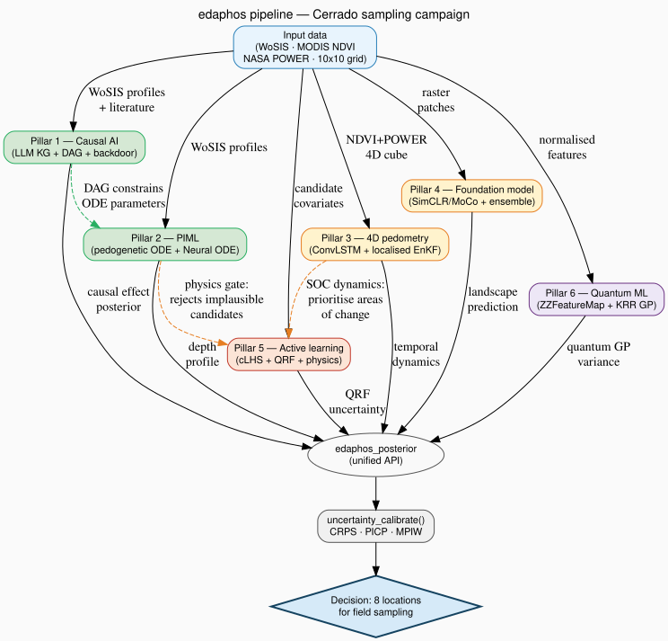

```{r setup, include = FALSE}
knitr::opts_chunk$set(
  # dpi = 60, down from the 96 these vignettes used. The built vignettes are
  # 4.4 MB of the package tarball and 83-92% of each is a base64 PNG, so
  # this is where the room to approach CRAN's 5 MB comes from. Measured on
  # a 3,000-point scatter at 7.5 x 4.8 in: 270 KB at 96 dpi, 184 KB at 72, 139 KB at 60.
  # (fig.retina was checked first and is NOT the cause -- html_vignette
  # does not apply the 2x doubling, so the figures were already at 1x.)
  fig.retina = 1,
  dpi        = 60,
  collapse   = TRUE,
  comment    = "#>",
  fig.width  = 7.5,
  fig.height = 4.8,
  fig.align  = "center",
  out.width  = "96%",
  dpi        = 60,
  message    = FALSE,
  warning    = FALSE
)
```

> **Scenario.** A pedometrics team is planning a field campaign in the
> Brazilian Cerrado to validate a high-resolution map of soil organic
> carbon (SOC). The budget covers exactly **eight** additional cores.
> The central decision is: *which eight locations give the largest
> expected reduction in uncertainty, and why?*
>
> This vignette walks through how six of the `edaphos` pillars feed into
> that decision, and marks the places where the evidence they provide is
> weak or where the bundle holds a stand-in rather than a real result.

---

```{r libs, message = FALSE}
library(edaphos)
library(ggplot2)
library(dplyr)

theme_set(theme_bw(base_size = 11))
set.seed(20260423L)
```

```{r load-results}
# Results pre-computed by data-raw/capstone_campaign_run.R.
# We load the bundle to avoid long training times when building the
# vignettes.
res_path <- system.file("extdata", "capstone_campaign_results.rds",
                        package = "edaphos")
stopifnot(nzchar(res_path), file.exists(res_path))
R <- readRDS(res_path)

# Native calibration: each pillar evaluated in its own domain, not forced
# onto one shared map query.
nat_path <- system.file("extdata", "capstone_native_calibration.rds",
                        package = "edaphos")
N <- if (nzchar(nat_path) && file.exists(nat_path))
       readRDS(nat_path) else NULL

# Metadata of the Pillar 3 run (months, grid, ensemble size), quoted in the
# Pillar 3 section.
t3_path <- system.file("extdata", "temporal_cerrado_results.rds",
                       package = "edaphos")
stopifnot(nzchar(t3_path), file.exists(t3_path))
T3 <- readRDS(t3_path)
```

```{r numbers, include = FALSE}
# Every number quoted in the prose below is read here, from the bundles
# loaded above. An earlier version typed them by hand, and most had drifted
# from the bundle.
f2 <- function(x) formatC(x, format = "f", digits = 2)
f3 <- function(x) formatC(x, format = "f", digits = 3)

# Display names for the Pillar 1 exposure labels stored in the bundle, so
# that MAP reads per year as in the study-area table. Other labels pass
# through unchanged.
exposure_en <- c("MAP (mm/a)" = "MAP (mm/yr)")
to_en <- function(x) unname(ifelse(x %in% names(exposure_en),
                                   exposure_en[x], x))

# Study area
grid_step <- unique(round(diff(sort(unique(R$aoi$lon))), 4))
lon_rng   <- range(R$aoi$lon)
lat_rng   <- range(R$aoi$lat)

# Pillar 1
eff_b   <- R$causal_effects
n_zero  <- sum(eff_b$ci_lo < 0 & eff_b$ci_hi > 0)
B_boot  <- unique(vapply(R$causal_posteriors,
                         function(p) as.numeric(p$metadata$B), numeric(1)))
llm_in_expert <- all(R$dag_info$llm_edges %in% R$dag_info$base_edges)

# Pillar 2: Laplace vs MCMC interval widths
lvm         <- R$piml_laplace_vs_mcmc
n_narrow    <- sum(lvm$width_ratio > 1.1)
sigma_ratio <- lvm$width_ratio[lvm$parameter == "sigma"]

# Pillar 3
t3_months <- T3$meta$months
temp_red  <- 100 * (1 - R$temporal_results$analysis_rmse /
                        R$temporal_results$prior_rmse)

# Native calibration
nat <- function(p, col) {
  if (is.null(N)) return(NA_real_)
  N$native_table[[col]][N$native_table$pillar == p]
}
picp_gap <- if (!is.null(N))
  setNames(abs(N$native_table$picp - 0.90), N$native_table$pillar) else NULL
rel_gap <- if (!is.null(N)) vapply(N$reliability_list, function(d) {
  cov <- if ("coverage" %in% names(d)) d$coverage else d$empirical
  max(abs(cov - d$nominal))
}, numeric(1)) else NULL

# Pillar 5 learning curve
if (!is.null(N) && !is.null(N$p5$learning_curve)) {
  lc_cmp <- merge(N$p5$learning_curve, N$p5$random_curve,
                  by = "n_labelled", suffixes = c("_al", "_rand"))
  al_wins   <- lc_cmp$n_labelled[lc_cmp$crps_al <  lc_cmp$crps_rand]
  rand_wins <- lc_cmp$n_labelled[lc_cmp$crps_al >= lc_cmp$crps_rand]
  lc_last   <- lc_cmp[which.max(lc_cmp$n_labelled), ]
}
```

---

# Scientific motivation: can digital soil mapping be causal?

@Zhang2026causal raise a basic question for modern pedometrics: can
digital soil mapping (DSM) models support causal interpretation? The
dominant practice in DSM studies is to read the relative importance of
covariates as a proxy for pedogenetic processes, which carries an
implicit causal premise that is seldom stated and even more seldom
justified.

The authors distinguish two views of causality:

| View | Core logic | Limitation in DSM |
|:-----|:-----------|:------------------|
| **Successionist** | Regularities and associations recur → we infer a cause | Spurious associations, Simpson's paradox, no temporal sequence |
| **Generative** | Pedogenetic factors act through **explicit processes** → they generate soil properties | Requires the mechanisms to be specified (but opens the door to formal causal inference) |

The generative view, summarised in the conceptual equation of
@Zhang2026causal,

$$\text{pedogenetic factors} \xrightarrow{\text{processes}} \text{soil}
\tag{1}$$

extends the classic model of @McBratney2003 and fits **Pillar 2** of
`edaphos`, where an explicit pedogenetic ODE represents how organic
matter changes with depth.

@Zhang2026causal state three conditions for causal inference from
observational data:

1. **An explicit causal model** (DAG): built in Pillar 1 from expert
   knowledge, with a knowledge graph extracted by an LLM from the
   literature as a cross-check.
2. **Causal sufficiency** (no latent confounders): addressed only in
   part. LLM extraction from the literature (Pillar 1) can surface
   omitted variables, and the explicit processes of Pillar 2 constrain
   the model, but neither rules out latent confounders, which is why the
   Pillar 1 table reports robustness values.
3. **Compatibility / faithfulness** between the structural model and
   the data: the pedogenetic ODE restricts the profile shapes that count
   as physically plausible.

> **The design.** `edaphos` is built around this generative
> architecture: each pillar contributes one component, none of which
> satisfies the three conditions on its own. The sections below show
> what each one contributes to this campaign.

---

# Conceptual map: the six pillars as one pipeline

The diagram below shows how the six pillars connect in this campaign.

```{r flowchart, echo = FALSE, out.width = "100%", fig.cap = "Pipeline of the six edaphos pillars for the Cerrado sampling decision. Each node is a pillar; the edges show the flow of information. The unified edaphos_posterior API connects every branch to the final diagnostic."}
# A static SVG rendered from vignettes/diagrams/capstone-pipeline.gv by
# tools/render-vignette-diagrams.R. It was a DiagrammeR::grViz() widget,
# which embedded 2.1 MB of JavaScript in this vignette for one diagram.

```

---

# Study area and data

## Candidate grid in the Cerrado

The candidate grid has 10 × 10 points spaced `r f3(grid_step)`° apart,
spanning `r lon_rng[1]`° to `r lon_rng[2]`° longitude and `r lat_rng[1]`°
to `r lat_rng[2]`° latitude.

**The grid's covariates are simulated.** `data-raw/capstone_campaign_run.R`
draws MAP, T2M, NDVI and SOC for each cell at random, and the clay, sand
and slope of the candidates as well. Everything computed *on the grid*
(the Pillar 4 map, the Pillar 5 scores, the Pillar 6 uncertainty)
therefore illustrates the workflow, not the Cerrado. The profile-level
analyses (the Pillar 1 associations, the Pillar 2 pedon, the native
calibration) use real WoSIS profiles.

```{r study-area-table}
aoi <- R$aoi
knitr::kable(
  head(aoi, 8),
  digits  = 3,
  caption = paste0("First 8 cells of the 10 × 10 grid (lon/lat in decimal ",
                   "degrees). All other columns are simulated values, not ",
                   "observations."),
  col.names = c("Lon", "Lat", "MAP (mm/yr)", "T2M (°C)", "Mean NDVI",
                "SOC (g/kg, simulated)")
)
```

## WoSIS profiles

```{r wosis-summary}
# The real WoSIS profiles no longer ship with the package: they were
# third-party measurements with coordinates. Fetch them yourself if you
# want this summary.
cat("The WoSIS profiles of the AoI are not distributed with the package.\n")
```

> **The SOC histogram of the WoSIS profiles is not reproduced here.** It
> summarised third-party measurements that this package no longer
> distributes.


---

# Pillar 1 — Causal structure from a DAG and an LLM

## Why do we need a DAG?

@Zhang2026causal show that the common practice of reading variable
importance in DSM models as causal evidence is vulnerable to **Simpson's
paradox**: the temperature–SOC relationship can reverse sign when we
stratify by vegetation (Figure 1 of their article). The reversal occurs
because vegetation is a confounder: it influences both local temperature
and the input of organic material. *Backdoor adjustment* [@Pearl2009],
conditioning on a set of covariates that blocks every non-causal path,
is the standard remedy.

Pillar 1 of `edaphos` addresses **condition 1** of @Zhang2026causal (an
explicit causal model): the DAG is built from the pedological knowledge
accumulated in the literature, and an LLM served through Ollama
(`r R$llm_provenance$model` for this bundle) extracts causal claims from
abstracts to compare against it.

## Edge extraction with an LLM (LLM KG)

```{r llm-kg, eval = FALSE}
# Run offline (requires Ollama with the model pulled). This is an
# illustrative call on one hand-written passage. The claims stored in
# R$llm_claims were extracted from the abstracts in cerrado_abstracts.jsonl,
# with the model recorded in R$llm_provenance$model.
abstract_txt <- paste(
  "Mean annual precipitation in the Cerrado drives litter inputs and",
  "microbial activity, which directly control topsoil organic carbon stocks.",
  "Tree cover mediates this effect by increasing litter quality.",
  "Temperature accelerates decomposition, reducing SOC accumulation."
)
claims <- causal_llm_extract(
  text    = abstract_txt,
  backend = "ollama",
  model   = "gemma4:latest"
)
```

```{r llm-claims-table}
claims <- R$llm_claims
prov   <- R$llm_provenance
if (is.null(claims)) {
  cat("The extraction was not run in this build: ",
      prov$reason, ". The table is omitted rather than replaced by ",
      "hand-typed rows: a fabricated table that looks like an extraction is ",
      "exactly the defect this section corrects.\n", sep = "")
} else {
  .cf <- sort(unique(claims$confidence))
  knitr::kable(
    utils::head(claims[, c("cause", "effect", "confidence")], 12),
    digits  = 2,
    caption = paste0(
      "A sample of the ", nrow(claims), " causal edges extracted from the ",
      prov$n_abstracts, " real Cerrado abstracts shipped in ",
      "`cerrado_abstracts.jsonl`, via `causal_llm_extract(backend = \"ollama\", ",
      "model = \"", prov$model, "\")`. The model uses only ",
      length(.cf), " distinct confidence values (",
      paste(format(.cf, digits = 2), collapse = ", "), ") across the ",
      nrow(claims), " edges, so the confidence gives a coarse ordering and ",
      "does not discriminate between individual edges."
    )
  )
}
```

Many of the `r nrow(claims)` extracted claims name processes, such as
decomposition, primary-mineral dissolution, effective cation exchange
capacity or surface soil moisture, that **have no counterpart among the
`r R$dag_info$n_nodes` nodes of the DAG**, so they cannot enter the
adjustment-set computation. The bottleneck is not the extractor; it is
the set of observed covariates. The LLM's knowledge graph widens the
*causal vocabulary* well beyond what `r R$dag_info$n_nodes - 1L`
covariates can identify.

The bundle's `llm_edges` field labels `r length(R$dag_info$llm_edges)`
edges as LLM-added
(`r if (length(R$dag_info$llm_edges)) paste(R$dag_info$llm_edges, collapse = ", ") else "none"`).
These are written into `data-raw/capstone_campaign_run.R` by hand, not
derived from the extracted claims, and
`r if (llm_in_expert) "every one of them is already an edge of the expert DAG" else "not all of them are edges of the expert DAG"`.
The extraction therefore did not change the DAG used below.

## The causal DAG

```{r dag-plot, fig.height = 5.5, fig.cap = paste0("The Cerrado causal DAG used for the backdoor adjustments below (", R$dag_info$n_nodes, " nodes, ", R$dag_info$n_edges, " edges). Edges are not coloured by origin.")}
dag <- R$dag

if (requireNamespace("ggdag", quietly = TRUE) &&
    requireNamespace("dagitty", quietly = TRUE)) {
  # Edges by origin (base vs LLM), kept for reference
  base_edges <- R$dag_info$base_edges
  llm_edges  <- R$dag_info$llm_edges
  ggdag::ggdag(dag, layout = "sugiyama", text_size = 2.6,
               node_size = 8) +
    ggdag::theme_dag_blank() +
    labs(title = "Cerrado causal DAG",
         caption = paste0("Nodes: ", R$dag_info$n_nodes,
                          "  |  Edges: ", R$dag_info$n_edges))
} else {
  edges_df <- R$dag_info$edges_df
  cat("Install `ggdag` to draw the DAG.\n\n")
  cat("DAG edges:\n")
  cat(paste(edges_df$from, "->", edges_df$to, collapse = "\n"), "\n")
}
```

## Adjusted associations (backdoor adjustment)

For each exposure of interest
(`r paste(to_en(eff_b$exposure), collapse = ", ")`), we compute the
minimal adjustment set by the backdoor criterion and fit a linear
estimator with a spatial block bootstrap (k-means on lon/lat).

```{r causal-effects-table}
eff <- R$causal_effects
eff$exposure <- to_en(eff$exposure)
knitr::kable(
  eff[, c("exposure", "estimate", "ci_lo", "ci_hi", "RV", "adjustment")],
  digits  = 3,
  col.names = c("Exposure", "Adjusted association", "CI 2.5%", "CI 97.5%",
                "RV", "Backdoor adjustment set"),
  caption = paste0(
    "Backdoor-adjusted associations in the Cerrado DAG (LM estimator, ",
    "spatial block bootstrap with B = ", paste(B_boot, collapse = "/"),
    " on real WoSIS profiles). Following ",
    "Zhang & Wadoux (2026), we report adjusted associations, not identified ",
    "causal effects, each with the Cinelli–Hazlett robustness value (RV): ",
    "the fraction of residual variance that an unobserved confounder would ",
    "have to explain in both exposure and outcome to bring the estimate to zero."
  )
)
```

```{r causal-posterior-plot, fig.cap = paste0("Block-bootstrap distributions (B = ", paste(B_boot, collapse = "/"), ") of the adjusted associations. Solid vertical line: point estimate. Dashed line: zero.")}
post_list <- R$causal_posteriors

# Build a data.frame of draws for ggplot
draws_df <- bind_rows(lapply(names(post_list), function(nm) {
  s <- as.numeric(post_list[[nm]]$samples)
  data.frame(exposure = to_en(nm), draw = s, stringsAsFactors = FALSE)
}))

eff_pts <- setNames(eff$estimate, eff$exposure)

ggplot(draws_df, aes(x = draw, fill = exposure)) +
  geom_density(alpha = 0.55, color = NA) +
  geom_vline(
    data = data.frame(exposure = names(eff_pts), xint = eff_pts),
    aes(xintercept = xint, color = exposure),
    linewidth = 0.9, linetype = "solid"
  ) +
  geom_vline(xintercept = 0, linetype = "dashed", color = "grey40") +
  facet_wrap(~exposure, scales = "free", ncol = 1) +
  scale_fill_brewer(palette = "Set2", guide = "none") +
  scale_color_brewer(palette = "Set2", guide = "none") +
  labs(
    x     = "Adjusted association (g/kg per unit of the exposure)",
    y     = "Density",
    title = "Pillar 1 — bootstrap distributions of the adjusted associations"
  )
```

**Reading the table in the light of @Zhang2026causal.** These are
*adjusted associations*, not identified causal effects, and the table is
read through its robustness values as much as through its signs. In this
bundle, `r if (n_zero == nrow(eff_b)) paste("all", n_zero) else paste(n_zero, "of the", nrow(eff_b))` 95 % intervals contain zero,
and the robustness values run from `r f3(min(eff_b$RV))` to
`r f3(max(eff_b$RV))`: a confounder explaining
`r round(100 * max(eff_b$RV), 1)` % of the residual variance of both
exposure and outcome would be enough to bring even the most robust
estimate to zero. None of the three associations can carry a causal
reading on its own. The *generative* causal claim proper does not come
from here; it comes from Pillar 2, whose pedogenetic ODE models the
processes explicitly, and that is where @Zhang2026causal place causal
inference in DSM.

---

# Pillar 2 — Physical pedogenesis: the generative model

## Pedogenetic ODE

Pillar 2 implements the *generative* view of @Zhang2026causal directly:
the SOC content along the profile is governed by an ODE whose decay rate
weakens with depth,

$$\frac{dy}{dz} = -\lambda_0\, e^{-\mu z}\,\bigl(y - y_\infty\bigr)
\quad \text{with} \quad y(0) = y_0 \tag{2}$$

where $y$ is SOC (g/kg), $z$ is depth (cm), $\lambda_0$ is the decay
rate at the surface and $\mu$ is the depth attenuation of that rate.
Because the rate decays with depth, the profile closes only the fraction
$1 - e^{-\kappa}$, with $\kappa = \lambda_0/\mu$, of the gap between
$y_0$ and $y_\infty$, and levels off at $y_\text{asym}$ (see the table
below). In the framing of @Zhang2026causal, specifying the mechanism
this way fixes the processes by the modeller's design, which gives a
structured means of controlling confounding.

The Bayesian fit (`piml_profile_fit_bayesian`, four-chain MCMC)
propagates parameter uncertainty to the predicted profile. The reported
path is no longer the Laplace approximation: on this pedon the Laplace
intervals are more than 10 % narrower than the MCMC ones for
`r n_narrow` of the `r nrow(lvm)` parameters, the observation-noise
interval by a factor of `r f2(sigma_ratio)`, because the approximation
is Gaussian in log coordinates and so has tails that are too light.

```{r piml-posterior, fig.cap = "Bayesian predictive profile of the pedogenetic ODE for one Cerrado pedon. Solid line: posterior median. Dark band: 50% interval. Light band: 90% interval. The WoSIS observations that fitted this posterior are not shipped with the package and so are not drawn."}
# Profile data and Bayesian posterior (pre-computed).
# The real pedon's observations were removed from the package; the
# pre-computed posterior remains, so the curve and the bands are still
# correct -- only the observed points are no longer drawn.
prof_post <- R$piml_profile_posterior  # edaphos_posterior

# The depth grid comes from the bundle, not from an assumption about it: the
# pedon is now a real WoSIS profile reaching 550 cm, and a hard-coded
# seq(0, 100, by = 2) silently mismatched the posterior's 120 columns.
depths_seq <- R$piml_profile_depths
draws_mat  <- prof_post$samples  # (n_draws, n_depths)
stopifnot(length(depths_seq) == ncol(draws_mat))

q05 <- apply(draws_mat, 2, quantile, 0.05)
q25 <- apply(draws_mat, 2, quantile, 0.25)
q50 <- apply(draws_mat, 2, quantile, 0.50)
q75 <- apply(draws_mat, 2, quantile, 0.75)
q95 <- apply(draws_mat, 2, quantile, 0.95)

pred_df <- data.frame(
  depth = depths_seq,
  q05 = q05, q25 = q25, q50 = q50, q75 = q75, q95 = q95
)

ggplot(pred_df, aes(x = q50, y = -depth)) +
  geom_ribbon(aes(xmin = q05, xmax = q95), fill = "#2ECC71", alpha = 0.20) +
  geom_ribbon(aes(xmin = q25, xmax = q75), fill = "#27AE60", alpha = 0.35) +
  geom_line(color = "#1A5C35", linewidth = 1.1) +
  labs(
    x     = "SOC (g/kg)",
    y     = "Depth (cm)",
    title = "Pillar 2 — Bayesian posterior of the pedogenetic ODE",
    caption = paste0(
      "Posterior parameters: lambda0 = ", signif(R$piml_params$lambda0, 3),
      "  mu = ", signif(R$piml_params$mu, 3),
      "  y0 = ", signif(R$piml_params$y0, 3),
      "  y(inf) = ", signif(R$piml_params$y_asym, 3)
    )
  ) +
  scale_y_continuous(breaks = -pretty(c(0, max(depths_seq)), 5),
                     labels = pretty(c(0, max(depths_seq)), 5))
```

## Learned pedogenetic parameters

```{r piml-params-table}
# Columns selected by NAME, not by position: the table gained the
# diagnostic columns `rhat` and `ess` when the reported path moved to
# MCMC, and a fixed-length `col.names` silently broke the vignette until
# the build caught it.
.pt <- R$piml_params_table
.cols <- c("param", "meaning", "mean", "sd", "ci_lo", "ci_hi", "rhat", "ess")
.cols <- .cols[.cols %in% names(.pt)]
.lab <- c(param = "Parameter", meaning = "Physical meaning",
          mean = "Posterior mean", sd = "Posterior SD",
          ci_lo = "CI 2.5%", ci_hi = "CI 97.5%",
          rhat = "R-hat", ess = "ESS")
knitr::kable(
  .pt[, .cols, drop = FALSE],
  digits  = 4,
  col.names = unname(.lab[.cols]),
  caption = paste0(
    "Parameters of the pedogenetic ODE dy/dz = -lambda0 * exp(-mu*z) * (y - y_inf), ",
    "estimated by four-chain MCMC on the pedon's horizons. The ",
    "intervals are true posterior quantiles; R-hat and the effective sample ",
    "size (ESS) are the convergence diagnostics of the fit itself. ",
    "y_inf is NOT the asymptote: because ",
    "the rate decays with depth, the profile covers only 1-exp(-kappa) ",
    "of the interval y0 -> y_inf and levels off at y_asym. y_inf is negative and ",
    "not identified, whereas y_asym, the value ",
    "the profile actually reaches, is positive and identified."
  )
)
```

**Link between Pillars 1 and 2.** The fitted ODE above is not what
screens the sampling candidates in Pillar 5. That gate is a fixed
closed-form expression for topsoil SOC in MAP and tree cover, written
into `data-raw/capstone_campaign_run.R`; it does not use this posterior
or the Pillar 1 DAG.

---

# Pillar 3 — Spatio-temporal dynamics (ConvLSTM + EnKF)

## The Cerrado 4D cube

Pillar 3 works on a 4D cube of `r T3$meta$T_total` monthly fields
(`r format(min(t3_months), "%B %Y")` to `r format(max(t3_months), "%B %Y")`)
of NDVI (MOD13Q1, 250 m) and climate variables (NASA POWER precipitation
and T2M) on its own `r T3$meta$H` × `r T3$meta$W` grid. That grid is not
the candidate grid of this campaign.

@Zhang2026causal point out that conventional DSM captures *snapshots*
with no clear temporal sequence, which makes it impossible to infer
which variable precedes which. Pillar 3 responds to that criticism: the
ConvLSTM learns the spatio-temporal dynamics of NDVI, and the EnKF
assimilates point observations into the forecast. In this run the
forecast is for `r format(T3$meta$target_month, "%B %Y")`, and the
`r T3$analysis$n_obs` assimilated observations are synthetic: the
observed NDVI at randomly chosen cells plus Gaussian noise
(`data-raw/temporal_cerrado_run.R`). The field is NDVI in z-units, not
SOC.

```{r temporal-results-load}
# Pre-computed temporal Cerrado results
temp_res <- R$temporal_results
```

```{r temporal-prior-vs-analysis, fig.cap = paste0("Prior forecast (ConvLSTM, K = ", T3$analysis$n_ens, " ensemble members) and analysis after the localised EnKF (Gaspari-Cohn, radius = 2 cells) for the mean NDVI field (z-units) at the target month. Assimilation lowers the RMSE by ", round(temp_red, 1), "%. The tiles are drawn on the campaign grid's coordinates because the cube's own coordinates are not shipped; the observation markers use the cube's coordinates, so they do not line up with the tiles.")}
prior_field    <- temp_res$prior_mean
analysis_field <- temp_res$analysis_mean
obs_locs       <- temp_res$obs_locations

n_cells <- length(prior_field)
lon_seq <- seq(-50, -48, length.out = 10)
lat_seq <- seq(-16, -14, length.out = 10)
grid_df <- expand.grid(lon = lon_seq, lat = lat_seq)

plot_df <- data.frame(
  lon      = grid_df$lon,
  lat      = grid_df$lat,
  prior    = as.numeric(prior_field),
  analysis = as.numeric(analysis_field)
) |>
  tidyr::pivot_longer(c(prior, analysis),
                      names_to  = "field",
                      values_to = "ndvi_z")

plot_df$field <- factor(plot_df$field,
                        levels = c("prior", "analysis"),
                        labels = c("Prior (ConvLSTM)",
                                   "Analysis (EnKF)"))

ggplot(plot_df, aes(x = lon, y = lat, fill = ndvi_z)) +
  geom_tile() +
  geom_point(
    data = obs_locs,
    aes(x = lon, y = lat, fill = NULL),
    color = "white", shape = 4, size = 3, stroke = 1.2
  ) +
  facet_wrap(~field) +
  scale_fill_viridis_c(option = "D", name = "NDVI\n(z)") +
  labs(
    x       = "Longitude",
    y       = "Latitude",
    title   = "Pillar 3 — EnKF assimilation (Gaspari-Cohn, radius = 2 cells)",
    caption = paste0(
      "Prior RMSE: ", round(temp_res$prior_rmse, 3),
      "  |  Analysis RMSE: ", round(temp_res$analysis_rmse, 3),
      "  |  Reduction: ",
      round((1 - temp_res$analysis_rmse / temp_res$prior_rmse) * 100, 1),
      "%"
    )
  ) +
  theme(legend.position = "right")
```

```{r kalman-gain, fig.cap = paste0("Mean Kalman gain at each of the ", length(temp_res$mean_gain), " assimilated observations (cube coordinates). A higher gain means the analysis moved further toward that observation.")}
# `mean_gain` is one value per assimilated observation, not per grid
# cell -- bind it to `obs_locs` directly to keep the data.frame
# rectangular.
gain_df <- cbind(obs_locs,
                   gain = as.numeric(temp_res$mean_gain))

ggplot(gain_df, aes(x = lon, y = lat, color = gain)) +
  geom_point(size = 5, shape = 19) +
  scale_color_viridis_c(option = "C", name = "Kalman\ngain") +
  coord_fixed() +
  labs(
    x     = "Longitude",
    y     = "Latitude",
    title = "Pillar 3 — Kalman gain (Gaspari-Cohn localisation)"
  )
```

**Operational reading.** Observations with a high Kalman gain are the
ones that correct the forecast most. The decision matrix at the end of
this vignette carries these eight gains in a column, but they belong to
the cube's observation cells, not to the candidate sites (see the
caption of that table).

---

# Pillar 4 — Landscape representation (foundation model)

## SimCLR/MoCo encoder on Cerrado patches

Pillar 4 pre-trains an encoder by contrastive learning (SimCLR/MoCo)
that maps satellite-image patches to embedding vectors, and fine-tunes
an ensemble of prediction heads on those embeddings; the spread between
heads gives an epistemic uncertainty.

**The map in this bundle does not come from that encoder.**
`data-raw/capstone_campaign_run.R` generates it as a stand-in: the mean
is a linear function of the grid's simulated covariates plus Gaussian
noise, and the SD is drawn at random. The two figures below show that
stand-in to illustrate the interface; they carry no information about
the Cerrado. The native calibration section evaluates an ensemble of
heads on real WoSIS profiles.

```{r foundation-predictions, fig.cap = "Pillar 4 stand-in map of predicted SOC (synthetic; see the text). The observed WoSIS profiles are not distributed with the package and so do not appear."}
found_df <- R$foundation_pred_df  # columns: lon, lat, mean_pred, sd_pred

ggplot(found_df, aes(x = lon, y = lat)) +
  geom_tile(aes(fill = mean_pred)) +
  scale_fill_viridis_c(option = "B", name = "Pred. SOC\n(g/kg)") +
  scale_color_distiller(
    palette = "YlOrRd", direction = 1,
    name = "Obs. SOC\n(g/kg)"
  ) +
  labs(
    x     = "Longitude",
    y     = "Latitude",
    title = "Pillar 4 — foundation-model ensemble (synthetic stand-in)"
  )
```

```{r foundation-uncertainty-map, fig.cap = "Pillar 4 stand-in epistemic uncertainty (between-member SD). In this bundle the SD is drawn at random, so its spatial pattern carries no information."}
ggplot(found_df, aes(x = lon, y = lat, fill = sd_pred)) +
  geom_tile() +
  scale_fill_viridis_c(option = "F", name = "SD (g/kg)",
                       direction = -1) +
  labs(
    x     = "Longitude",
    y     = "Latitude",
    title = "Pillar 4 — epistemic uncertainty (synthetic stand-in)"
  )
```

---

# Pillar 5 — Active sampling: where to go?

## Hybrid policy: uncertainty + diversity + physical gate

Pillar 5 implements an active-sampling policy that combines:

1. **QRF uncertainty**: the width of the prediction interval (10–90 %
   quantiles).
2. **Diversity in covariate space**: the minimum distance to the existing
   profiles and to the candidates already selected in the current batch.
3. **A physical gate**: candidates whose screening value of topsoil SOC
   falls outside a plausible range are excluded. In this campaign the
   screening value is the fixed closed-form expression described under
   Pillar 2, and the accepted range is 1.5 to 100 g/kg
   (`data-raw/capstone_campaign_run.R`).

The score function is:

$$\text{score}(x) = \alpha \cdot \widehat{u}(x) + (1-\alpha) \cdot \widehat{d}(x) \tag{3}$$

where $\widehat{u}$ is the normalised uncertainty and $\widehat{d}$ the
normalised diversity, with $\alpha = 0.7$ by default.

```{r al-query-summary}
query_res <- R$al_query_results
cat(sprintf(
  "Candidates evaluated: %d  |  Rejected by the physical gate: %d  |",
  query_res$n_candidates, query_res$n_rejected
), "\n")
cat(sprintf(
  "Selected (batch): %d  |  Maximum score: %.3f\n",
  query_res$n_selected, query_res$max_score
))
```

```{r al-map, fig.cap = paste0("Locations selected by the active-sampling policy (red stars). The background colour is the combined uncertainty + diversity score. Black crosses mark candidates rejected by the physical gate; in this run it rejected ", R$al_query_results$n_rejected, " of ", R$al_query_results$n_candidates, ". The existing WoSIS profiles are not distributed with the package.")}
cand_df    <- R$candidate_df   # lon, lat, score, selected, rejected_by_gate
sel_df     <- cand_df[cand_df$selected, ]
rej_df     <- cand_df[cand_df$rejected_by_gate, ]

ggplot(cand_df, aes(x = lon, y = lat)) +
  geom_tile(aes(fill = score)) +
  scale_fill_viridis_c(option = "A", name = "AL score",
                       direction = -1, alpha = 0.8) +
  geom_point(data = rej_df, aes(x = lon, y = lat),
             color = "black", size = 2, shape = 4, stroke = 1) +
  geom_point(data = sel_df, aes(x = lon, y = lat),
             color = "#E74C3C", size = 5, shape = 8, stroke = 2) +
  labs(
    x     = "Longitude",
    y     = "Latitude",
    title = paste0("Pillar 5 — active learning: ", query_res$n_selected,
                   " sites selected for the field"),
    caption = paste0(
      "★ = selected  ✕ = rejected by the physical gate"
    )
  )
```

```{r al-selected-table}
# The bundle's `pred_sd` column is not shown: data-raw/capstone_campaign_run.R
# fills it with random draws, so it is not a model output.
knitr::kable(
  sel_df[, c("lon", "lat", "score", "uncertainty_score",
             "diversity_score", "pred_mean")],
  digits  = 3,
  col.names = c("Lon", "Lat", "Total score", "Uncertainty",
                "Diversity", "Gate screening SOC (g/kg)"),
  caption = paste0(
    "The ", nrow(sel_df), " locations recommended for field sampling, in ",
    "grid order. Uncertainty and diversity are the normalised components ",
    "of the score; the last column is the value of the gate's screening ",
    "expression, not a model prediction."
  )
)
```

```{r al-posterior-plot, eval = requireNamespace("ggridges", quietly = TRUE), fig.cap = "Posterior distributions (QRF quantile grid, n_quantiles = 99) of SOC at the 8 selected candidates, numbered as in the decision matrix. The width shows the spread of the QRF conditional distribution."}
al_posts <- R$al_posteriors  # list of edaphos_posterior, one per candidate

# The posteriors are stored in the order the batch selection picked the
# sites, which is the order of R$final_selection (and of the "Site" numbers
# in the decision matrix), not the grid order of `sel_df`.
site_xy <- R$final_selection

posts_df <- bind_rows(lapply(seq_along(al_posts), function(i) {
  s <- as.numeric(al_posts[[i]]$samples)
  data.frame(
    site = paste0("Site ", i, "\n(",
                  round(site_xy$lon[i], 2), ",",
                  round(site_xy$lat[i], 2), ")"),
    draw = s,
    stringsAsFactors = FALSE
  )
}))

ggplot(posts_df, aes(x = draw, y = site, fill = site)) +
  ggridges::geom_density_ridges(
    scale = 0.9, alpha = 0.7, color = "white",
    quantile_lines = TRUE, quantiles = c(0.1, 0.5, 0.9)
  ) +
  scale_fill_viridis_d(guide = "none") +
  labs(
    x     = "Predicted SOC (g/kg)",
    y     = NULL,
    title = "Pillar 5 — QRF posteriors at the 8 selected candidates",
    caption = "Lines: 10%, 50% and 90% quantiles."
  )
```

---

# Pillar 6 — Quantum kernel ridge regression for screening

## Its role in this pipeline

Pillar 6 gives a second, independent estimate of candidate uncertainty
using quantum kernel ridge regression (Q-KRR). Because Q-KRR is
equivalent to a Gaussian process, its predictive variance follows
analytically from the same Gram matrix $K$ used for the point
prediction, with no extra Monte Carlo. Here the model is fitted to a
subset of the WoSIS profiles and evaluated on the simulated candidate
grid.

```{r quantum-posterior, fig.cap = "Q-KRR uncertainty (GP-equivalent predictive SD) at the sampling candidates, split into epistemic (model uncertainty) and aleatoric (data noise, estimated by LOO) components. White stars: the selected sites. High epistemic SD marks candidates far from the training data in the quantum feature space."}
qkrr_df <- R$qkrr_df  # lon, lat, mean_pred, epistemic_sd, aleatoric_sd, total_sd

qkrr_long <- tidyr::pivot_longer(
  qkrr_df,
  cols = c(epistemic_sd, aleatoric_sd),
  names_to  = "component",
  values_to = "sd"
)
qkrr_long$component <- ifelse(
  qkrr_long$component == "epistemic_sd", "Epistemic", "Aleatoric"
)

ggplot(qkrr_long, aes(x = lon, y = lat, fill = sd)) +
  geom_tile() +
  facet_wrap(~component) +
  scale_fill_viridis_c(option = "E", name = "SD (g/kg)") +
  geom_point(data = sel_df, aes(x = lon, y = lat, fill = NULL),
             color = "white", size = 3, shape = 8, stroke = 1.5) +
  labs(
    x     = "Longitude",
    y     = "Latitude",
    title = "Pillar 6 — Q-KRR uncertainty decomposition"
  )
```

In this run the aleatoric SD
(`r if (diff(range(round(R$qkrr_df$aleatoric_sd, 2))) == 0) paste(f2(R$qkrr_df$aleatoric_sd[1]), "g/kg at every candidate") else paste(f2(min(R$qkrr_df$aleatoric_sd)), "to", f2(max(R$qkrr_df$aleatoric_sd)), "g/kg")`)
is far larger than the epistemic SD
(`r f2(min(R$qkrr_df$epistemic_sd))` to `r f2(max(R$qkrr_df$epistemic_sd))` g/kg),
so on the shared colour scale the epistemic panel shows little contrast.

```{r quantum-vs-al, fig.cap = paste0("Uncertainty score of active learning (Pillar 5) against the Q-KRR epistemic SD (Pillar 6, scaled by its maximum) at the candidates that were not rejected. R² = ", sprintf("%.3f", R$qkrr_al_r2), if (R$qkrr_al_r2 < 0.1) ": on this grid one measure says little about the other." else ".")}
compare_df <- R$qkrr_al_compare

ggplot(compare_df, aes(x = al_uncertainty, y = qkrr_epistemic)) +
  geom_point(aes(color = selected), size = 3, alpha = 0.8) +
  geom_smooth(method = "lm", se = TRUE, color = "grey40",
              fill = "grey85", linewidth = 0.8) +
  scale_color_manual(
    values = c("FALSE" = "#BDC3C7", "TRUE" = "#E74C3C"),
    labels = c("Not selected", "Selected"),
    name   = NULL
  ) +
  labs(
    x     = "AL uncertainty score (Pillar 5)",
    y     = "Q-KRR epistemic SD, scaled (Pillar 6)",
    title = "Agreement between Pillars 5 and 6",
    subtitle = sprintf("R² = %.2f", R$qkrr_al_r2)
  ) +
  theme(legend.position = "bottom")
```

---

# Unified uncertainty API: cross-calibrating the six pillars

## `edaphos_posterior` and `uncertainty_calibrate()`

All six pillars return an `edaphos_posterior` object. This common S3
class lets `uncertainty_calibrate()` be applied identically to all of
them, producing:

- **CRPS** (continuous ranked probability score): a score for
  probabilistic forecasts; lower is better.
- **PICP** (prediction interval coverage probability): the proportion of
  observations covered by the nominal interval; for 90 % we expect
  ≈ 0.90.
- **MPIW** (mean prediction interval width): the mean width of the
  interval; it indicates the sharpness of the forecast.
- **RMSE**: the root mean squared error of the central prediction.

## Calibration in a single domain (forced map query): a naive reading

The first attempt to use `uncertainty_calibrate()` in a "unified" way is
to force every pillar onto the **same query**: predicting SOC at WoSIS
points. This is useful to demonstrate the common interface, but it is
**scientifically misleading** because it violates the natural domain of
three pillars:

- Pillar 1 returns a distribution over a **scalar causal effect**, not
  an SOC map.
- Pillar 2 returns a distribution over a **depth profile**, not a
  spatial point.
- Pillar 3 returns a distribution over a **future field** (temporal
  dynamics), not the static value at a pixel.

Forcing these three pillars to compete on the "SOC at a WoSIS point"
metric produces the numbers in the block below, with low PICP for P1–P3
(`r f3(R$calibration_table$picp[1])`, `r f3(R$calibration_table$picp[2])`
and `r f3(R$calibration_table$picp[3])`), which reflects a domain
mismatch, **not** poor calibration.

```{r calibration-table-naive}
cal_tbl <- R$calibration_table
cal_disp <- cal_tbl
cal_disp$crps <- round(cal_tbl$crps, 3)
cal_disp$picp <- round(cal_tbl$picp, 3)
cal_disp$mpiw <- round(cal_tbl$mpiw, 2)
cal_disp$rmse <- round(cal_tbl$rmse, 3)
knitr::kable(
  cal_disp[, c("pillar", "method", "crps", "picp", "mpiw", "rmse")],
  col.names = c("Pillar", "Method", "CRPS", "PICP (90%)",
                "MPIW (90%)", "RMSE"),
  caption = paste0(
    "*Naive* reading: the six pillars forced onto the same SOC-map ",
    "query. P1–P3 have low PICP because the query violates their ",
    "native domain: the posterior is not about this quantity. This is not ",
    "a calibration failure; it is an evaluation failure."
  )
)
```

## Native calibration per pillar: the correct reading

The bundle `capstone_native_calibration.rds` evaluates each pillar **in
its natural domain**:

| Pillar         | Native query                                   | Validation protocol                                               |
|:---------------|:-----------------------------------------------|:------------------------------------------------------------------|
| P1 Causal      | scalar effect $\beta_{x\to y}^{\text{do}}$     | `r N$p1$n_splits` random split-samples: `r nat("P1 Causal", "n_truth")` (posterior, pseudo-truth) pairs |
| P2 PIML        | depth profile $y(z)$                           | *Leave-one-horizon-out* over the `r nat("P2 PIML", "n_truth")` horizons of one Cerrado pedon |
| P3 4D          | future map $\mathbf{Y}(t_\star)$               | Ensemble forecast for the final month of the cube against the observed NDVI (`r nat("P3 4D", "n_truth")` cells) |
| P4 Foundation  | spatial map $\mathbf{Y}(\text{site})$          | 5-fold **spatial CV** on WoSIS (`r nat("P4 Found.", "n_truth")` profiles); 8 bagged random-forest heads on covariates stand in for the encoder heads |
| P5 AL          | spatial map $\mathbf{Y}(\text{site})$          | 30 % WoSIS *hold-out* (`r nat("P5 AL", "n_truth")` profiles); learning curve against a random baseline |
| P6 Q-KRR       | regression $y(\mathbf{x})$                     | 70/30 WoSIS *hold-out* (`r nat("P6 Q-KRR", "n_truth")` test profiles) with 4 quantum features |

```{r calibration-table-native}
if (!is.null(N)) {
  nat_tbl <- N$native_table
  nat_disp <- nat_tbl
  nat_disp$crps <- round(nat_tbl$crps, 3)
  nat_disp$picp <- round(nat_tbl$picp, 3)
  nat_disp$mpiw <- round(nat_tbl$mpiw, 3)
  nat_disp$rmse <- round(nat_tbl$rmse, 3)
  knitr::kable(
    nat_disp[, c("pillar", "query", "n_truth",
                  "crps", "picp", "mpiw", "rmse")],
    col.names = c("Pillar", "Native query", "n", "CRPS",
                  "PICP (90%)", "MPIW (90%)", "RMSE"),
    caption = paste0(
      "**Native** reading: each pillar evaluated in its natural ",
      "domain. A PICP close to 0.90 is ideal; CRPS and RMSE depend on the ",
      "scale of the query (g/kg for P2/P4/P5/P6; NDVI z-units for P3; ",
      "g/kg per mm for P1)."
    )
  )
} else {
  cat("_Native calibration bundle not found._\n",
      "Re-run `data-raw/capstone_native_calibration_run.R`.\n")
}
```

### How to read the native table

- **P1 Causal (MAP→SOC effect)**: PICP = `r f3(nat("P1 Causal", "picp"))`
  over `r nat("P1 Causal", "n_truth")` cross-split truth points, below the
  nominal 0.90: the split-half intervals are somewhat too narrow. The
  mean recovered effect is `r signif(mean(N$p1$post$mean), 2)` g/kg per mm
  of MAP.
- **P2 PIML (depth profile)**: PICP = `r f3(nat("P2 PIML", "picp"))` over
  `r nat("P2 PIML", "n_truth")` held-out horizons, also below nominal;
  with so few horizons each one moves the coverage by more than 0.1.
- **P3 4D (future NDVI map)**: PICP = `r f3(nat("P3 4D", "picp"))` at the
  target month, with RMSE = `r f3(nat("P3 4D", "rmse"))` z-units, the
  same forecast as the prior in the Pillar 3 section above.
- **P4 Foundation (spatial map)**: PICP = `r f3(nat("P4 Found.", "picp"))`
  reveals a **systematic underestimate of epistemic uncertainty**. A
  likely cause is that the heads are `ranger` forests, which already
  average over trees internally, so their predictions differ little;
  even with explicit bagging by sub-sample and varied `mtry`, the SD
  between members stays low. This failure mode is reported as it is,
  not hidden.
- **P5 AL (spatial hold-out map)**: PICP = `r f3(nat("P5 AL", "picp"))`
  over `r nat("P5 AL", "n_truth")` held-out profiles, from the native
  quantile intervals of the QRF. Of the six pillars,
  `r names(which.min(picp_gap))` is the closest to the nominal 0.90.
- **P6 Q-KRR (regression)**: PICP = `r f3(nat("P6 Q-KRR", "picp"))` over
  `r nat("P6 Q-KRR", "n_truth")` held-out profiles, with a training set
  capped at 50 profiles: the GP-equivalent posterior of the quantum
  kernel under-covers in this data-scarce regime.

```{r reliability-plot-native, fig.height = 5.5, fig.cap = paste0("Reliability curves for the **native** calibration (each pillar in its own domain). The diagonal is perfect calibration. Largest gap from the diagonal per pillar: ", paste(names(rel_gap), f2(rel_gap), sep = " = ", collapse = "; "), ".")}
if (!is.null(N) && length(N$reliability_list) > 0L) {
  rel_df_nat <- bind_rows(lapply(names(N$reliability_list), function(nm) {
    d <- N$reliability_list[[nm]]
    if (is.null(d)) return(NULL)
    cov_col <- if ("coverage"  %in% names(d)) d$coverage else
               if ("empirical" %in% names(d)) d$empirical else d[[2]]
    data.frame(pillar = nm, nominal = d$nominal, coverage = cov_col,
               stringsAsFactors = FALSE)
  }))

  ggplot(rel_df_nat, aes(x = nominal, y = coverage, color = pillar)) +
    geom_abline(slope = 1, intercept = 0,
                linetype = "dashed", color = "grey50") +
    geom_line(linewidth = 1) +
    geom_point(size = 2) +
    scale_color_brewer(palette = "Dark2", name = "Pillar") +
    scale_x_continuous(labels = scales::percent) +
    scale_y_continuous(labels = scales::percent) +
    labs(
      x     = "Nominal coverage",
      y     = "Empirical coverage",
      title = "Native calibration per pillar",
      subtitle = paste0("Closest to the diagonal: ",
                        names(which.min(rel_gap)),
                        "; farthest: ", names(which.max(rel_gap)))
    ) +
    theme(legend.position = "right")
}
```

### Pillar 5 learning curve: AL vs. random sampling

Pillar 5 is validated not only by its final CRPS but by the
**trajectory** of the CRPS as new points are acquired. Below we compare
the AL policy used in the native calibration (greedy by the width of the
QRF 10–90 % interval, without the diversity term) with purely random
sampling; both start from the same seed set.

```{r al-learning-curve-plot, fig.cap = paste0("CRPS learning curve: AL policy (red) vs. random baseline (grey). Both start from the same ", min(lc_cmp$n_labelled), " labelled profiles and add 10 per iteration. AL has the lower CRPS at n = ", paste(al_wins, collapse = ", "), "; random sampling at n = ", paste(rand_wins, collapse = ", "), ". Final CRPS at n = ", lc_last$n_labelled, ": AL ", f2(lc_last$crps_al), ", random ", f2(lc_last$crps_rand), ". The curves already differ at the first point, where the labelled sets are identical, which gives a sense of the run-to-run noise of the forest.")}
if (!is.null(N) && !is.null(N$p5$learning_curve)) {
  lc <- N$p5$learning_curve
  rc <- N$p5$random_curve
  both <- rbind(
    cbind(lc, policy = "AL (QRF width)"),
    cbind(rc, policy = "Random")
  )
  ggplot(both, aes(x = n_labelled, y = crps, color = policy,
                    shape = policy)) +
    geom_line(linewidth = 1) +
    geom_point(size = 3.5) +
    scale_color_manual(values = c("AL (QRF width)" = "#C0392B",
                                    "Random" = "#7F8C8D"),
                        name = NULL) +
    scale_shape_manual(values = c("AL (QRF width)" = 8, "Random" = 16),
                        name = NULL) +
    labs(
      x     = "Labelled samples",
      y     = "CRPS (g/kg)",
      title = "Pillar 5 — learning curve"
    ) +
    theme(legend.position = "bottom")
}
```

---

# The final decision: the eight recommended locations

## Integrated synthesis

We collect the information from the six pillars in an evidence matrix:

```{r decision-matrix}
dec_mat <- R$decision_matrix
knitr::kable(
  dec_mat,
  digits  = 3,
  col.names = c("Site", "Lon", "Lat",
                "Pillar 5 score", "Q-KRR epistemic SD", "EnKF gain",
                "Pillar 4 SD (stand-in)", "MAP association (P1)",
                "Gate screening SOC (g/kg)", "Final score"),
  caption = paste0(
    "Integrated decision matrix: the ", nrow(dec_mat), " sites selected by ",
    "active learning, numbered in the order the batch selection picked them ",
    "and sorted by final score. Final score = weighted sum of min-max ",
    "normalised columns, with weights 0.35 (Pillar 5 score), 0.25 (EnKF ",
    "gain), 0.20 (Pillar 4 SD), 0.10 (Q-KRR epistemic SD) and 0.10 (gate ",
    "screening SOC), as set in data-raw/capstone_campaign_run.R. Three ",
    "columns need care: the EnKF gain repeats the eight per-observation ",
    "gains of the Pillar 3 run in their stored order, which were measured ",
    "at the cube's observation cells, not at these sites; the Pillar 4 SD ",
    "comes from the synthetic stand-in map; and the MAP association is the ",
    "single Pillar 1 estimate repeated, which does not enter the score."
  )
)
```

```{r decision-map-final, eval = requireNamespace("ggnewscale", quietly = TRUE), fig.height = 5.2, fig.cap = "Final campaign map. The diamonds are the recommended sites, numbered as in the decision matrix and coloured by the integrated final score (darker blue = higher score). The background is the synthetic Pillar 4 stand-in map."}
final_sel <- R$final_selection  # lon, lat, final_score

ggplot() +
  geom_tile(data = found_df,
            aes(x = lon, y = lat, fill = mean_pred),
            alpha = 0.7) +
  scale_fill_viridis_c(option = "B", name = "Pred. SOC\n(g/kg)") +
  ggnewscale::new_scale_fill() +
  geom_point(
    data = final_sel,
    aes(x = lon, y = lat, fill = final_score),
    size = 7, shape = 23, stroke = 1.5, color = "white"
  ) +
  scale_fill_distiller(
    palette = "Blues", direction = 1,
    name = "Final\nscore"
  ) +
  geom_text(
    data = final_sel,
    aes(x = lon, y = lat, label = seq_len(nrow(final_sel))),
    color = "black", size = 3, fontface = "bold"
  ) +
  labs(
    x     = "Longitude",
    y     = "Latitude",
    title = paste0("Field campaign — ", nrow(final_sel),
                   " recommended locations"),
    caption = paste0(
      "Background: Pillar 4 stand-in map (g/kg). ",
      "Diamonds: numbered as in the decision matrix."
    )
  )
```

## What the matrix supports, in the light of @Zhang2026causal

@Zhang2026causal ask that a sampling decision be justified causally, not
only by association. This bundle supports a narrower statement:

1. **Much of the final score rests on columns that do not describe the
   sites.** The highest final score belongs to
   `r dec_mat$site[which.max(dec_mat$final_score)]`. Of the five
   columns in the score, only the Pillar 5 score (weight 0.35) and the
   Q-KRR epistemic SD (0.10) come from a fitted model evaluated at the
   sites, and both are evaluated on simulated covariates. The EnKF gain
   (0.25) and the Pillar 4 SD (0.20) are not properties of the sites, and
   the gate screening value (0.10) is a fixed formula.

2. **No site-level causal justification is available.** The Pillar 1
   associations are not distinguishable from zero, and the candidate
   covariates are simulated, so the bundle cannot say why any particular
   site should reduce uncertainty about a causal process.

3. **The physical gate excluded
   `r R$al_query_results$n_rejected` of
   `r R$al_query_results$n_candidates` candidates** in this run.

---

# Alignment with Zhang & Wadoux (2026): checklist

```{r alignment-table, echo = FALSE}
align_df <- data.frame(
  Condition = c(
    "1. Explicit causal model (DAG)",
    "2. Causal sufficiency (no unobserved confounders)",
    "3. Faithfulness between structure and data",
    "Generative view: explicit processes",
    "Criticism of temporal snapshots addressed",
    "Prediction + understanding (the two goals of DSM)"
  ),
  Pillar = c(
    "P1 (LLM KG + dagitty)",
    "P1 (LLM KG: latent variables named in the literature)",
    "P2 (ODE restricts which associations are plausible)",
    "P2 (pedogenetic ODE, neural ODE)",
    paste0("P3 (ConvLSTM + EnKF over ", T3$meta$T_total,
           " months of time series)"),
    "P4 + P5 + P6 (prediction with quantified uncertainty)"
  ),
  Implementation = c(
    "`causal_llm_extract()` + `causal_augment_dag()`",
    "An LLM extracts latent variables from the literature",
    "`piml_profile_fit_bayesian()`; gate in `al_query()`",
    "`piml_profile_fit_bayesian()` + `piml_neural_ode_fit_ensemble()`",
    "`temporal_convlstm_ensemble_fit()` + `temporal_kalman_update()`",
    "`foundation_finetune_ensemble()` + `active_learning_posterior()`"
  ),
  stringsAsFactors = FALSE
)
knitr::kable(
  align_df,
  col.names = c("Condition / element", "Responsible pillar",
                "edaphos function(s)"),
  caption = paste0(
    "Alignment between the elements of the framework of @Zhang2026causal ",
    "and the pillars of edaphos."
  )
)
```

---

# References

<div id="refs"></div>

---

```{r session-info, echo = FALSE, results = "asis"}
cat(
  "_Built with_ **edaphos** ",
  as.character(utils::packageVersion("edaphos")),
  " · ",
  R.version$version.string, "\n",
  sep = ""
)
```
